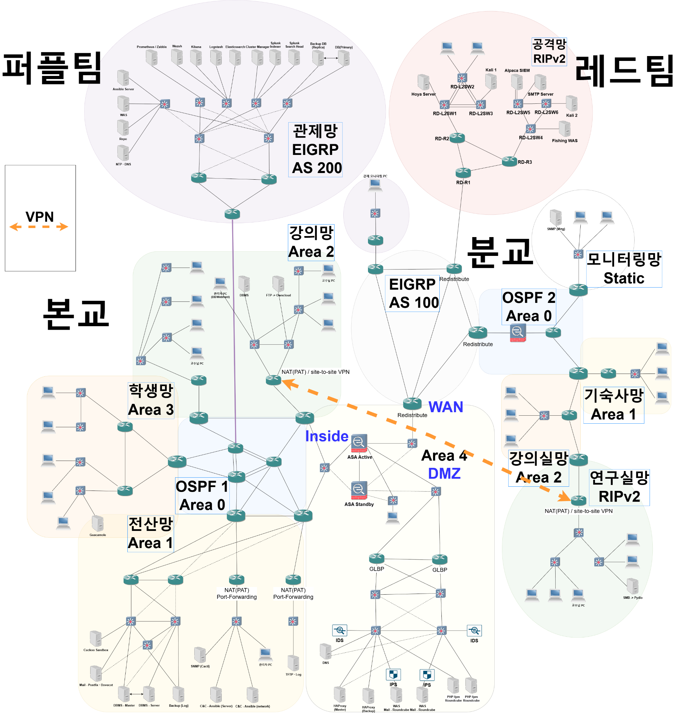
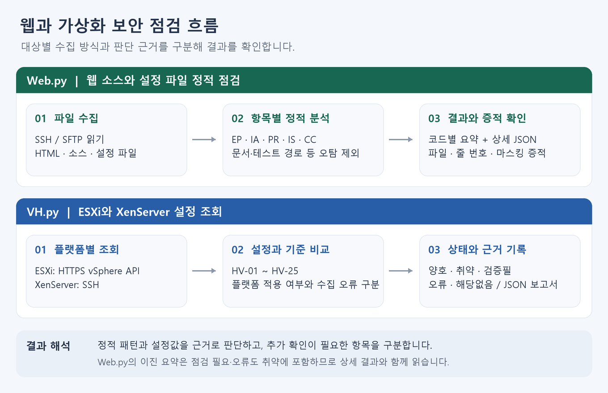

# IT 인프라·보안 포트폴리오

쇼핑몰·대학 인프라 환경에서 웹 취약점을 점검하고 관련 로그를 분석함. Holymoly의 URL·폼 수집을 보완하고, Hoya로 Linux·Windows의 원격 명령과 파일 전송을 검증함. 웹·가상화 설정을 점검하는 Python 도구의 오탐과 실행 오류도 분석함.

## 주요 경험

- **네트워크·서비스** — 웹·메일·파일 서비스의 통신 경로, 계정 접근 범위, 수집 경로 분석
- **Linux·Windows** — 원격 명령·파일 전송 검증, 상호 인증서 통신과 파일 해시 검증
- **로그 분석** — 웹·WAF·DB·OS 기록 대조, 요청부터 서비스 결과까지 단계별 확인
- **점검 자동화** — URL·폼 수집, 웹·가상화 설정 점검, 오탐·POST 실행 오류 개선

## [대학 IT 인프라 보안 검증과 원격 점검](projects/03-campus-pentest/README.md)

**기간** 2026.09.21 ~ 2026.10.07

**역할** 원격 점검 기능 검증 · 서비스 보안 점검 (레드팀)

본교·분교의 웹·메일·연구 파일 환경에서 서비스 접근 경로와 보안 시나리오를 분석함. Hoya의 원격 명령·파일 전송을 3개 운영체제에서 검증하고 POST 검사 오류와 저장형 입력 판정을 보완함. 학사 DB 변경, FTP 열람, 장비 응답 손실, 메일 검사·배달 기록을 단계별로 대조함.

- Rocky·Ubuntu·Windows 원격 응답과 왕복 파일 SHA-256 검증
- 서버 자원·장비 응답·메일 처리 화면을 통한 서비스 상태 분석
- POST 실행 오류 해결과 저장형 입력의 판정 조건 개선

[프로젝트 요약 보기](projects/03-campus-pentest/README.md)

## [쇼핑몰 서비스 보안 점검과 로그 분석](projects/02-web-pentest/README.md)

**기간** 2026.08.03 ~ 2026.08.14

**역할** 웹 보안 점검 · 로그 분석 · 입력점 수집 자동화 (레드팀)

로그인·검색 SQL Injection, 저장형 콘텐츠, 파일 업로드, 반복 인증을 점검함. Holymoly의 폼 처리 주소 누락을 수정하고, 시나리오별 요청·응답을 웹·WAF·DB·OS 기록과 대조함. ALPACA의 탐지 규칙과 서비스 응답을 비교해 인증·조회·서버 실행 결과를 확인함.

- HTTP 요청·세션·GET·POST 폼 분석과 입력점 수집 개선
- 웹 접근·ModSecurity·MariaDB·auditd 로그의 시각·대상 대조
- 네 가지 시나리오의 인증·데이터 조회·서버 실행·탐지 증적 분석

[프로젝트 요약 보기](projects/02-web-pentest/README.md)

## [주요정보통신기반시설 기준 웹·가상화 점검 도구](projects/infrastructure-security-audit/README.md)

**기간** 2026.08.04 ~ 2026.08.04

**역할** 점검 요구사항 정의 · 실행 결과 검토 · 오탐 분석

Web.py·VH.py의 웹·가상화 점검 조건과 결과 출력 형식을 정의함. 웹 소스의 일반 문자열을 인증 코드로 잡는 오탐을 보완하고, ESXi 접속 오류를 패키지·버전·TLS 단계로 나눠 분석함. 웹 회귀 테스트 19개와 가상화 모의 입력 6개로 판정·오류 처리를 확인함.

- 웹 소스·서버 설정의 인증·세션·오류 노출 점검과 오탐 보정
- ESXi HTTPS API·XenServer SSH 수집 방식과 접속 오류의 분리
- 패키지·인증서 문제 분석, 항목별 판정과 JSON 증적 정리

[프로젝트 요약 보기](projects/infrastructure-security-audit/README.md)
