# 쇼핑몰 서비스 보안 점검과 로그 분석

[프로젝트 요약](README.md) · [포트폴리오 메인](../../README.md)

[프로젝트 소개](#프로젝트-소개) · [역할](#역할) · [수행 과정](#수행-과정) · [문제 해결](#문제-해결) · [결과와 배운 점](#결과와-배운-점)

## 프로젝트 소개

> 본 프로젝트는 외부 운영망과 분리된 격리 환경에서 수행함. 본문과 증적 화면의 IP 주소·도메인은 네트워크 구성과 서비스 연동 검증을 위해 임의로 설정한 값이며, 실제 기관의 운영망이나 서비스 주소를 의미하지 않음.

nginx·PHP·MariaDB 기반 쇼핑몰의 로그인, 검색, 게시판, 파일 업로드를 점검함. Holymoly로 URL과 폼을 수집하고, 취약점 재현 결과를 웹·WAF·DB·OS 로그와 대조함.

| 항목 | 내용 |
| --- | --- |
| 수행 기간 | 2026년 8월 3일 ~ 2026년 8월 14일 |
| 전체 목표 | 쇼핑몰 서비스 구축, 공격 시나리오 수행, 탐지 기록 분석 |
| 역할 | **웹 보안 점검 · 로그 분석 · 입력점 수집 자동화 (레드팀)** |
| 대상 환경 | GNS3 격리 네트워크, nginx·PHP·MariaDB 기반 쇼핑몰 |
| 활용 기술 | Python·Scapy·Holymoly, Nmap·Hydra, HTTP·세션·GET/POST 폼 분석 |
| 분석 자료 | 웹 접근 로그, ModSecurity 탐지 기록, MariaDB 감사 로그, Linux auditd 기록 |

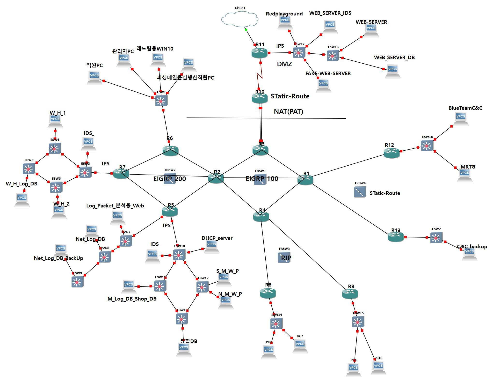

*본사·지사·물류센터 구조와 쇼핑몰 DMZ, 관리·관제 구간을 연결한 네트워크.*

본사·지사 사용자망과 외부 서비스 구간을 분리하고, 쇼핑몰·웹하드·관리·관제·백업 서버를 연결한 환경임. 웹 요청이 들어오는 경로와 IDS가 복사 트래픽을 관찰하는 경로가 구분됨.

| 네트워크 구간 | 구성 | 서비스 연결 |
| --- | --- | --- |
| 코어·분배 | R1~R7, EIGRP AS 100·200, 경로 재분배 | 본사·지사·외부 서비스 구간 연결 |
| 업무망 | 본사·지사, R8·R9 물류·고객센터, VLAN·RIPv2·DHCP | 사용자 단말과 내부 업무 서비스 |
| 쇼핑몰 DMZ | R10·R11, ESW17·ESW18 | 웹·DB·진단 단말, IDS 미러링, 경계 통제 |
| 관리·관제 | R12·R13, 정적 경로·SSH 접근 정책 | 로그 수집, 원격 관리, 백업·웹하드 |

쇼핑몰은 Rocky Linux의 Nginx·PHP-FPM과 MariaDB로 구성됨. WS01은 취약 쇼핑몰, WS02는 보안 비교 사이트, DB06은 회원·상품·주문 데이터 저장을 담당함. IDS03은 Snort 3, IPS03은 pfSense·Suricata를 사용함. 패킷·경보·서버 로그는 중앙 분석 서버 MS02의 ALPACA에 수집됨.

웹 요청은 진단 단말에서 서비스 경계인 R10·R11을 거쳐 쇼핑몰 구간으로 전달됨. ESW17·ESW18에는 웹·DB 연결과 IDS 미러링이 구성돼 있으며, 요청을 처리하는 경로와 패킷을 복사해 관찰하는 경로를 나눠 파악함. 웹 서버가 응답을 반환한 뒤에도 DB 조회, 파일 처리, 서버의 외부 연결이 이어질 수 있어 각 구간의 기록을 함께 분석함.

| 자산 | 역할과 서비스 | 점검에 사용한 연결 관계 |
| --- | --- | --- |
| WS01 | Nginx·PHP-FPM 기반 점검 대상 쇼핑몰 | HTTP 80 요청 처리, DB06의 TCP 3306 연결, 업로드 파일 처리 |
| WS02 | 보안 비교 사이트 | 같은 웹 서비스 계열의 비교 환경, 관리 SSH 출발지 제한 |
| DB06 | MariaDB 회원·상품·주문 데이터 저장 | 쇼핑몰 요청에 따른 조회·상태 변경 |
| ATK01 | Kali Linux 진단 단말 | Nmap·Wireshark·Hydra와 Python 도구 사용, HTTP 요청·패킷 수집 |
| ATK03 | Nginx·PHP 기반 피싱 재현 서버 | 쿠폰 페이지, 가상 배송·결제정보 입력 흐름 |
| IDS03 | Snort 3 패킷 탐지 | ESW17 미러링 트래픽의 웹 공격·정찰 이벤트 관찰 |
| IPS03 | pfSense·Suricata 경계 통제 | 브리지 구간의 Alert·Drop 동작, 일부 규칙 적용 |
| MS02 | ALPACA 중앙 분석 | 원격 로그 TCP 514 수신, 패킷·경보·서버 로그 조회 |

연계 환경에는 HD01·HD02 파일 서비스, DB01 웹하드 로그 DB, MS01 DNS·DHCP, MR01·MR02 모니터링, DB02~DB05 저장·백업 서버가 구성됨. 쇼핑몰 시나리오는 WS01·DB06을 중심으로 진행하고, DB01 반복 연결과 HD02 관리 SSH는 공통 인프라 시험으로 정리함.

### 서비스 구간별 구성과 연결

쇼핑몰 요청 처리, 내부 파일 저장, 중앙 분석 구간으로 나눠 환경을 파악함. 웹 서버와 연결 DB, 센서와 수집 서버를 대응시켜 요청이 처리되는 위치와 로그가 남는 위치를 확인함.

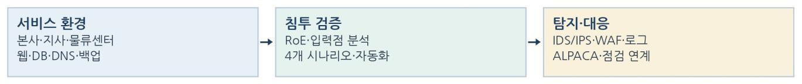

*서비스 환경·침투 검증·탐지 대응의 전체 작업 구성.*

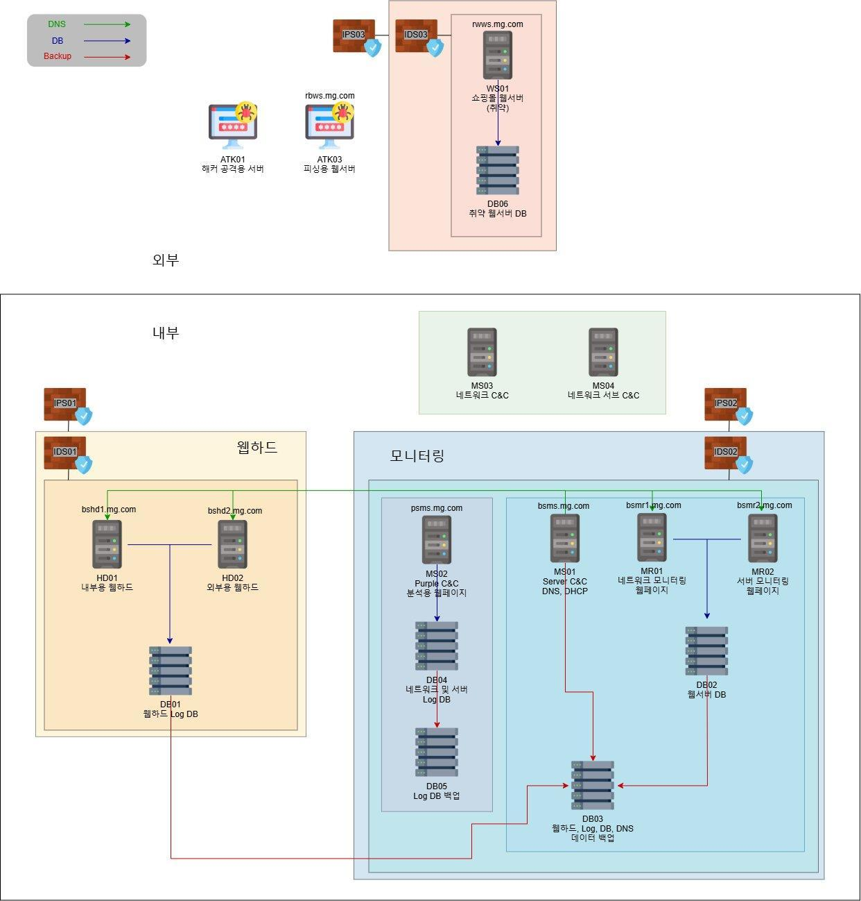

*쇼핑몰·웹하드·중앙 분석·백업 서버 배치.*

서버 배치도에서 녹색은 DNS, 파란색은 DB, 빨간색은 백업 연결을 나타냄. 쇼핑몰의 회원·주문 데이터는 WS01에서 DB06으로 전달되고, 웹하드와 모니터링 데이터는 각각 DB01·DB02로 모이는 구성임. 중앙 분석 로그는 DB04에서 저장하고 DB05로 백업하는 관계임.

1. **대외 서비스 식별**: WS01·WS02, DB06, ATK01·ATK03, IDS03·IPS03을 쇼핑몰 구간으로 묶음. 웹 요청, DB 조회, 탐지 센서의 관측 위치를 이 구간에서 먼저 확인함.
2. **파일 서비스 식별**: HD01·HD02의 웹하드와 DB01의 로그 저장 관계를 확인함. 관리 접근 시험은 HD02, 반복 연결 시험은 DB01을 대상으로 기록함.
3. **기반 서비스 식별**: MS01의 DNS·DHCP, MR01·MR02의 모니터링과 DB02를 연결함. 이름 해석, 상태 수집, 로그 저장이 서로 다른 서버에 배치된 구조를 파악함.
4. **수집·백업 관계 확인**: 중앙 네트워크 로그는 DB04에서 DB05로 백업됨. 웹하드·모니터링·DNS 데이터는 DB03에 통합 백업하는 관계로 확인함.
5. **관리 경로 분리**: MS03·MS04는 R12·R13을 통해 관리 작업을 수행하는 구간임. 공개 웹 요청이 도착하는 경로와 관리자 SSH 경로를 각각 분석함.

#### 쇼핑몰과 파일 서비스의 실행 환경

| 자산 | 운영체제 | 서비스 구성 | 연결·처리 내용 |
| --- | --- | --- | --- |
| WS01 | Rocky Linux 9.7 | Nginx 1.28.0, PHP·PHP-FPM 8.4.23 | HTTP 80으로 쇼핑몰 요청 처리, DB06 TCP 3306 연결 |
| WS02 | Rocky Linux 9.7 | Nginx 1.28.0, PHP 8.4.23 | 보안 비교 웹 환경, 관리 SSH 출발지 제한 |
| DB06 | Rocky Linux 9.7 | MariaDB 10.5.29 | 회원·상품·주문 저장, WAS 연결 및 관리 SSH |
| ATK01 | Kali Linux | Nmap, Wireshark, Hydra, Python 도구 | 서비스 조사와 HTTP·패킷 확인 |
| ATK03 | Rocky Linux 9.7 | Nginx 1.28.0, PHP 8.4.22 | 쿠폰 안내와 가상 결제 흐름 재현 |
| IDS03 | Rocky Linux 9.7 | Snort 3.12.2 | ESW17 미러링에서 웹 공격·정찰 트래픽 관찰 |
| IPS03 | FreeBSD | pfSense 2.8.1, Suricata 7.0.11 | 브리지 구간 통제, Alert·Drop 분배 |
| HD01 | Ubuntu 24.04 | Nginx 1.24.0, Pydio 5.0.2, SMB 4.19.5 | 관리자 웹하드, DB01 연계 |
| HD02 | Rocky Linux 9.7 | Apache 2.4.62, ownCloud 10.16.0, FTP | 직원 웹하드, 관리 SSH·외부 연결 통제 |
| DB01 | Ubuntu 24.04 | MariaDB 10.5.29 | 웹하드 로그 저장, TCP 3306 반복 연결 제한 시험 |
| IDS01·IPS01 | Rocky Linux·FreeBSD | Snort 3.12.2, pfSense 2.8.1 | 파일 서비스의 FTP·SMB·파일 반입 관찰과 통제 |

버전 정보는 점검 당시의 구성임. 웹 입력점의 처리 위치는 Nginx·PHP-FPM·MariaDB로 나눠 확인함. 같은 HTTP 응답 안에서도 PHP에서 발생한 오류, DB가 반환한 오류, 파일 처리 결과의 발생 위치가 다르므로 서비스 구성과 함께 해석함.

#### 관제·DNS·백업·원격 관리 구성

| 자산 | 운영체제·주요 서비스 | 확인한 구성 또는 상태 |
| --- | --- | --- |
| MS01 | Windows Server 2025, IIS 10.0, Microsoft DNS, Python·Jupyter | Master DNS·DHCP IPv4 |
| MR01 | Rocky Linux 9.7, Apache 2.4.62, MRTG 2.17.7 | 네트워크 모니터링, SNMP Agent 미적용 항목 존재 |
| MR02 | Ubuntu 24.04, Nginx 1.24.0, Cacti 1.2.26 | 서버 모니터링, 서비스–DB 연동 오류 기록 |
| DB02 | Ubuntu 24.04, MariaDB 10.5.29 | MR01·MR02 로그 저장 대상 |
| DB03 | Ubuntu 24.04, MariaDB 10.5.29, BIND9 9.16.23 | DB01·DB02·MS01 백업과 DNS Slave, 야간 백업·평시 링크 제한 |
| DB04 | Rocky Linux 9.7, MariaDB 10.5.29 | 중앙 네트워크·서버 로그 저장 |
| DB05 | Rocky Linux 9.7, MariaDB 10.5.29 | DB04 데이터 백업 |
| MS02 | Rocky Linux 9.7, Apache 2.4.62, PHP 8.4.23, Python 3.9.25 | ALPACA 분석 환경, 원격 로그 TCP 514 수신 |
| MS03·MS04 | Rocky Linux 9.7, Python 3.9.25 | 네트워크 원격 관리, R12·R13 관리 경로 연결 |
| IDS02·IPS02 | Rocky Linux·FreeBSD, Snort 3.12.2, pfSense 2.8.1, Suricata 7.0.11 | 모니터링망의 SNMP·DNS·SSH·DHCP 통신 관찰·통제 |

모니터링은 웹 화면, 수집 Agent, 저장 DB의 연결 상태로 나눠 파악함. MR01에는 SNMP Agent 미적용 항목이, MR02에는 서비스–DB 연동 오류가 남아 있어 해당 자산의 구성 상태에 함께 기록함.

## 역할

| 담당 업무 | 수행 내용 |
| --- | --- |
| 공격 표면 조사 | 노출 포트·서비스와 로그인·검색·게시판·업로드 기능 조사 |
| 입력 지점 수집 | Holymoly의 URL·폼 수집, GET·POST 파라미터 정리, 로그인 처리 주소 누락 수정 |
| 모의해킹 | SQL Injection, 저장형 XSS, 업로드 파일 실행, 반복 로그인 시나리오 검증 |
| 로그 분석 | 공격 시각·대상·요청 경로를 기준으로 웹·WAF·DB·OS 기록 대조 |

레드팀에서 웹 보안 점검·로그 분석과 Holymoly 작업을 담당함. 네트워크·서버 구축, ALPACA·PCrafter 개발은 각 담당 팀원이 수행함. 아래의 시나리오 실행과 관제 기록은 공동 결과이며, Holymoly 구성과 로그인 처리 주소 수정은 개인 작업 내용임.

## 수행 과정

**내용 바로가기**

| 구분 | 상세 내용 |
| --- | --- |
| 환경·점검 범위 | [서비스 구성](#서비스-구간별-구성과-연결) · [진행 순서](#점검-진행-순서와-실행-단위) · [대상 조사](#대상-서비스와-입력-지점-조사) |
| 입력점 수집·선정 | [Holymoly](#holymoly--url폼-수집과-요청-구성) · [PCrafter 탐색 결과](#pcrafter-연계-탐색-결과-검토와-시나리오-선정) |
| 취약점 재현 | [인증 우회·DB 조회](#scn-01--로그인-인증-우회와-회원-데이터-조회) · [쿠폰·결제 흐름](#scn-02--저장형-콘텐츠와-쿠폰결제-흐름) · [업로드·서버 실행](#scn-03--프로필-업로드에서-서버-실행까지) · [반복 인증](#scn-04--반복-인증과-최종-로그인-확인) |
| 요청·탐지 대조 | [PCrafter 통신](#pcrafter-통신-구조와-입력-전송-과정) · [ALPACA 수집](#alpaca--공격-요청과-로그-대조) · [SQLi 경보](#sql-injection--탐지-이벤트) · [반복 로그인 경보](#반복-로그인--요청-조건과-경보) · [저장형·업로드 경보](#저장형-콘텐츠업로드-탐지-기록) |
| 통제·재시험 | [공통 인프라](#공통-인프라의-접근연결-제한-결과) · [시나리오별 조치](#시나리오별-조치-항목과-재시험-구성) |
| 문제 해결 | [폼 처리 주소 누락](#로그인-폼의-처리-주소-누락) · [업로드 후 연결 실패](#업로드-후-연결-실패-분석) |

### 점검 진행 순서와 실행 단위

*범위 합의·입력점 탐색·시나리오 설계·검증·대응의 진행 순서.*

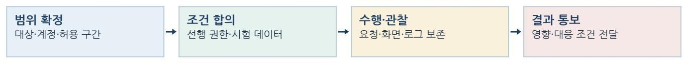

*대상과 계정 범위 확정부터 실행 기록 전달까지의 절차.*

대상 URL과 기능을 정한 뒤 정상 요청을 확보하고, 입력값 변경이 인증·조회·파일 처리에 미치는 영향을 확인함. HTTP 요청·응답, 화면, PCAP, 서버 기록을 대상과 시각으로 묶고 계정·데이터·실행 상태의 변화를 함께 기록함.

| 실행 구분 | 사용 범위 | 기록을 나눈 이유 |
| --- | --- | --- |
| 주 웹 시나리오 | VulnMart 웹·DB, 주 시나리오 대상 `10.60.0.10` | 로그인·검색·저장 콘텐츠·업로드의 실제 영향 확인 |
| 엔드포인트 탐색 저장 실행 | `172.16.1.50` 대상의 저장 결과 | URL·후보 레코드 집계 단위 보존 |
| 반복 로그인 화면 실행 | `172.16.20.100` | 화면에 표시된 계정과 응답을 해당 실행에 연결 |
| 공통 인프라 연결 시험 | DB01 TCP 3306, HD02 관리 SSH | 웹 인증과 다른 서비스의 접근 통제 확인 |

주소는 격리 네트워크의 대상 구분에 사용함. 테스트 계정과 가상 회원·주문·결제 데이터를 사용했으며, 웹 시나리오의 수행 범위에서 서비스 중단이나 데이터 파괴는 제외함. 저장형 콘텐츠와 업로드에는 필요한 계정·세션·실행 조건을 부여한 그레이박스 점검을 함께 사용함.

각 시나리오에서는 입력점, 선행 계정 상태, 전송한 요청, 반환된 응답, 화면 변화, 관련 경보를 순서대로 남김. URL·후보 레코드와 반복 인증 응답은 각각의 실행 단위로 집계함.

### 대상 서비스와 입력 지점 조사

VulnMart 웹 서비스와 연계 DB를 대상으로 Nmap 서비스 조사와 기능별 HTTP 요청 분석을 수행함. 테스트 계정과 가상 회원·주문 데이터를 사용함. 일부 저장형 콘텐츠·업로드 단계는 사전에 허용된 계정·세션과 파일 실행 조건을 사용한 그레이박스 점검으로 진행함.

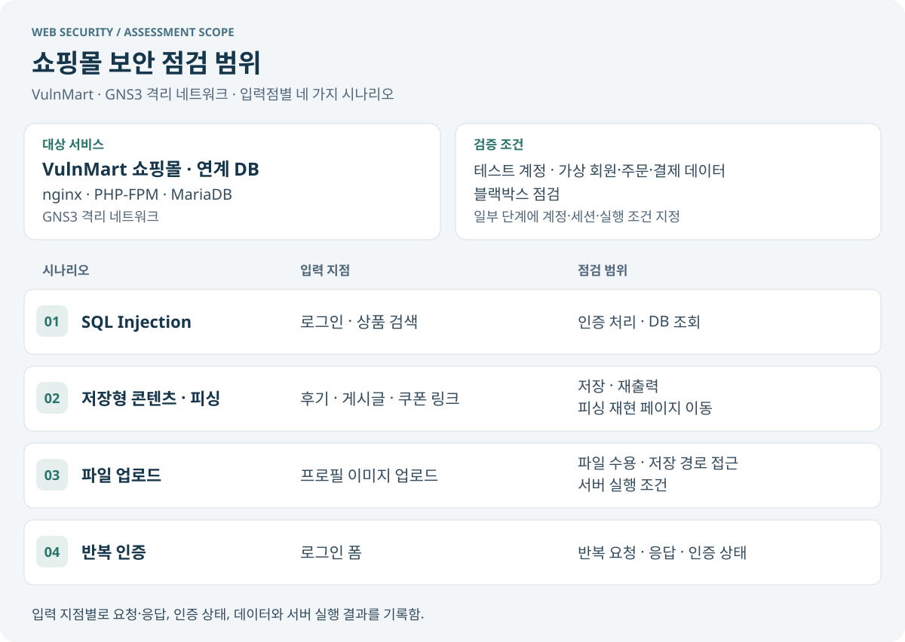

*대상 서비스와 입력 지점별 점검 범위.*

| 조사 항목 | 기록 내용 |
| --- | --- |
| 서비스 | 노출 포트, 서비스 종류, 웹 기능 |
| URL·폼 | 화면 주소, 폼의 `action`·`method`, 쿼리·입력 필드 |
| 인증 상태 | 로그인 전후 접근 가능한 페이지와 기능 |
| 응답 비교 | 정상 요청 대비 오류, 입력값 반사, 상태 변화 |
| 재현 결과 | 인증된 계정, 응답 데이터, 서버 측 실행 기록 |

웹 요청은 Nginx에서 PHP 업무 처리로 전달되며, 로그인·검색·주문은 DB 조회와 세션 상태에 연결됨. 후기·게시글은 저장된 내용이 다른 화면에 다시 출력됨. 프로필 업로드는 파일 저장 후 웹 경로에서 접근하는 구조임.

| 업무 기능 | 입력과 처리 흐름 | 연결한 점검 항목 |
| --- | --- | --- |
| 로그인 | `username`·`password` → 인증 처리 → 세션 | SQL Injection, 반복 인증 |
| 상품 검색 | `q` → DB 조회 → HTML 응답 | DB 오류, SQL Injection, 입력값 반사 |
| 후기·게시글 | 본문 입력 → 저장 → 다른 사용자의 조회 화면 | 저장형 콘텐츠, 스크립트 실행, 외부 이동 |
| 프로필 이미지 | 파일 수신 → 저장 → 웹 경로 접근 | 허용 형식, 실행 파일 수용, 서버 측 실행 |
| 주문·결제 | 주문 ID·세션 → 조회·상태 변경 | 소유권 확인, 요청 출처 보호, 업무 상태 변화 |

로그인 전후의 화면과 접근 경로를 나누어 기록함. 정상 요청의 응답을 먼저 확보하고 입력값을 바꿔가며 비교함. URL·폼·파라미터 목록과 함께 계정·시각·대상·요청·응답을 남겨 각 실행 결과를 다시 찾을 수 있게 정리함.

1. **서비스 확인**: Nmap으로 접근 가능한 포트와 서비스를 확인하고, 웹 페이지에서 로그인·검색·후기·프로필·주문 기능의 진입 위치를 조사함.
2. **정상 동작 확인**: 정상 로그인, 상품 검색, 게시글 조회, 주문 화면, 이미지 업로드의 요청·응답을 확보함. 이후 입력값을 바꾼 결과를 비교할 기준으로 사용함.
3. **인증 전후 경로 비교**: 로그인 전후에 열리는 페이지와 사용 가능한 기능을 확인함. 세션이 필요한 게시·업로드 기능은 해당 계정의 접근 상태와 함께 기록함.
4. **요청 구조 수집**: HTML 링크, 폼의 `action`·`method`, 쿼리와 입력 필드를 수집함. 브라우저에서 관찰한 API 요청과 자동 수집 목록을 함께 검토함.
5. **재현 대상 선정**: 정상 응답과 비교해 DB 오류, 입력값 반사, 저장된 콘텐츠의 재출력, 인증 상태 변화가 나타난 입력점을 선정함.
6. **실행 기록 정리**: 시나리오별 계정·시각·대상·요청·응답·화면·PCAP을 묶고, 인증·데이터·서버 실행의 결과를 정리함.

로그인과 검색은 같은 웹 서비스 안에서도 처리 결과가 다름. 로그인은 계정 표시와 세션, 검색은 반환된 데이터와 화면 출력을 확인함. 파일 업로드는 수신 응답 이후 저장된 파일의 접근과 서버 실행까지 이어서 점검함.

#### 쇼핑몰 DMZ에서 확인한 패킷 경로

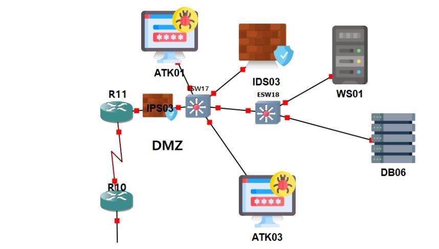

*R10·R11, IPS03, ESW17·ESW18, WS01·DB06과 진단 거점의 배치.*

진단 단말 ATK01과 쿠폰 흐름 재현 서버 ATK03은 쇼핑몰 구간의 별도 노드로 배치됨. IDS03은 복사된 트래픽을 관측하는 센서이며, IPS03은 서비스 경계 쪽에 위치함. 같은 구간 안에서 시작된 요청과 경계 라우터를 통과하는 요청은 통과 장비가 다르므로, 탐지 이벤트가 남은 위치와 실제 패킷 경로를 대조함.

웹 서버 WS01과 DB06은 ESW18에 연결돼 있음. WS01의 PHP 업무 로직이 DB06을 조회하고 결과를 HTML로 반환하는 구조임. 검색 입력에서 상품 외 데이터가 출력돼 웹의 입력 처리와 DB 응답을 함께 확인함.

#### 요청 처리와 정상 기능 확인

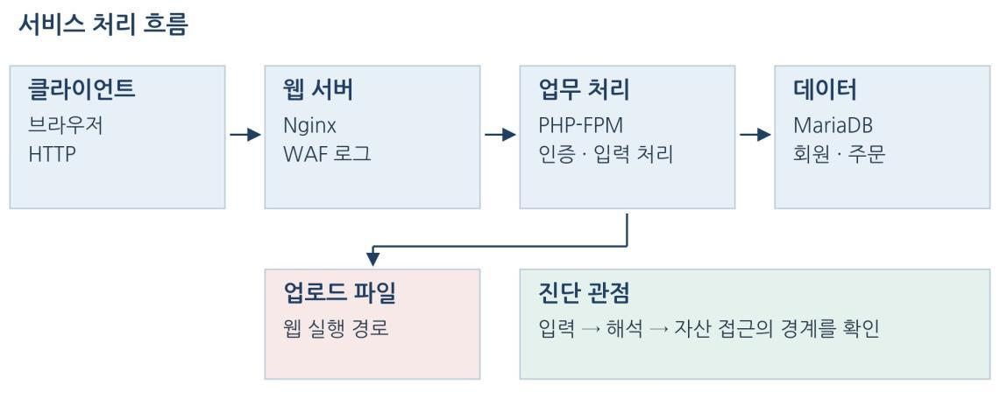

*클라이언트 요청이 Nginx·PHP-FPM·MariaDB·업로드 파일로 이어지는 처리 흐름.*

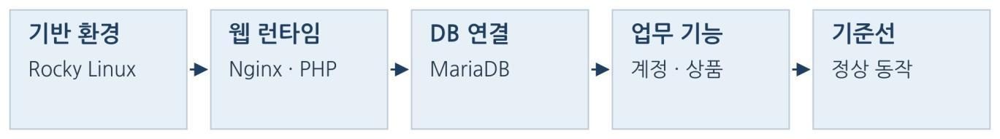

*Rocky Linux 기반 환경·웹 런타임·DB 연결·업무 기능 확인 순서.*

서비스는 Rocky Linux 기반 환경에 Nginx·PHP 런타임을 연결하고 MariaDB를 연계한 뒤, 계정·상품·주문 기능을 확인하는 순서로 구성됨. 레드팀 점검에서는 배포 결과에 접근해 각 기능의 정상 입력과 응답을 기준선으로 확보함.

| 확인 순서 | 정상 기능에서 본 대상 | 시나리오와 연결한 차이 |
| --- | --- | --- |
| 로그인 화면 접근 | 입력 필드와 요청 주소, 실패 안내 | 입력 변경 후 인증 세션과 계정 표시 |
| 상품 검색 | `q`에 대응하는 상품 카드와 결과 카운터 | DB 오류, 스키마 컬럼, 회원 데이터의 출력 |
| 후기 작성·조회 | 본문 입력과 저장 후 조회 화면 | 쿠폰 콘텐츠 재출력과 외부 이동 버튼 |
| 프로필 이미지 변경 | 파일 선택, 전송, 변경 응답 | 이미지 외 실행 파일 형식의 수용과 접근 |
| 주문 상태 확인 | 주문 ID, 세션, 조회·취소 요청 | 상태 변경 요청과 DB UPDATE 기록 |

정상 동작을 확보한 뒤 동일 기능에서 입력만 바꿔 비교함. 로그인은 계정 표시·세션, 검색은 결과 카드·카운터, 업로드는 변경 안내·저장 경로·서버 연결 순서로 확인함.

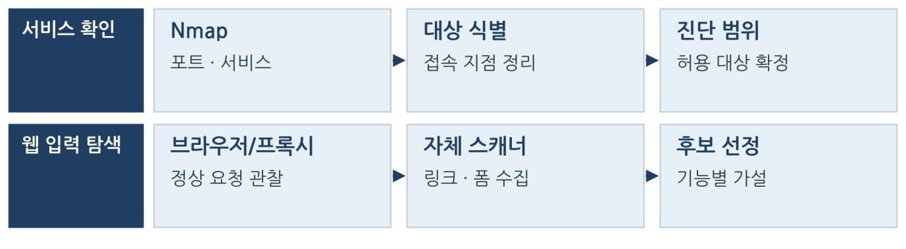

*포트·서비스 조사와 브라우저·폼 기반 입력점 탐색의 구분.*

### Holymoly — URL·폼 수집과 요청 구성

Python으로 URL과 폼을 수집하는 Holymoly를 제작함. 정적 링크와 HTML 폼에서 입력 필드·전송 대상·인코딩 방식을 추출하고, 수집한 요청을 검사 모듈에 전달함.

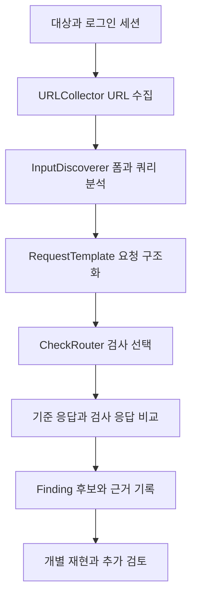

| 구성 요소 | 입력 | 처리·출력 |
| --- | --- | --- |
| `URLCollector` | 시작 URL, 로그인 세션, 페이지의 링크 | 세션을 공유해 내부 URL 수집, 로그인 요청 주소를 최종 목록에 보존 |
| `InputDiscoverer` | HTML 폼, URL 쿼리 | 입력 필드·요청 방식·전송 대상 추출 |
| `RequestTemplate` | 페이지 주소, `action`, 필드, 인코딩 | 화면 주소와 요청 주소를 구분한 요청 구조 저장 |
| `RequestBuilder` | 요청 구조와 파라미터 | GET 쿼리, URL 인코딩 POST, multipart 요청 구성 |
| `CheckRouter`·`SecurityScanner` | 수집된 입력점, 검사 정책 | 적용할 검사 선택, 기준 응답과 검사 응답 비교 |
| `Finding` | 검사 결과와 응답 근거 | 후보 유형, 요청 방식, 파라미터, 판단 근거 기록 |

수집부터 후보 기록까지 다음 순서로 구성함.

1. **URL 수집**: 시작 페이지에서 내부 링크를 따라 URL 목록을 구성함. 로그인 세션을 수집 과정에서 공유해 인증 후 접근 가능한 페이지도 포함함.
2. **폼·쿼리 분석**: 각 페이지의 입력 필드, `action`, `method`를 추출함. 화면을 보여 주는 페이지 주소와 데이터를 처리하는 요청 주소를 각각 보존함.
3. **요청 구조 저장**: 전송 대상, 필드, 인코딩 방식을 `RequestTemplate`에 정리함. 같은 페이지 안에서도 폼의 전송 대상과 방식에 따라 요청을 구분함.
4. **전송 방식 구성**: GET은 URL 쿼리, 일반 POST는 URL 인코딩 본문, 파일 입력은 multipart 요청으로 연결함. 수집된 필드가 실제 요청에 들어가도록 구성함.
5. **검사 선택과 응답 비교**: `CheckRouter`·`SecurityScanner`에서 입력 특성과 검사 정책에 맞는 검사를 선택함. 기준 응답과 검사 응답의 오류·반사·상태 변화를 비교함.
6. **후보 기록**: `Finding`에 후보 유형, 요청 방식, 파라미터와 응답 근거를 기록함. 이후 개별 재현에서 인증 상태·데이터 응답·브라우저 동작을 확인함.

| 자동 탐색 결과 | 기록한 근거 | 개별 재현 항목 |
| --- | --- | --- |
| 반사형 XSS 후보 | 응답에 이스케이프되지 않은 표식 | 출력 문맥, 브라우저 실행 여부 |
| 저장형 XSS 후보 | 저장 기능으로 추정한 POST 폼·텍스트 필드 | 저장·조회 결과, 브라우저 동작 |
| SQL Injection 의심 | 기준 응답에 없던 DB 오류 | 인증·조회 결과에 미친 영향 |
| 업로드 입력점 | 파일 업로드 필드 | 파일 수용, 저장 경로, 서버 실행 |

정적 링크·폼은 자동 수집하고, JavaScript로 생성되는 화면과 API는 별도 확인 항목으로 분류함. 데이터를 바꾸는 POST 능동 검사는 기본 비활성화하고 검사 정책에서 선택하도록 구성함.

검색 결과에서는 정상 응답과 입력값을 바꾼 응답을 비교함. 새로 나타난 DB 오류는 SQL Injection 후보로, 이스케이프되지 않은 표식은 반사형 XSS 후보로 기록함. 저장형 후보는 입력 폼을 찾은 뒤 저장·재조회·브라우저 실행 순서로 확인하는 흐름으로 구성함. 이 목록에서 재현할 입력점을 선정함.

일반적인 토큰 필드가 보이지 않는 폼을 CSRF 후보로 분류함. 서버 측 토큰 검증, SameSite, Origin·Referer와 상태 변경을 추가 점검 항목으로 정리함. 주문 기능에서는 `order.php` 취소 요청과 DB UPDATE 기록을 확인하고, 계정별 주문 소유권 비교를 점검 목록에 추가함.

#### 로그인 세션을 유지한 URL 수집 화면

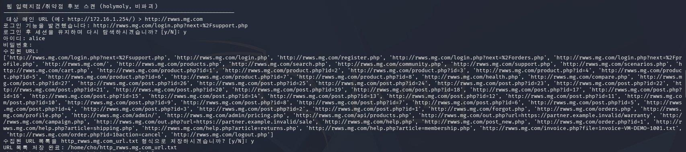

*Holymoly의 로그인 세션 유지와 내부 URL 수집·파일 저장 결과.*

수집 화면에서는 시작 URL을 입력한 뒤 로그인 기능을 발견하고, 로그인 세션을 유지한 상태로 다시 탐색하는 선택이 표시됨. 계정 입력 이후 로그인·회원가입·검색·상품·후기·고객지원·주문·프로필 등 여러 경로가 URL 목록에 출력됨. 목록 저장을 선택한 뒤 결과 텍스트 파일의 저장 완료 메시지를 확인함.

1. 시작 주소에서 얻은 내부 링크를 수집함. 로그인 페이지의 `next` 값처럼 이동 대상이 쿼리에 포함된 주소도 원래 요청 형태로 남김.
2. 로그인 후 같은 세션으로 접근 가능한 기능을 탐색함. 상품 상세의 `id`, 게시글의 `id`, 고객지원과 주문으로 연결되는 경로를 구분함.
3. `/api/products.php`와 `/api/search.php`처럼 HTML 화면과 함께 노출되는 API 경로를 목록에서 검토함. 브라우저에서 관찰한 요청 방식과 파라미터를 수집 목록에 대응시킴.
4. URL 목록을 파일에 저장함. 쿼리 변형을 포함한 전체 URL과 경로 기준 목록을 각각 비교해 검사 대상을 정함.

| 수집 화면에 나타난 경로 유형 | 관찰한 형태 | 점검에 연결한 항목 |
| --- | --- | --- |
| 로그인·가입·복구 | 로그인 이동 대상 쿼리, 가입·비밀번호 복구 경로 | 인증 처리 주소와 세션 유지 |
| 상품·검색 | 상품 ID와 검색 파라미터 | 정상 조회와 입력 변경 응답 비교 |
| 게시·후기·지원 | 게시글 ID, 작성 화면, 지원 폼 | POST 요청 대상과 저장 결과 |
| 주문·프로필 | 주문 ID·취소 동작, 프로필 화면 | 인증 상태·업무 상태·업로드 |
| API·이동 경로 | API 이름, 외부 이동 인자 | 브라우저 요청 대조와 이동 경계 |

수집 URL을 요청 방식·필드 이름·인증 상태·처리 주소로 묶어 입력점 목록을 구성함. 이 과정에서 화면 주소만 수집하면 인증 처리 `action`이 누락되는 문제를 찾아 수정함.

### PCrafter 연계 탐색 결과 검토와 시나리오 선정

공동 점검에 사용한 PCrafter 연계 탐색 도구(`real_main.py`)의 저장 결과를 검토함. 목록에는 URL 108개, 경로 기준 중복을 제거한 27개, 검토 레코드 19개가 저장됨. URL 목록에는 같은 경로의 쿼리 변형이 포함돼 있어 경로·입력 필드·요청 방식으로 다시 확인함. 19개 레코드는 검증할 후보를 모은 목록이며, 아래와 같이 나뉨.

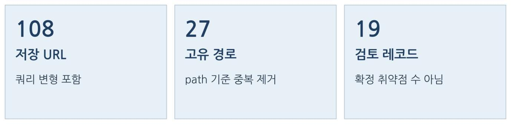

*저장 URL 108개·고유 경로 27개·검토 레코드 19개의 탐색 집계.*

| 분류 | 레코드 수 | 탐색에서 나타난 신호 | 다음 확인 단계 |
| --- | --- | --- | --- |
| CSRF 보호 검토 | 11 | 일반적인 CSRF 토큰 필드명 미발견 | 서버 검증·요청 출처·쿠키 정책과 상태 변경 확인 |
| 반사형 XSS 후보 | 3 | 입력 표식이 응답에 이스케이프되지 않고 반사 | 출력 문맥과 브라우저 실행 확인 |
| 저장형 콘텐츠 후보 | 3 | 저장 기능으로 추정한 POST 입력 | 저장 후 다른 조회 화면의 출력 확인 |
| SQL Injection 후보 | 1 | 정상 검색에 없던 DB 오류 | 쿼리 영향, 스키마·회원 데이터 응답 확인 |
| 파일 업로드 검토 | 1 | 파일 입력점 발견 | 파일 수용·경로 접근·서버 실행 확인 |

검색 파라미터 `q`에서는 DB 오류와 문자열 반사가 함께 관찰됨. DB 오류는 SQL Injection 재현 대상으로, 문자열 반사는 출력 문맥 확인 대상으로 나눔. 저장형 콘텐츠와 업로드는 필요한 세션·실행 조건을 정한 뒤 개별 시나리오에 편입함. 최종적으로 인증·회원 데이터·저장 콘텐츠·서버 실행·반복 인증의 영향을 네 가지 시나리오로 묶음.

#### 검색 입력의 후보 근거와 재현 연결

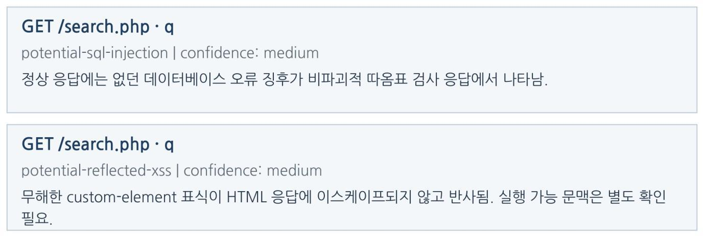

*검색 q 입력의 SQL Injection 의심과 반사형 XSS 후보 근거.*

`GET /search.php`의 `q`에서는 두 종류의 후보가 기록됨. 첫 번째는 정상 응답에 없던 DB 오류가 따옴표 검사 응답에서 나타난 경우임. 두 번째는 무해한 표식이 HTML 응답에 이스케이프되지 않은 채 반사된 경우임. 같은 파라미터에서 발생했어도 원인이 DB 질의 처리인지 HTML 출력 처리인지에 따라 확인할 다음 단계가 달라짐.

| 후보 필드 | SQL Injection 의심 레코드 | 반사형 XSS 후보 레코드 |
| --- | --- | --- |
| 요청 | `GET /search.php` | `GET /search.php` |
| 파라미터 | `q` | `q` |
| 분류 | `potential-sql-injection` | `potential-reflected-xss` |
| 신뢰도 | `medium` | `medium` |
| 관측 신호 | 정상 응답에는 없던 DB 오류 | 표식의 이스케이프 없는 HTML 반사 |
| 이어서 확인한 대상 | 검색 질의 영향과 DB 구조·회원 응답 | 출력 문맥과 브라우저 실행 여부 |

DB 오류를 확인한 경로에서는 구조 조회와 회원 데이터 응답까지 이어서 점검함. 문자열 반사는 반사형 후보로 유지하고 저장형 콘텐츠 시나리오의 결과와 별도로 다룸. 저장형 후보는 입력 폼을 찾은 상태에서 실제 저장·조회 결과를 확인하는 단계로 이동함.

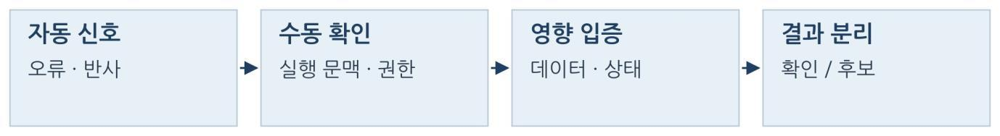

*자동 신호·수동 확인·실제 영향·최종 결과 분류의 연결.*

#### 취약점 유형과 영향 자산 분류

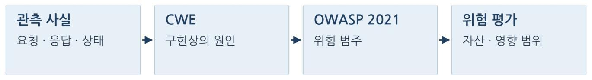

*관측한 요청·응답에서 구현 원인과 자산 영향으로 이어지는 분류.*

항목 번호는 시나리오에서 사용한 입력과 보조 설정을 구분하기 위해 사용함. 로그인·검색의 SQL 입력 처리, 저장된 콘텐츠의 출력, 실행 파일 수용, 반복 인증 방어는 서로 다른 처리 지점으로 분류함. 쿠키·CSP·WAF 모드와 상세 오류는 해당 경로의 보호 조건으로 함께 점검함.

| 항목 | 대상·원인 | CWE / OWASP 2021 | 시나리오에서 확인한 내용 |
| --- | --- | --- | --- |
| V-01·02 | 로그인·검색의 SQL 입력 처리 | CWE-89 / A03 | 인증 우회, 스키마·회원 데이터 응답 |
| V-03 | 저장 콘텐츠의 실행 가능한 출력 | CWE-79 / A03 | 후기의 콘텐츠 재출력과 외부 이동 흐름 |
| V-04 | 쿠키 보안속성 | CWE-1004·614 / A05 | 인증·콘텐츠 시나리오의 세션 보호 조건 |
| V-05·06 | HTTP와 가상 결제정보의 평문 구간 | CWE-319·311 / A02 | 정보 입력·전송 구간의 보호 조건 |
| V-07 | 외부 이동 대상 검증 | CWE-601 / A01 | 쿠폰 선택 이후 이동 경로 |
| V-08·09 | 위험 파일 수용과 실행 경로 | CWE-434·94 / A05·A03 | 업로드 파일의 수용·서버 실행 |
| V-10 | 반복 인증 시도 방어 | CWE-307 / A07 | 실패·성공 응답 및 최종 로그인 상태 |
| V-11 | 평문·약한 인증정보 | CWE-256·312 / A02 | 회원 데이터와 반복 인증의 환경 조건 |
| V-12 | 상세 SQL 오류 | CWE-209 / A05 | 검색 입력 탐색 단서와 내부 정보 노출 |
| V-13·14 | CSP·WAF 동작 모드 | 보완 통제·운영 설정 / A05 | 출력 보호와 탐지·차단 적용 조건 |

항목 번호는 입력 처리와 보조 설정의 관리 번호임. 쿠키·CSP·WAF 모드는 인증·콘텐츠 경로에 연결하고, 상세 SQL 오류는 검색 입력의 탐색 단서로 정리함.

#### 시나리오와 별도로 관리한 입력점

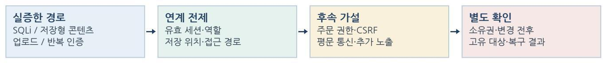

*실행한 경로에서 주문 권한·요청 출처·추가 노출 점검으로 이어지는 검토 범위.*

| 검토 항목 | 확보한 신호·기록 | 추가 확인으로 남긴 처리 지점 |
| --- | --- | --- |
| CSRF 보호 후보 11개 | 일반적인 토큰 필드명이 없는 폼 | 서버 토큰·SameSite·Origin·Referer와 실제 상태 변경 |
| 반사형 XSS 후보 3개 | 이스케이프되지 않은 응답 표식 | HTML 속성·태그·스크립트 문맥과 브라우저 실행 |
| 저장형 콘텐츠 후보 3개 | POST 폼과 텍스트 입력 필드 | 저장 요청·재조회 결과·출력 동작 |
| 파일 업로드 검토 1개 | 파일 입력 필드 | 파일 수신·저장 경로·서버 해석 |
| 주문 취소 | `order.php` 취소 요청과 DB UPDATE | 주문 소유자와 다른 계정의 처리 차이 |
| 세션·헤더·오류 | 쿠키 속성, CSP, 상세 SQL 오류 | 인증·출력·정보 노출 경계의 보완 조건 |

주문 취소 요청과 DB UPDATE를 연결하고, 정상 소유자와 다른 계정의 처리 차이를 추가 점검 항목으로 남김. L2 MITM 가능성 검토에서는 주소 매핑·양방향 경유·PCAP을 확인 항목으로 정리함.

### 웹 취약점 재현

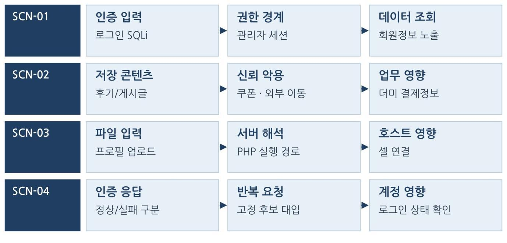

*네 시나리오의 입력점·중간 동작·영향 자산.*

재현 결과는 로그인·검색 SQL Injection, 저장형 콘텐츠, 파일 업로드, 반복 인증으로 나눠 정리함. 각 시나리오의 요청·응답을 로그인 상태, 조회된 데이터, 서버 실행 화면과 대조함.

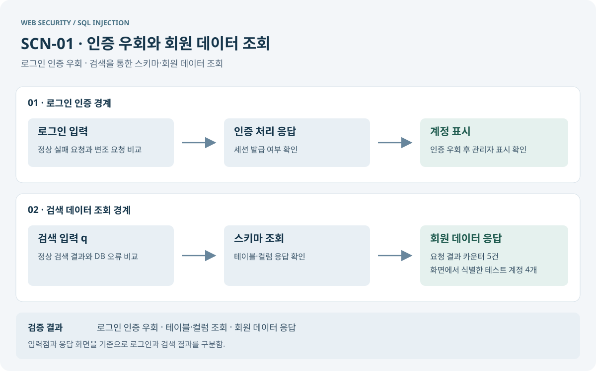

*로그인 인증 우회와 검색 데이터 조회 과정.*

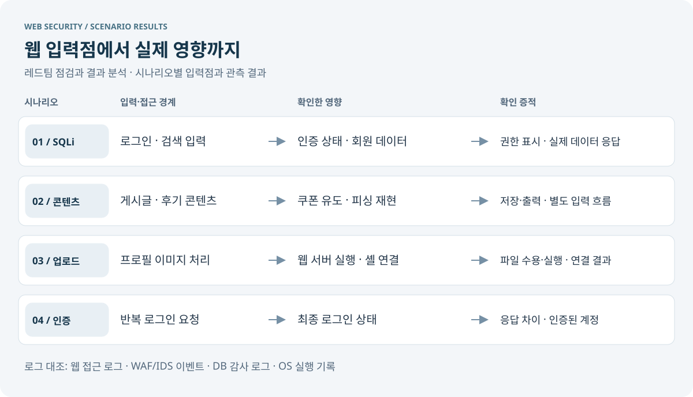

*시나리오별 입력점과 확인 결과.*

| 시나리오 | 입력·수행 내용 | 확인 결과 |
| --- | --- | --- |
| SCN-01 · 로그인·검색 SQL Injection | 로그인 입력과 검색 파라미터 변조 | 인증 우회 후 관리자 표시, DB 구조·회원 데이터 응답 |
| SCN-02 · 저장형 콘텐츠·쿠폰 피싱 | 후기·게시글의 쿠폰 유도 콘텐츠와 가상 정보 입력·결제 흐름 | 쇼핑몰 내부 게시 기록과 외부 피싱 재현 페이지 입력 확인 |
| SCN-03 · 업로드·서버 실행 | 업로드 파일 수용, URL 접근, 서버 실행, 외부 연결 | 대상 웹 애플리케이션 서버의 셸 연결 |
| SCN-04 · 반복 인증 | 반복 로그인 요청과 응답 비교 | 실패·성공 응답 차이와 최종 로그인 상태 |

#### SCN-01 · 로그인 인증 우회와 회원 데이터 조회

로그인의 `username`·`password`와 검색의 `q`를 대상으로 진행함. 테스트 계정과 가상 회원 데이터를 사용하고, 로그인은 인증 상태, 검색은 DB 조회 결과를 기준으로 분석함.

**로그인 입력 확인 과정**

*로그인 입력·인증 상태·검색 입력·회원 조회의 확인 순서.*

1. 정상적으로 실패하는 로그인 요청을 보내 실패 화면과 응답을 확보함. 동일한 로그인 폼을 사용해 입력값을 변경한 요청과 비교함.
2. 로그인 입력의 SQL 주석·조건식이 인증 처리에 영향을 주는지 점검함. 오류 메시지와 로그인 결과를 구분해 기록함.
3. 입력을 바꾼 요청 이후 발급된 세션과 화면의 계정 표시를 확인함. 인증 우회 실행에서는 상단에 `admin`과 로그아웃 메뉴가 표시됨.
4. 인증 입력, 응답, 세션·계정 표시를 묶어 로그인 우회 결과로 정리함. 검색을 통한 데이터 조회는 별도 입력점의 결과로 기록함.

**로그인 요청 전후 화면**

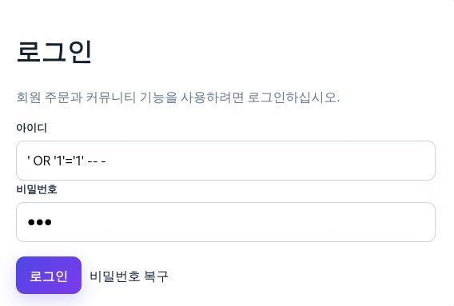

*로그인 입력에 조건식과 SQL 주석을 사용한 요청 화면.*

*인증 우회 요청 이후 admin 계정과 로그아웃 메뉴.*

로그인 폼에 조건식과 SQL 주석을 입력한 뒤 상단에 `admin` 계정과 로그아웃 메뉴가 표시됨. 일반 실패 요청과 비교해 인증 상태가 바뀐 결과를 확인하고 로그인 입력점의 인증 우회로 기록함.

**검색 입력 확인 과정**

*오류 관찰·컬럼 구조 확인·데이터 조회·관측 범위 산정의 순서.*

1. 정상 상품 검색 결과를 확보한 뒤 `q` 값을 변경함. 정상 응답에 없던 DB 오류를 확인하고 검색 입력이 쿼리 처리에 영향을 주는 지점을 조사함.
2. `information_schema` 관련 요청으로 테이블·컬럼 정보를 확인함. 반환된 컬럼 이름과 자료형이 상품 검색 결과의 카드 영역에 출력됨.
3. 구조 조회 화면에서 `id`, `username`, `email`, `password_hash`를 식별함. 해당 구조 조회 요청의 결과 카운터는 13건으로 표시됨.
4. 구조 확인 후 회원 데이터 조회 응답을 확인함. 회원 조회 요청의 카운터는 5건이며, 화면에서 식별한 테스트 계정은 4개임.

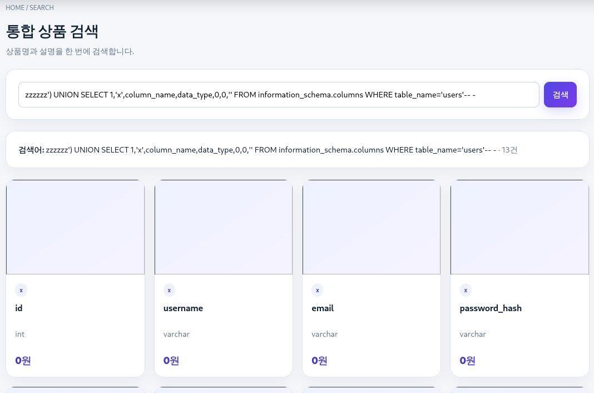

*검색 입력으로 확인한 회원 테이블의 컬럼·자료형. 구조 조회 카운터는 13건이며, 회원 데이터 조회 요청과 별도임.*

| 화면에서 확인한 컬럼 | 표시된 자료형 | 확인 내용 |
| --- | --- | --- |
| `id` | `int` | 회원 식별 필드 |
| `username` | `varchar` | 계정명 필드 |
| `email` | `varchar` | 이메일 필드 |
| `password_hash` | `varchar` | 인증정보 저장 필드 이름 |

| 단계 | 확인 내용 | 증적 |
| --- | --- | --- |
| 인증 처리 | 정상 실패 요청과 변조 요청의 인증 결과 비교 | 인증 우회 후 관리자 계정 표시 |
| DB 구조 조회 | 검색 응답의 테이블·컬럼 정보 확인 | 컬럼·자료형 응답, 구조 조회 카운터 13건 |
| 회원 데이터 조회 | 구조 확인 후 조회 결과 대조 | 결과 카운터 5건, 화면에서 테스트 계정 4개 식별 |

로그인 입력에서는 인증 상태가 바뀌었고, 검색 입력에서는 상품 검색 영역에 회원 테이블 정보가 출력됨. 두 입력점의 영향을 인증 처리와 데이터 조회로 나눠 정리하고, 이후 탐지 이벤트의 SQL 주석·항진식·스키마 조회·UNION 항목과 대조함.

**회원 조회 요청의 카운터 확인**

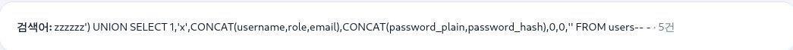

*회원 데이터 조회 요청의 검색 결과 카운터 5건.*

구조 조회는 컬럼명·자료형 13건을 반환하고, 회원 조회는 결과 카운터 5건으로 표시됨. 회원 테이블의 필드가 상품 카드 위치에 출력돼 검색 기능을 통한 데이터 노출을 확인함.

회원 조회의 가시 영역에서는 `admin`, `alice`, `bob`, `victim` 테스트 계정을 식별함. 요청에 포함된 `role`, `email`, 인증정보 관련 필드가 상품 검색 응답으로 반환된 결과를 확인함.

| 단계별 경계 | 입력 전 상태 | 입력 후 관측 | 연결한 영향 |
| --- | --- | --- | --- |
| 로그인 | 로그인 폼과 일반 실패 응답 | 관리자 계정 표시·로그아웃 메뉴 | 인증 상태 변경 |
| 검색 구조 조회 | 상품 검색 입력과 카드 출력 | 회원 컬럼명·자료형 | DB 구조 정보 노출 |
| 검색 회원 조회 | 상품 조회 기능 | 회원 필드가 포함된 결과와 카운터 | 회원 데이터 기밀성 영향 |

검색 화면을 통해 반환된 값과 탐지 규칙의 `information_schema`·`UNION SELECT` 특징을 연결함. 입력 처리 오류가 인증과 데이터 조회에 각각 영향을 준 결과를 분리해 조치 대상을 선정함.

#### SCN-02 · 저장형 콘텐츠와 쿠폰·결제 흐름

후기·게시글에 저장된 콘텐츠를 쿠폰 안내로 표시하고, 사용자가 선택하면 외부 입력 페이지로 이동하는 시나리오임. 저장형 XSS가 동작하는 조건과 인가된 로그인 세션을 선행 조건으로 두고, 콘텐츠 저장·재출력·외부 이동을 검증함. 배송·결제 입력에는 가상 정보를 사용함.

1. **저장 위치 확인**: 후기·게시글의 본문 입력과 조회 화면을 확인함. 콘텐츠를 입력한 화면과 다른 사용자가 해당 내용을 보는 화면을 구분함.
2. **콘텐츠 저장과 재조회**: 쿠폰 안내 콘텐츠를 입력하고 조회 화면을 다시 열어 표시 상태를 확인함. 상품 후기 안에 쿠폰 안내 문구와 확인 버튼이 출력됨.
3. **외부 이동 확인**: 쿠폰 확인 버튼을 선택해 피싱 재현 페이지에 도달하는 흐름을 확인함. 쇼핑몰 내부 콘텐츠와 외부 입력 화면을 각각 기록함.
4. **가상 정보 입력**: 외부 페이지의 배송·카드정보 입력 화면과 결제 흐름을 확인함. 입력 대상은 테스트용 배송·결제정보임.
5. **쇼핑몰 복귀 확인**: 결제 흐름 이후 쇼핑몰 주문 화면으로 돌아온 상태를 확인함. 쿠폰 콘텐츠, 이동 대상, 외부 입력, 복귀 화면을 순서대로 정리함.

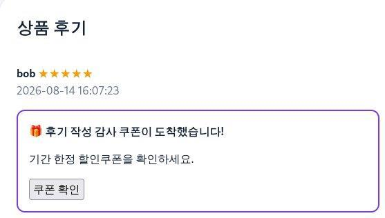

*후기 화면에 재출력된 쿠폰 콘텐츠와 외부 이동 버튼.*

| 단계 | 관측 내용 |
| --- | --- |
| 저장·재출력 | 후기 영역에서 쿠폰 유도 콘텐츠 표시 |
| 외부 이동 | 쿠폰 선택 후 피싱 재현 페이지 도달 |
| 가상 정보 입력 | 배송·카드정보 입력 화면과 결제 흐름 |
| 쇼핑몰 복귀 | 결제 흐름 이후 쇼핑몰 주문 화면 |

이 과정에서는 사용자가 신뢰하는 후기 영역에 들어간 콘텐츠와 외부 페이지의 정보 입력을 연결해 확인함. 출력된 HTML 콘텐츠, 브라우저 이동, 외부 입력 화면을 각각 남기고, 저장형 XSS 관련 경보는 해당 콘텐츠 단계와 함께 분석함.

**쿠폰 선택 이후 표시된 별도 안내 화면**

*20% 쿠폰 안내와 쿠폰 받기 버튼이 표시된 화면.*

후기 영역에는 작은 안내와 확인 버튼이 들어가고, 이어지는 화면에는 별도의 큰 쿠폰 안내와 선택 버튼이 표시됨. 첫 화면은 쇼핑몰 콘텐츠 안에 저장된 입력의 재출력이고, 다음 화면은 쿠폰 선택 이후의 유도 화면임. 사용자가 평소 이용하는 후기 영역을 통해 다른 입력 흐름으로 진입하는 경로를 확인함.

1. 후기 조회 화면에서 작성자·평점과 함께 표시된 쿠폰 안내를 확인함. 일반 후기 텍스트와 버튼이 함께 출력되는 상태임.
2. 쿠폰 확인을 선택한 뒤 표시되는 안내 화면의 문구와 버튼을 확인함. 두 화면의 표시 위치와 사용자의 선택 동작을 연결함.
3. 가상 배송·카드 데이터를 입력하고 결제 흐름을 거쳐 쇼핑몰 주문 화면으로 돌아오는 과정을 확인함.
4. 콘텐츠 출력, 외부 화면 이동, 정보 입력, 쇼핑몰 내부 주문 상태를 단계별로 기록함. 쿠폰 안내 화면에는 20% 할인 문구와 쿠폰 받기 버튼이 표시됨.

후기의 저장 위치, 재조회 화면의 쿠폰 버튼, 외부 입력 화면을 연결함. 쇼핑몰 후기에서 시작한 사용자 동작이 별도 서버의 정보 입력으로 이어지는 경로를 확인함.

#### SCN-03 · 프로필 업로드에서 서버 실행까지

*프로필 입력·저장 경로·PHP 실행·서버 외부 연결의 단계.*

프로필 이미지 업로드가 허용된 테스트 계정으로 파일 수용·접근·실행을 확인함. 업로드 기능 접근 권한과 서버의 파일 실행 조건을 사전에 정한 그레이박스 범위에서 검증함. 파일 입력부터 웹 서버에서 시작된 연결까지 단계별 화면을 비교함.

1. **파일 선택**: 프로필 이미지 입력에서 PHP 형식의 파일을 선택함. 파일 선택 화면에는 `test.php`가 표시됨.
2. **업로드 응답 확인**: 파일 전송 후 프로필 변경 응답을 확인함. 화면에 프로필 이미지가 변경됐다는 메시지가 표시돼 파일 수용 단계를 기록함.
3. **저장 경로 접근**: 업로드된 파일의 웹 경로를 요청하고 파일 처리 결과를 확인함. 파일을 받는 단계와 웹 서버가 해당 경로를 처리하는 단계를 나눔.
4. **서버 연결 확인**: 진단 거점에서 대기 중인 연결로 대상 웹 서버의 접속이 도착하는지 확인함. 실행 화면에 연결 수신 메시지와 `bash-5.1$` 프롬프트가 표시됨.
5. **실행 결과 정리**: 업로드 수용 화면, 경로 접근, 연결 메시지와 프롬프트를 묶어 대상 WAS 1대의 서버 실행 결과로 정리함. 별도 실행의 연결 실패는 오류 분석 항목으로 분리함.

**파일 선택과 업로드 응답**

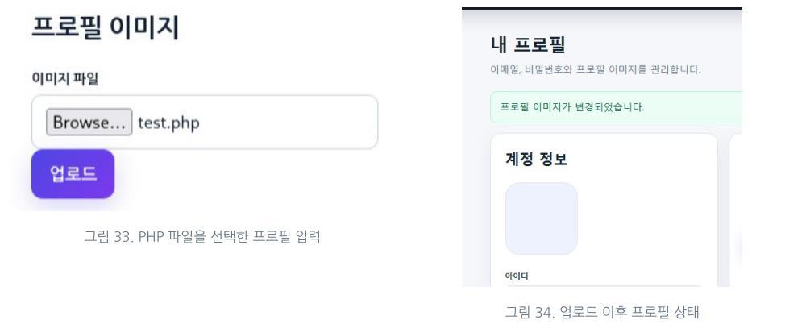

*프로필 입력의 test.php 선택과 업로드 이후 변경 안내.*

프로필 입력은 화면상 이미지 업로드 기능이지만, 선택된 파일은 `test.php`임. 전송 뒤에는 프로필 이미지 변경 안내가 표시됨. 이 두 화면으로 파일 선택과 애플리케이션 수용을 확인한 뒤, 웹 경로 접근과 서버 실행 결과를 이어서 확인함.

허용된 테스트 계정과 파일 실행 조건에서 진행함. 업로드 수용 후 웹 경로를 요청하고, 진단 거점에 도착한 서버 연결과 셸 프롬프트를 확인함.

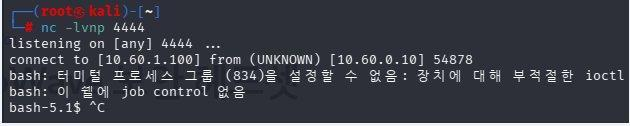

*서버에서 시작된 연결의 수신 메시지와 `bash-5.1$` 프롬프트.*

| 단계 | 확인 대상 | 관측 결과 |
| --- | --- | --- |
| 파일 수용 | 프로필 업로드의 파일 형식 처리 | 실행 파일 형식 수용 |
| 저장 경로 접근 | 업로드된 파일의 웹 경로 | 해당 파일 접근 요청 |
| 서버 실행 | 업로드 파일 처리 후 동작 | 웹 서버에서 시작된 연결 |
| 연결 결과 | 진단 거점의 세션 | 대상 WAS 1대의 셸 프롬프트 |

연결 화면에는 TTY 설정과 job control 관련 메시지도 함께 표시됨. 결과는 연결 수신과 셸 프롬프트가 나타난 시점까지 기록함. 일부 실행에서는 `no route to host`로 연결에 실패해 WAF 매치, 웹 접근, 서버 실행 기록을 따로 대조함.

#### SCN-04 · 반복 인증과 최종 로그인 확인

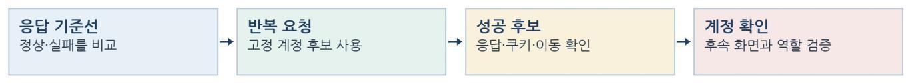

*정상·실패 응답 확보부터 후보 반복 요청과 계정 확인까지의 절차.*

허용된 로그인 경로에서 고정된 테스트 계정 후보로 반복 인증을 수행함. 정상·실패 응답을 먼저 확보한 뒤 같은 입력 형식으로 후보 조합을 요청하고, 응답과 최종 계정 표시를 확인하는 순서로 진행함.

1. **실패 응답 확보**: 잘못된 인증 요청을 보내 실패 안내와 HTTP 응답을 확인함. 해당 서비스의 실패 요청에는 HTTP 200과 아이디·비밀번호 확인 안내가 나타남.
2. **성공 응답 확보**: 정상 계정으로 로그인해 성공 안내, 쿠키, `Location`과 응답 코드를 확인함. 성공 요청에서는 HTTP 302가 관찰됨.
3. **후보 반복 요청**: 동일한 로그인 경로와 필드에 고정 후보 조합을 대입함. Hydra 실행 결과에서 성공 후보로 표시된 계정을 정리하고, 실패 누적 중 응답 차이를 비교함.
4. **세션 확인**: 성공 후보 계정으로 로그인해 인증된 세션과 후속 접근을 확인함. 상단 계정명과 로그아웃 메뉴가 표시된 화면을 결과로 남김.
5. **응답 집계**: 반복 인증 결과는 실패·성공 응답 횟수로 정리함. 별도 로그 분석 실행에서는 실패 44회, 성공 응답 3회가 집계됨.

**실패 안내와 성공 안내 비교**

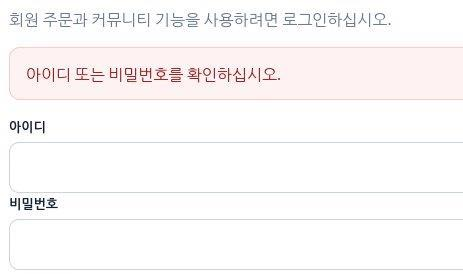

*로그인 실패 시 아이디·비밀번호 확인 안내.*

*정상 인증 후 로그인 완료 안내.*

실패 화면은 로그인 폼을 유지하면서 인증정보 확인 안내를 출력함. 성공 화면은 로그인 완료 안내를 출력함. 반복 요청 결과를 분류할 때는 이 화면 차이를 HTTP 응답 코드와 함께 사용함.

**HTTP 응답 코드 비교**

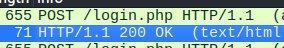

*실패 로그인 요청에 대한 HTTP 200 응답.*

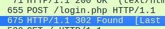

*성공 로그인 요청에 대한 HTTP 302 응답.*

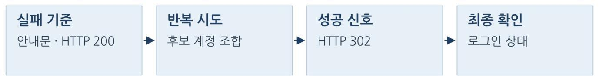

*실패 기준·반복 시도·성공 신호·최종 로그인 확인의 분리.*

해당 서비스에서는 로그인 실패 페이지도 정상 HTML 응답으로 반환해 HTTP 200으로 표시됨. 성공 요청에서는 HTTP 302가 나타남. 상태 코드만 비교하면 일반 페이지 이동과 구분이 어려워, 쿠키·이동 대상과 최종 계정 표시까지 함께 확인함.

반복 요청 화면에서 나온 성공 후보는 동일 계정으로 다시 로그인해 확인함. 최종 화면에 계정명과 로그아웃 메뉴가 표시돼 인증 상태를 확인함.

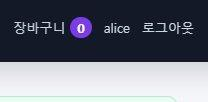

*성공 후보를 다시 확인한 최종 계정 표시와 로그아웃 메뉴.*

| 단계 | 수행 내용 | 관측 결과 |
| --- | --- | --- |
| 기준 응답 확보 | 올바른 인증과 잘못된 인증 요청 비교 | 실패 안내·HTTP 200, 성공 안내·HTTP 302 |
| 반복 시도 | 동일한 입력 형식에 테스트 계정 후보 조합 대입 | Hydra 실행 화면의 테스트 계정 조합 |
| 인증 상태 확인 | 성공 후보로 분류한 계정의 로그인 | 계정 표시와 로그인 상태 |
| 로그 집계 | 별도 분석 실행의 성공·실패 응답 분리 | 실패 44회, 성공 응답 3회 |

HTTP 상태 코드, 화면 안내, 로그인 세션을 함께 사용해 결과를 확인함. SQL Injection 시나리오는 인증 조건을 바꾸는 경로이고, 반복 인증은 유효한 계정 조합으로 로그인하는 경로임. 두 시나리오의 입력과 응답 기록을 별도로 정리함.

### PCrafter 통신 구조와 입력 전송 과정

PCrafter는 공동 점검에서 사용한 패킷·세션 처리 도구임. Holymoly의 URL·폼 수집과 역할을 나눠 파악하고, 공통 통신 계층과 시나리오 요청 모듈의 연결을 검토함. 패킷 빌더·세션 관리의 구현은 담당 팀원의 작업이며, 아래 내용은 시나리오 요청과 응답을 분석할 때 확인한 구조임.

#### 계층별 모듈과 연결 상태

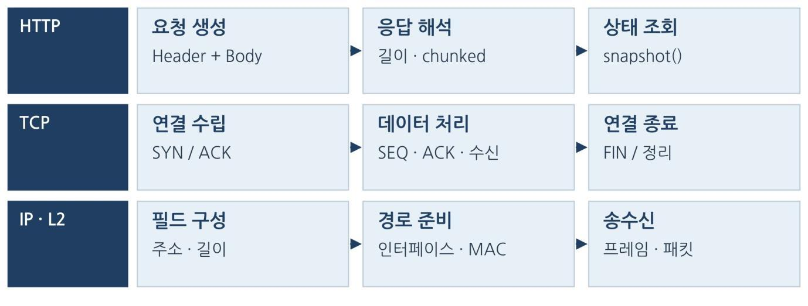

*HTTP·TCP·IP·L2별 요청 생성과 세션 처리 구조.*

| 구성 | 담당 처리 | 점검 과정에서 확인한 정보 |
| --- | --- | --- |
| `Ethernet_pac` | Ethernet 프레임 필드 구성 | 인터페이스·MAC과 실제 프레임 송수신 |
| `IP_pac` | IP 주소·길이 등 필드 구성 | 출발지·목적지와 패킷 구성 |
| `TCP_pac` | TCP 필드 구성 | SEQ·ACK·플래그와 데이터 연결 |
| `RawTcpSession` | 연결 수립, 데이터 송수신, 종료·정리 | 연결 상태와 송수신 전후 SEQ·ACK |
| `HTTP_pac` | HTTP 요청의 헤더·본문 구성 | 요청 주소·필드·전송 데이터 |
| `RawHttpSession` | HTTP 호출과 응답 경계 처리 | 헤더·본문, 길이·chunked 처리, 응답 완료 상태 |

1. HTTP 요청 모듈에서 헤더와 본문을 구성함. 검색은 URL 쿼리, 콘텐츠 입력은 POST 본문으로 전달돼 요청 방식과 입력 필드가 달라짐.
2. `RawHttpSession`에서 HTTP 요청을 통신 계층에 전달하고 응답 헤더·본문의 경계를 처리함. 길이 정보와 chunked 전송에 따른 응답 처리 구조를 확인함.
3. `RawTcpSession`에서 SYN·ACK에 따른 연결 상태와 데이터 송수신을 관리함. SEQ·ACK의 전후 값을 통해 요청과 응답이 어느 단계까지 진행됐는지 확인할 수 있게 구성됨.
4. IP·Ethernet 계층에서 인터페이스·주소·MAC과 프레임 송수신을 연결함. HTTP 응답이 없을 때도 하위 연결 단계의 상태를 함께 비교함.
5. 요청 완료·시간 초과와 패킷 기록을 반환함. 애플리케이션 응답의 오류와 통신 자체의 미완료를 구분하는 데 사용함.

#### 호출 결과의 관측 필드

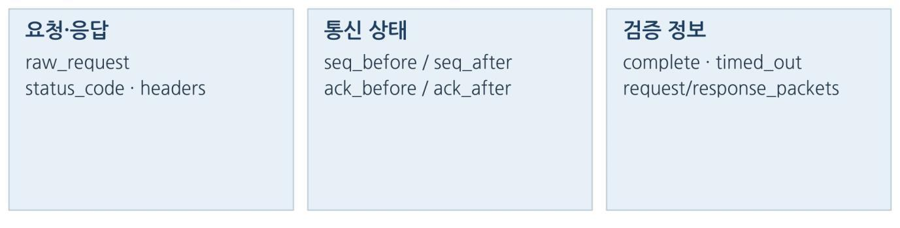

*요청·응답, 통신 상태, 완료·시간 초과와 패킷 기록 필드.*

| 필드 | 의미 | 비교한 내용 |
| --- | --- | --- |
| `raw_request` | 전송할 HTTP 요청 | 요청 방식·경로·헤더·본문 구성 |
| `status_code`·`headers` | HTTP 응답 상태와 헤더 | 실패·성공 응답 및 이동·쿠키 정보 |
| `seq_before`·`seq_after` | 송수신 전후 시퀀스 상태 | 요청 데이터 전송과 상태 변화 |
| `ack_before`·`ack_after` | 송수신 전후 확인 응답 상태 | 수신 데이터와 확인 응답의 연결 |
| `complete` | 응답 완료 여부 | 결과가 끝까지 처리됐는지 확인 |
| `timed_out` | 시간 초과 여부 | 응답 미완료와 취약점 결과 분리 |
| `request_packets`·`response_packets` | 요청·응답 패킷 목록 | 실제 통신 내용과 HTTP 결과 대조 |
| `snapshot()` | 현재 통신 상태 | 실패 지점과 연결 상태 확인 |

로그인 분석에서는 `status_code`·`headers`로 HTTP 200·302와 세션 정보를 확인함. 응답이 끝나지 않은 실행은 `complete`·`timed_out`와 패킷 목록을 대조해 통신 상태를 확인함.

#### 탐색 결과와 시나리오 요청 모듈 연결

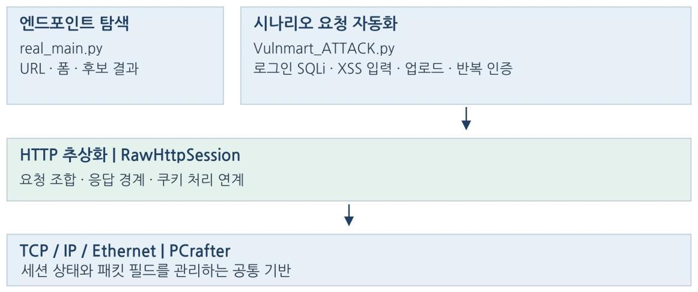

*엔드포인트 탐색·시나리오 요청·HTTP 세션·패킷 처리 모듈 관계.*

공동 자동화 흐름은 `real_main.py`의 엔드포인트 탐색과 `Vulnmart_ATTACK.py`의 시나리오 요청 모듈을 공통 HTTP·TCP 기반에 연결하는 구조임. 로그인 SQLi, 저장형 콘텐츠 입력, 업로드, 반복 로그인 요청 함수를 분리하고, URL·폼·후보 결과를 다음 요청의 입력으로 사용함.

| 입력 자료 | 처리 과정 | 남긴 결과 |
| --- | --- | --- |
| URL 목록 | 내부 링크·쿼리 변형과 경로 기준 중복 비교 | 저장 URL 108개, 고유 경로 27개 |
| 후보 JSON | 유형·확인 페이지·요청 주소·필드 확인 | 검토 레코드 19개 |
| 선택한 입력점 | 인증 상태와 요청 형식 확인 | 요청 방식·URL·파라미터 |
| 입력 파일 | 지정한 필드의 요청 데이터로 전달 | 파일 크기·전송 대상·HTTP 응답 |
| 시나리오 실행 결과 | 화면·세션·DB·서버 결과와 대조 | 개별 재현 결과와 관련 로그 |

시나리오 요청 함수와 실제 입력 전송 결과를 연결해 검토함. 아래 실행에서는 후기 입력점을 선택하고, 인증 세션 생성부터 POST 요청·응답까지 확인함.

#### 저장형 콘텐츠 전송 화면 분석

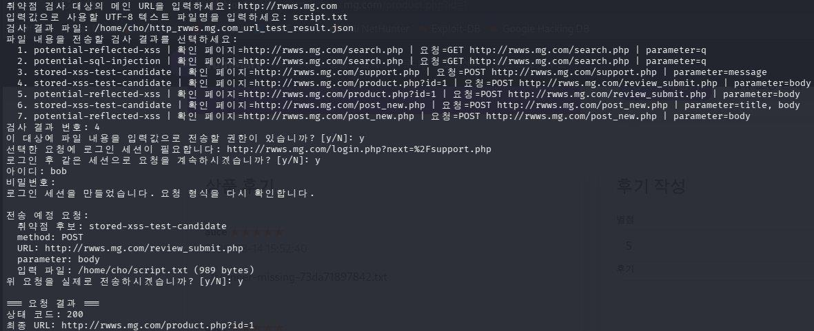

*후보 선택·로그인 세션 생성·후기 본문 전송과 HTTP 응답.*

실행 화면에서는 대상과 UTF-8 입력 파일을 지정한 뒤, 후보 목록에서 전송할 입력점을 선택함. 후보에는 `potential-reflected-xss`, `potential-sql-injection`, `stored-xss-test-candidate`가 표시되며 확인 페이지와 요청 주소·필드가 함께 출력됨.

1. **후보 선택**: 목록의 4번을 선택함. 확인 페이지는 `/product.php?id=1`, 실제 요청 주소는 `/review_submit.php`, 전송 필드는 `body`로 표시됨.
2. **인증 세션 생성**: 해당 요청에 로그인이 필요해 테스트 계정으로 세션을 생성함. 세션 생성 완료 후 전송 예정 요청을 다시 출력함.
3. **요청 내용 확인**: 유형 `stored-xss-test-candidate`, 방식 `POST`, 파라미터 `body`와 입력 파일 989 bytes를 확인함. 화면 주소와 POST 처리 주소가 분리돼 있음.
4. **전송 결과 확인**: 요청 후 상태 코드 200과 최종 URL `/product.php?id=1`이 출력됨. 전송 응답을 받은 뒤 상품 후기 화면에서 저장된 콘텐츠를 확인하는 순서로 연결함.

이 화면에서 확인한 것은 선택한 후기 입력점의 인증 세션·POST 전송·응답임. 저장된 쿠폰 콘텐츠가 실제 후기 화면에 출력된 결과는 앞선 SCN-02 화면과 함께 확인함. 입력 전송 도구의 HTTP 성공 응답과 브라우저의 최종 표시를 나눠 기록함.

### ALPACA — 공격 요청과 로그 대조

공격 시각·대상·URI를 기준으로 웹 접근, ModSecurity, MariaDB 감사, Linux auditd 기록을 비교함. ALPACA는 PCAP·Snort 경보·pfSense·서버 로그를 중앙 DB와 조사 화면에 연결하는 구조임. 공격 요청이 어느 구간까지 전달됐는지와 어떤 동작이 남았는지를 소스별로 확인함.

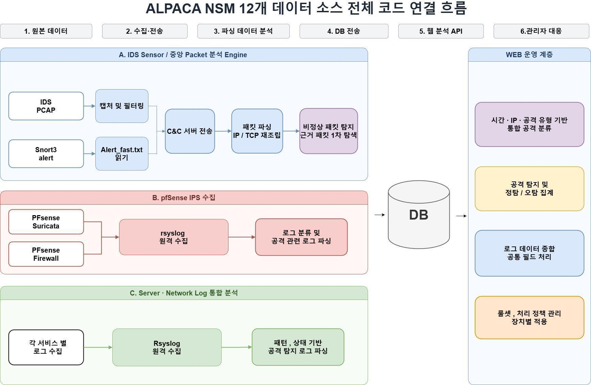

*IDS 패킷·경보, pfSense·Suricata, 서비스 로그의 중앙 분석 연결.*

수집 흐름은 패킷과 경보, 방화벽 로그, 서버 로그의 세 경로로 나뉨. IDS PCAP은 캡처·필터링 후 IP·TCP 파싱과 재조립으로 연결되고, Snort `fast.txt`는 경보 읽기 경로를 사용함. pfSense·Suricata와 서버 서비스 로그는 rsyslog 원격 수집 후 분류·파싱됨.

중앙 DB에는 발생 시각·IP·공격 유형·소스별 정보가 저장되고, 분석 화면에서는 공격 분류·정탐/오탐 집계·공통 필드 조사로 이어짐. 룰·정책 관리 화면과 실제 장비 적용은 나눠 확인함.

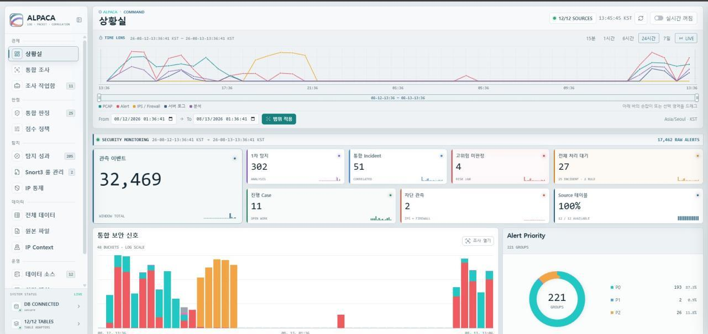

*ALPACA 통합 상황실의 시간별 이벤트와 소스별 집계.*

대시보드에서 시간대별 이벤트 추이와 소스별 집계를 먼저 확인함. 급증한 구간과 시나리오 실행 시각을 기준으로 상세 목록을 열고 대상·요청 경로·이벤트 요약을 대조함.

| 조사 화면에서 사용한 정보 | 연결한 확인 작업 |
| --- | --- |
| 시간대별 이벤트 추이 | 시나리오 실행 구간과 이벤트 증가 구간 대조 |
| 데이터 소스 구분 | 패킷·Alert·서버 로그 중 어느 수집 경로의 기록인지 확인 |
| 이벤트 요약 | SQL 주석, 반복 로그인, 업로드·셸 연결 특징 검색 |
| 원본 기록 | 같은 시각·대상·요청의 HTTP·DB·OS 내용 확인 |
| 판정·Case | 정탐·오탐 검토와 시나리오별 관련 기록 묶음 |

대시보드에서 실행 시간대를 찾은 뒤 웹 접근 로그의 요청, 규칙의 매치 내용, 서버의 인증·조회·실행 결과 순서로 확인함.

**로그가 모이는 과정**

| 입력 소스 | 수집·처리 과정 | 조사에 사용한 정보 |
| --- | --- | --- |
| IDS PCAP | 캡처·필터링 후 중앙 분석으로 전달, IP·TCP 파싱·재조립 | 실제 통신 흐름과 요청·응답 |
| Snort 3 Alert | `fast.txt` 경보를 읽어 중앙 분석으로 전달 | 규칙 매치와 공격 특징 |
| pfSense·Suricata | rsyslog로 원격 수집 후 로그 분류·파싱 | 경계 장비 이벤트와 적용 동작 |
| 웹·DB·OS 로그 | 서비스별 로그를 rsyslog로 수집 | URL 접근, DB 처리, 파일·프로세스·실행 흔적 |
| 중앙 DB·분석 화면 | 공통 필드를 묶어 시간·IP·공격 유형으로 조회 | 이벤트 대조, 정탐·오탐 검토, Case 정리 |

수집된 이벤트는 발생 시각·소스·요약으로 먼저 확인함. 필요한 실행을 찾으면 대상과 요청 경로를 대조하고, PCAP·원본 로그·웹 화면으로 이어서 확인함.

1. **실행 구간 찾기**: 시나리오의 실행 시각과 대상을 기준으로 조회 범위를 정함. 로그인·검색·업로드의 요청 경로와 파라미터를 함께 확인함.
2. **웹 요청 확인**: 접근 로그에서 URI·요청 방식·응답 코드를 확인해 서버에 도착한 요청을 찾음. 화면에 나타난 로그인 상태와 조회 결과를 해당 요청에 연결함.
3. **탐지 이벤트 대조**: 같은 시나리오의 WAF·IDS/IPS 경보를 확인하고 규칙의 관측 특징을 비교함. 규칙 이름과 SID는 관리 목록에서 대조함.
4. **DB·OS 결과 확인**: 검색은 DB 조회 응답, 업로드는 파일 접근과 실행·연결 흔적을 확인함. 주문 취소 요청은 DB UPDATE 기록과 함께 검토함.
5. **시나리오 기록 정리**: 입력값, 응답, 경보, 서버 결과를 실행별로 묶음. 서로 다른 실행의 화면도 시각·대상을 유지해 비교할 수 있게 정리함.

| 자료 | 대조 항목 |
| --- | --- |
| 웹 접근 로그 | 요청 시각, URI, 요청 방식, HTTP 응답 코드 |
| WAF·IDS/IPS 이벤트 | 같은 대상·시각의 규칙 매치와 경보 |
| MariaDB 감사 로그 | 웹 입력과 연계된 DB 접근·조회 기록 |
| Linux auditd·세션 기록 | 파일·프로세스·서버 실행 흔적 |

ModSecurity는 **DetectionOnly 모드**로 운영됨. WAF 매치는 탐지 기록으로 정리하고, 실제 서비스 결과는 로그인 세션·조회 데이터·서버 실행 화면에서 확인함. SQL Injection은 웹 요청과 DB 응답, 업로드는 파일 접근과 서버 연결, 반복 로그인은 응답 차이와 최종 계정 표시를 연결해 분석함.

관제 과정에서 정상 RDP ACK가 스캔으로 탐지된 사례를 확인함. 이를 오탐 사례로 정리하고 규칙 검토 항목에 추가함. IP 통제 기능은 정탐 IP를 통제 목록과 DB에 등록하는 단계까지 구현됨.

### SQL Injection — 탐지 이벤트

로그인·검색 입력에서 SQL 주석, 항진식, 스키마 조회, UNION 관련 이벤트를 확인함.

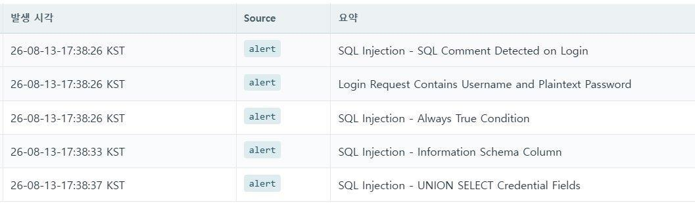

*로그인·검색 요청에서 발생한 SQL Injection 경보.*

| SID | 관측 특징 |
| --- | --- |
| `2001006` / `2001010` | 로그인 입력의 SQL 주석 / 항진식 |
| `2001009` | `information_schema`를 통한 구조 조회 |
| `2001008` | `UNION SELECT`와 인증정보 관련 필드 |

로그인 주석·항진식 이벤트는 인증 입력에서, `information_schema`와 `UNION SELECT` 이벤트는 검색을 통한 조회 단계에서 발생함. 규칙 목록의 SID와 경보 요약을 찾고, 같은 시나리오의 관리자 표시·회원 데이터 응답과 비교함.

탐지 화면에는 다음 순서로 이벤트가 남아 있음.

| 표시 시각 · KST | 경보 요약 | 연결한 작업 |
| --- | --- | --- |
| 2026-08-13 17:38:26 | `SQL Comment Detected on Login` | 로그인 입력의 SQL 주석 특징 |
| 2026-08-13 17:38:26 | `Login Request Contains Username and Plaintext Password` | 로그인 요청 내 계정·인증 필드 |
| 2026-08-13 17:38:26 | `Always True Condition` | 인증 입력의 항진식 특징 |
| 2026-08-13 17:38:33 | `Information Schema Column` | 검색을 통한 테이블·컬럼 확인 |
| 2026-08-13 17:38:37 | `UNION SELECT Credential Fields` | 회원 테이블의 인증정보 관련 필드 조회 |

이벤트의 발생 시각과 요약을 따라 로그인 입력에서 구조 조회·회원 필드 조회로 이어진 흔적을 확인함. 요청에 포함된 문자열은 탐지 규칙과, 실제 영향은 관리자 표시·검색 응답과 각각 대조함.

**SQL 입력 처리의 조치 대상**

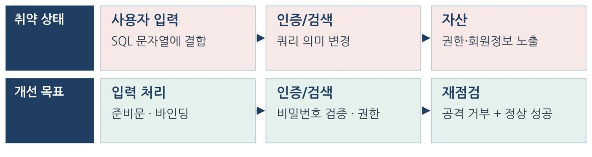

*사용자 입력과 SQL 처리의 취약 상태 및 바인딩·인증 검증의 조치 대상.*

로그인에서는 입력 문자열이 인증 조건에 영향을 주는 지점, 검색에서는 사용자 입력이 데이터 조회 구문에 영향을 주는 지점을 조치 대상으로 정함. 쿼리 바인딩과 인증정보 검증, 서비스 DB 계정 권한을 각각 구분해 점검 항목을 작성함.

SCN-01의 경보는 로그인과 검색에서 발생한 SQL 특징을 보여 줌. 조치 확인에서는 같은 조건식·조회 입력의 처리 결과와 정상 계정 로그인·상품 검색을 한 쌍으로 비교하는 구성을 사용함. 탐지 규칙 등록과 애플리케이션의 입력 처리 수정을 서로 다른 작업으로 관리함.

### 반복 로그인 — 요청 조건과 경보

`/login.php`의 POST 요청을 반복하고 실패·성공 응답과 최종 로그인 상태를 비교함. 반복 요청 탐지에는 SID `3001001`을 사용하며, 조건은 **60초 안에 로그인 요청 10회 이상**임.

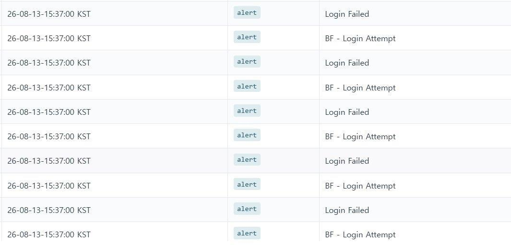

*로그인 실패와 반복 요청 경보.*

| 항목 | 내용 |
| --- | --- |
| 요청 정보 | `/login.php`, POST, 요청 시각·출발지·계정 |
| 응답 비교 | 로그인 실패·성공 응답, 최종 인증 상태 |
| 탐지 결과 | `Login Failed`, `BF - Login Attempt` 이벤트 |
| 적용 상태 | IDS Alert 확인. IPS Drop은 공격 의도·오탐 검토 후 적용 여부 결정 |

로그인 실패 경보와 반복 요청 경보는 따로 확인함. `Login Failed`는 실패로 분류된 경보명이며, `BF - Login Attempt`는 일정 시간 안에 누적된 요청 조건의 경보임. 실제 인증 상태는 앞서 확인한 서비스 응답·세션과 대조함.

1. `/login.php`의 POST 요청에서 출발지·계정·시각과 성공·실패 응답을 정리함.
2. 반복 요청 특징을 SID `3001001`의 60초·10회 조건에 연결함.
3. 경보 화면에서 `Login Failed`와 `BF - Login Attempt`가 반복되는지 확인함. 제시된 화면에는 2026-08-13 15:37:00 KST의 경보가 나열됨.
4. 계정 제한·잠금·지연은 인증 애플리케이션의 조치 항목으로 정리하고, 정상 로그인·계정 복구를 재시험 항목에 포함함.

룰 검토 시에는 적용 엔진, 대상, 관측 필드, 조건, Alert·Drop 동작과 정상 요청을 함께 정리함. 동일 출발지를 사용하는 정상 사용자의 로그인도 비교 대상으로 둠.

**반복 요청 특징의 룰 전환**

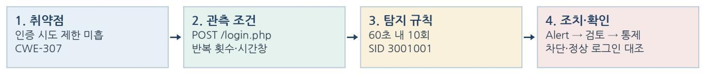

*인증 시도 제한 항목과 POST 로그인·시간창·SID 3001001의 연결.*

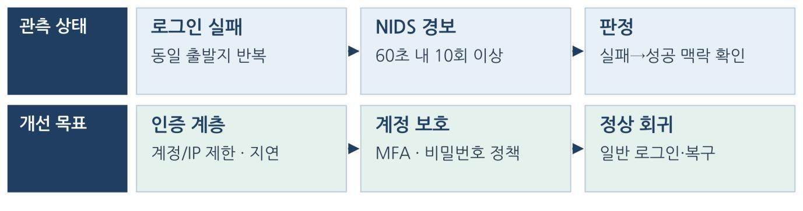

*반복 요청의 경보와 인증 계층의 제한·지연·계정 보호 구분.*

레드팀에서는 `/login.php`, POST 방식, 실패·성공 응답, 시각·출발지·계정 정보를 관측 특징으로 정리함. 규칙 담당자가 네트워크에서 볼 수 있는 필드와 인증 애플리케이션에서 처리해야 할 계정 상태를 나눠 전달함.

| 구분 | 정리한 조건 | 확인 결과 또는 적용 위치 |
| --- | --- | --- |
| 입력 | 로그인 경로·POST 요청·출발지·시각 | 반복 요청 흐름을 경보와 대조 |
| 탐지 조건 | 60초 내 10회 이상 | SID `3001001`과 BF 경보 연결 |
| IDS 동작 | Alert | 반복 시도 특징 기록 |
| IPS 동작 | 공격 의도·오탐 검토 후 선택 | 공통 규칙을 일괄 Drop으로 전환하지 않음 |
| 인증 애플리케이션 | 요청 제한·지연·계정 잠금·추가 인증 | 계정 단위 보호 항목 |
| 정상 동작 비교 | 정상 로그인·복구, 공유 출발지의 정상 사용자 | 제한 정책의 영향 확인 항목 |

네트워크 경보는 요청 빈도를 관측하고, 계정 잠금은 애플리케이션이 계정 상태를 변경하는 동작임. 서로 다른 제어 위치를 구분해 조치안을 작성함. 실패·성공의 응답 차이와 최종 계정 접근은 반복 요청 재현의 결과로 유지함.

### 저장형 콘텐츠·업로드 탐지 기록

#### 저장 콘텐츠와 쿠키 관련 탐지

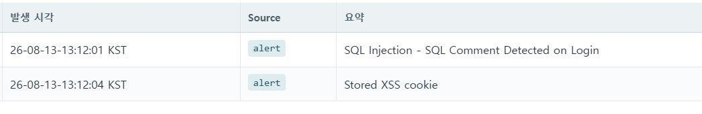

*로그인 SQL 주석과 Stored XSS cookie 경보의 발생 기록.*

이벤트 목록에는 2026-08-13 13:12:01 KST의 로그인 SQL 주석 특징과 13:12:04 KST의 `Stored XSS cookie` 이벤트가 표시됨. 저장형 콘텐츠의 표시 화면과 관련 입력 특징을 시간 순서로 대조함.

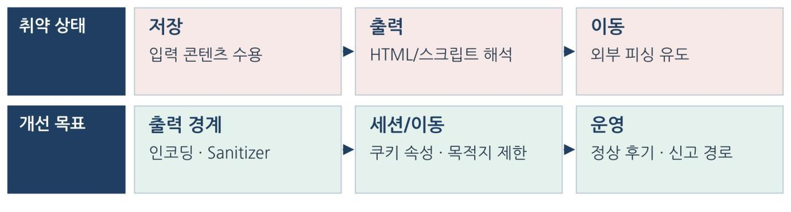

*저장·HTML 출력·외부 이동 경로와 출력·세션·이동 보호의 조치 대상.*

콘텐츠 출력은 문맥별 인코딩 또는 Sanitizer 적용 대상으로, 세션은 쿠키 속성 점검 대상으로, 외부 이동은 허용 목적지 점검 대상으로 나눔. `document.cookie` 문자열을 관측하는 SID `2003005`는 해당 특징의 탐지 규칙으로 관리함. 정상 후기 작성·열람과 쿠폰 콘텐츠의 출력·이동을 각각 비교하는 재시험 항목을 작성함.

#### 파일 업로드와 서버 연결의 탐지

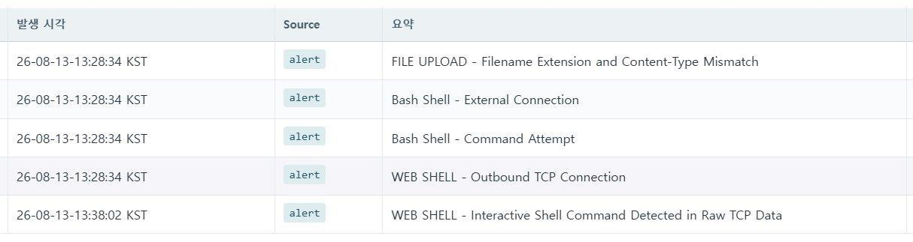

*업로드 형식 불일치·셸 명령·외부 TCP 연결 관련 이벤트.*

업로드의 확장자·Content-Type 불일치, bash 명령·외부 연결, TCP 데이터의 셸 명령 특징이 각각 이벤트로 표시됨. 파일 반입·서버 명령·외부 연결 위치에 해당하는 경보를 연결해 실행 흐름을 추적함.

SQL Injection과 반복 로그인 외에 콘텐츠 입력, 업로드, 셸 명령, 외부 연결의 관측 특징도 규칙에 반영됨.

| SID | 관측 위치·특징 | 연결한 시나리오 |
| --- | --- | --- |
| `2003005` | `document.cookie` 문자열 | SCN-02 저장형 XSS 관련 이벤트 |
| `2006002` | 업로드 파일 형식·확장자·콘텐츠 특징 | SCN-03 위험 파일 수용 |
| `5002001` | 세션 데이터의 셸 명령 특징 | SCN-03 서버 실행 |
| `5001001` | 외부 연결 후보 | SCN-03 역방향 연결 |

`2003005`는 특정 문자열을 관측한 규칙임. 콘텐츠가 저장된 위치와 실제 조회 화면의 동작은 시나리오 증적으로 확인함. 업로드 관련 이벤트도 파일 수용, 명령 특징, 연결 후보의 서로 다른 단계에서 발생함. 서버 실행 여부는 셸 연결 결과와 대조함.

업로드·셸 연결 경보는 파일 입력 이후의 동작을 확인하는 데 사용함. 화면에는 확장자·Content-Type 불일치, 셸 명령 시도, 외부 TCP 연결이 각각 표시됨.

| 표시 시각 · KST | 경보 요약 | 확인 단계 |
| --- | --- | --- |
| 2026-08-13 13:28:34 | `FILE UPLOAD - Filename Extension and Content-Type Mismatch` | 업로드 파일 이름·전송 형식의 특징 |
| 2026-08-13 13:28:34 | `Bash Shell - Command Attempt` | 셸 명령 시도 |
| 2026-08-13 13:28:34 | `Bash Shell - External Connection` | 셸의 외부 연결 특징 |
| 2026-08-13 13:28:34 | `WEB SHELL - Outbound TCP Connection` | 서버에서 시작된 TCP 연결 |
| 2026-08-13 13:38:02 | `WEB SHELL - Interactive Shell Command Detected in Raw TCP Data` | TCP 데이터 안의 대화형 셸 명령 특징 |

이벤트명과 시각을 기준으로 파일 반입, 명령 실행, 외부 연결을 나눠 정리함. 셸 프롬프트가 표시된 실행 화면과 경보를 함께 검토해 서버 실행 단계의 결과를 설명함.

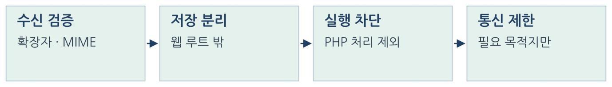

*파일 수신 검증·저장 분리·PHP 실행 제한·외부 통신 제한의 위치.*

파일 수신 단계는 형식·확장자·MIME, 저장 단계는 웹 루트와 파일 경로, 실행 단계는 PHP 처리 여부, 연결 단계는 외부 목적지를 조치 대상으로 정리함. 정상 이미지 업로드·표시와 위험 형식의 처리 결과를 비교하도록 재시험 항목을 구성함. 서버에서 역방향 연결이 실패한 경우에도 업로드 수용과 실행 경로는 각각 확인 대상으로 유지함.

### 공통 인프라의 접근·연결 제한 결과

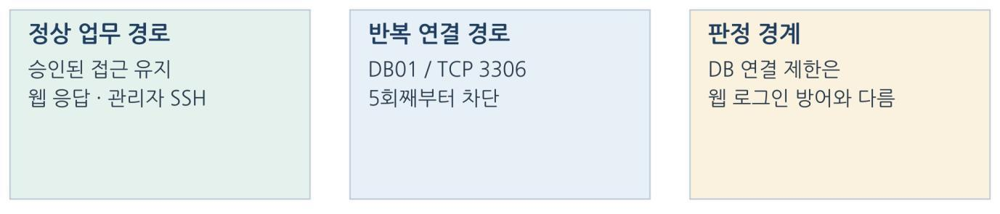

*정상 관리 경로와 DB 반복 연결 제한의 대상 구분.*

공통 인프라에서는 DB01의 TCP 3306 반복 연결과 HD02의 관리자 SSH 접근을 시험함. DB 연결 빈도 제한을 확인하는 과정과 정상 관리 접속 확인을 함께 정리함.

1. **반복 연결 준비**: DB 포트로 연결을 시도하는 반복문을 사용함. 각 시도에 1초 제한 시간을 두고, 시도 사이에 1초 대기를 적용함.
2. **8회 접속 시도**: 연결 명령의 종료 상태에 따라 `SUCCESS` 또는 `BLOCKED (Drop)`을 출력함. 1~4회는 `SUCCESS`, 5~8회는 `BLOCKED (Drop)`으로 표시됨.
3. **서버 로그 대조**: 커널 로그의 `DB_BRUTE_FORCE_DETECTED` 항목을 확인함. `PROTO=TCP`, `DPT=3306`, `SYN`과 발생 시각을 대조해 반복 접속 기록을 찾음.
4. **정상 관리 접근 확인**: 허용된 관리자 계정·경로로 HD02 SSH 접속을 확인함. 반복 연결 제한과 정상 관리 접근 결과를 각각 기록함.

**반복 연결 실행 화면**

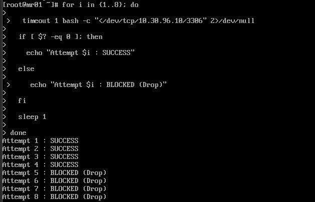

*DB 포트의 8회 연결 시도와 SUCCESS·BLOCKED 결과.*

실행 화면의 반복문은 1~8회 연결을 시도하고 결과에 따라 문자열을 출력함. 5회째부터 `BLOCKED (Drop)`으로 바뀐 지점을 확인한 뒤 대상 서버의 커널 기록을 비교함.

**서버 측 제한 로그**

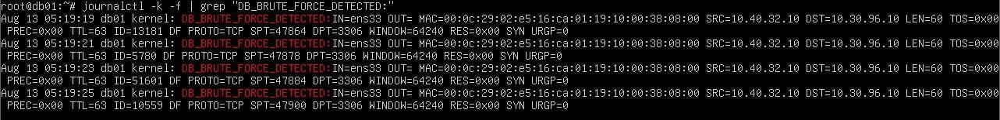

*DB_BRUTE_FORCE_DETECTED 접두어와 TCP 3306 SYN 기록.*

서버 로그에는 새 TCP 연결의 SYN, 목적지 포트 3306, 규칙 접두어와 시각이 남음. 접속 시도 출력과 대상 서버의 로그를 연결해 DB 포트의 연결 빈도 제한을 확인함.

| 대상 | 시험 조건 | 확인 결과 |
| --- | --- | --- |
| DB01 · TCP 3306 | 60초 안에 반복 접속 | 앞선 4회 성공, 5회째부터 차단, 커널 로그 확인 |
| HD02 · 관리 SSH | 허용된 관리자 접속 | 정상 관리 접속 성공 |

| 로그·출력 필드 | 확인한 값 | 분석에 사용한 내용 |
| --- | --- | --- |
| 시도 결과 | 1~4회 `SUCCESS`, 5~8회 `BLOCKED (Drop)` | 접속 결과가 바뀌는 시점 |
| 커널 로그 접두어 | `DB_BRUTE_FORCE_DETECTED` | 반복 접속 규칙에 해당하는 기록 |
| 프로토콜·목적지 포트 | `PROTO=TCP`, `DPT=3306` | 점검 대상 DB 서비스 |
| TCP 플래그 | `SYN` | 새 연결 시도 |
| 로그 시각 | 05:19:19·21·23·25 | 제한 이후 연속 접속 시도 |

DB01 시험은 DB 포트의 연결 제한을 확인한 결과로 정리함. 쇼핑몰의 반복 로그인은 HTTP 요청과 계정 상태를 처리하는 별도 시나리오로 관리함.

### 시나리오별 조치 항목과 재시험 구성

재현 결과를 입력 처리, 콘텐츠 출력, 파일 처리, 인증 정책으로 나눠 조치 항목을 작성함. 요청에 어떤 특징이 있었는지, 어느 서비스에서 결과가 바뀌었는지, 다시 시험할 정상 기능은 무엇인지를 같은 항목에 연결함.

| 대상 | 조치 항목 | 같은 입력으로 다시 확인할 내용 | 정상 기능 비교 |
| --- | --- | --- | --- |
| 로그인·검색 SQL Injection | Prepared Statement·바인딩 적용, 인증정보 검증, DB 계정 권한 점검 | 조건식·UNION이 SQL 구문이 아닌 입력 데이터로 처리되는지 확인 | 정상 계정 로그인과 상품 검색 |
| 저장형 콘텐츠 | 출력 문맥별 인코딩 또는 Sanitizer 적용 | 저장한 입력이 조회 화면에서 코드로 실행되는지 확인 | 일반 후기 작성·저장·열람 |
| 세션·외부 이동 | 쿠키 보안속성, 외부 이동 허용 대상 점검 | 콘텐츠를 통한 외부 이동과 세션 접근 흐름 확인 | 정상 페이지 이동과 세션 유지 |
| 파일 업로드 | 허용 형식·확장자·MIME 검증, 웹 루트 밖 저장, PHP 처리 제외 | 위험 파일의 수용과 직접 URL 실행 여부 확인 | 정상 이미지 업로드·표시 |
| 서버 외부 연결 | 필요한 목적지 중심의 연결 허용 | 서버에서 시작되는 외부 연결의 처리 결과 확인 | 필요한 서비스 연결 |
| 반복 인증 | 계정·출발지 기준 요청 제한, 점진적 지연, 약한 비밀번호 방지, MFA | 반복 요청의 제한·지연·경보 확인 | 정상 로그인·계정 복구, 공유 출발지의 정상 접속 |

로그인·검색 SQL Injection과 실행 파일 업로드는 인증·DB·서버 실행에 직접 연결돼 우선 조치 대상으로 정리함. 콘텐츠 출력·평문 인증정보·반복 인증은 입력·전송·계정 보호 항목으로, 상세 SQL 오류와 외부 이동 정책은 노출 정보·이동 경로 항목으로 묶음.

재시험 기록에는 변경한 소스·설정, 동일 입력의 응답, 정상 기능의 응답, 연결된 경보·로그를 남기는 구성을 사용함. SQL Injection은 같은 조건식·UNION 입력과 정상 검색을, 업로드는 같은 형식의 파일과 정상 이미지를 한 쌍으로 비교하도록 정리함. 인증 보호는 반복 요청 결과와 정상 계정의 로그인·복구 흐름을 함께 확인하는 항목으로 구성함.

#### 관측 특징을 조치 항목으로 전달한 과정

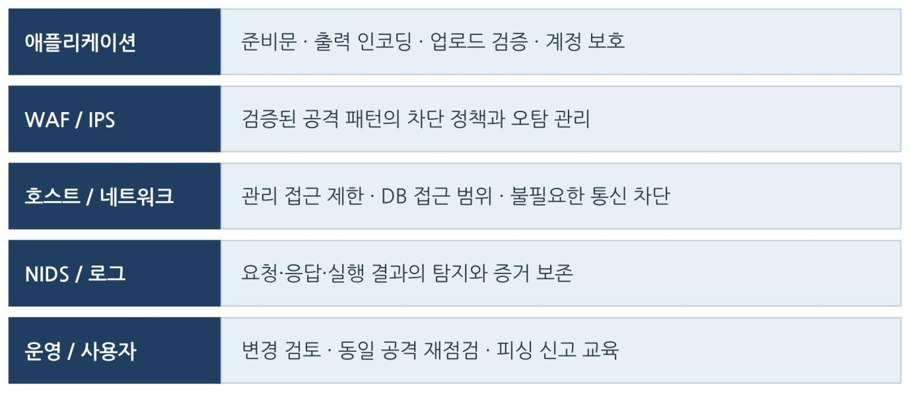

*애플리케이션·WAF·호스트·네트워크·관제별 조치 항목.*

조치 대상은 입력을 처리하는 애플리케이션, 서비스 경계의 WAF·IPS, 호스트·네트워크, 탐지·로그, 사용자 대응으로 나눔. SQL 입력 처리와 파일 실행 경로는 애플리케이션·서버의 원인 제거 대상으로 정하고, 경보·통신 제한은 공격의 관측과 경로 제한에 연결함. 사용자 대응 항목은 비정상 쿠폰·결제 요구를 식별하고 신고할 수 있는 경로로 정리함.

#### 요청 특징과 규칙 조건 연결

*요청·시각·대상에서 탐지 특징·정상 대조·Alert·Drop 정책으로 이어지는 과정.*

HTTP 요청과 화면 결과에서 규칙으로 사용할 특징을 골라 전달함. 로그인·검색은 요청 경로와 입력 특징, 업로드는 파일 형식과 실행·연결, 반복 인증은 시간창과 요청 횟수로 구분함. 규칙 담당자는 적용 엔진·필드·SID·동작을 관리하고, 정상 요청에서 오탐이 발생하는지 함께 검토함.

| 전달한 내용 | 사용한 세부 항목 | 연결된 결과 |
| --- | --- | --- |
| 대상과 요청 | 웹 경로, GET·POST, 입력 필드, 실행 시각 | 시나리오에 해당하는 이벤트 검색 |
| 입력 특징 | SQL 주석·항진식·구조 조회·파일 형식 | 규칙 매치 내용 비교 |
| 동작 특징 | 서버 외부 연결·셸 명령·반복 로그인 | 서비스·연결 단계별 이벤트 분류 |
| 정상 비교 | 일반 로그인·검색·후기·이미지 업로드 | 차단·제한 정책의 정상 기능 영향 검토 |
| 결과 상태 | 요청 처리·경보·서버 상태 | 탐지와 실제 영향의 대조 |

정상 RDP ACK가 스캔으로 분류된 사례를 네트워크 탐지의 오탐 검토 항목으로 정리함. 정상 RDP 세션의 ACK와 스캔 조건을 대조해 규칙 검토 대상으로 전달함.

#### 재시험에서 사용할 변경·응답·로그 항목

*변경 확인·동일 입력·정상 기능·로그·결과 판정의 확인 순서.*

*코드·설정 변경부터 동일 입력과 정상 업무 확인까지의 기록 흐름.*

추가 입력점은 요청 출처·소유권·출력 문맥에 따라 관리함. CSRF 후보는 토큰 이름 외에도 서버 검증과 실제 상태 변경을, 주문 취소는 소유자별 요청 결과를, 반사형 후보는 반사된 표식의 출력 문맥을 확인 항목으로 둠.

## 문제 해결

### 로그인 폼의 처리 주소 누락

링크 수집 결과에 로그인 화면이 포함돼도 폼의 `action`으로 지정한 인증 처리 주소가 누락될 수 있는 문제를 확인함.

**문제 확인 과정**

1. 링크를 따라 수집한 URL 목록에서 로그인 화면 주소를 확인함.
2. 해당 화면의 HTML 폼을 분석해 인증정보를 전송하는 `action` 주소를 확인함. 화면 주소와 실제 처리 주소가 다른 경우를 구분함.
3. 최종 검사 목록에 화면 주소만 포함되면 인증 처리 주소가 검사기로 전달되지 않는 구조를 확인함.
4. 수집 결과와 검사기에 전달할 목록을 수정 대상으로 정함. 요청 주소를 추가하면서 폼의 필드·전송 방식·인코딩도 함께 유지함.

| 단계 | 내용 |
| --- | --- |
| 문제 | 로그인 화면 주소와 실제 인증 처리 주소가 다른 경우 처리 주소 누락 |
| 원인 | 화면의 링크를 중심으로 URL 목록을 구성 |
| 수정 | 페이지 주소와 요청 주소를 각각 보존하고, 로그인 `action`을 최종 목록에 병합 |
| 결과 | 인증 처리 주소를 포함한 목록을 `SecurityScanner.scan()`에 전달 |

수집 결과와 `SecurityScanner.scan()`에 넘기는 최종 목록을 수정함. 요청 구성에는 폼의 방식·필드·인코딩을 유지함. 주소 수집과 인증 폼의 능동 검사는 분리하고, 수집된 인증 폼에도 별도 검사 정책을 적용함.

| 보존한 항목 | 처리에 사용한 위치 |
| --- | --- |
| 페이지 주소 | 폼을 발견한 화면과 수집 경로 |
| 폼의 `action` | 실제 인증정보 전송 대상 |
| `method` | GET·POST 요청 방식 |
| 입력 필드 | 요청에 들어갈 파라미터 |
| 인코딩 방식 | URL 인코딩·multipart 요청 구성 |
| 로그인 세션 | 인증 후 페이지와 폼 접근 |

수정 후 전달 구조는 수집한 페이지 목록에 로그인 처리 주소를 병합한 형태임. `SecurityScanner.scan()`은 이 최종 목록을 받으며, 각 입력점의 능동 검사 여부는 검사 정책에서 선택함. 화면을 수집하는 과정과 실제 요청을 만드는 과정 사이에서 누락되는 정보를 보완함.

### 업로드 후 연결 실패 분석

*셸 연결 성공 실행과 업로드·접근 이후 연결 실패 실행의 구분.*

업로드 점검 중 셸 연결에 실패한 실행을 확인함. 연결에 성공한 실행과 WAF·웹 접근·서버 로그를 비교하고, 파일 수용부터 외부 연결까지 단계별 차이를 정리함.

1. **성공 실행 확인**: 서버에서 시작된 연결과 셸 프롬프트가 표시된 화면을 기준으로 삼음. 파일 접근 이후 연결이 도착한 결과를 기록함.
2. **WAF 기록 확인**: 별도 실행에서 규칙 `933110`의 PHP 업로드 매치와 `action_result: 403`을 확인함.
3. **웹 접근 확인**: 업로드 경로에 대한 GET 요청과 HTTP 200 응답을 확인함. 파일을 요청한 기록을 WAF 이벤트와 별도 항목으로 정리함.
4. **연결 오류 확인**: bash 실행 시도에 이어 `no route to host`·`failed`가 나타난 실행을 확인함. 파일 수용·경로 접근 이후 외부 연결 단계에서 실패한 기록으로 분류함.
5. **결과 비교**: 각 실행의 시각·요청·응답을 유지한 채 성공 화면과 오류 로그를 비교함. 파일 처리와 외부 연결을 나눠 조치·재시험 항목에 반영함.

| 기록 | 분석 결과 |
| --- | --- |
| 셸 연결 성공 화면 | 해당 실행에서 대상 웹 서버의 실행·연결 확인 |
| WAF 규칙 `933110`, `action_result: 403` | PHP 업로드 특징이 규칙에 매치된 기록 |
| 업로드 경로 GET, HTTP `200` | 업로드 파일 경로의 접근 기록 |
| bash 실행 시도, `no route to host`·`failed` | 서버 측 명령 실행 시도 중 외부 연결 실패 |

WAF 규칙에 매치된 실행과 업로드 파일에 접근한 실행을 나눠 정리함. `no route to host`는 외부 연결 단계의 오류로 기록하고, 셸 연결 성공 화면과 비교함. 이후 점검 항목에는 위험 파일의 수용·실행 제한과 정상 이미지 업로드·표시를 함께 추가함.

## 결과와 배운 점

| 항목 | 결과 |
| --- | --- |
| 입력점 수집 | URL·폼·파라미터를 요청 구조로 저장하고 로그인 처리 주소 누락 수정 |
| 시나리오 분석 | 인증 우회, 회원 데이터 조회, 피싱 시나리오, 서버 실행, 반복 인증 결과 대조 |
| 로그 분석 | 공격 요청과 웹·WAF·DB·OS 기록 대조, SQLi·반복 로그인 탐지 이벤트 확인 |
| 결과 집계 | 자동 탐색 후보와 실제 재현 결과 분리, 서로 다른 실행의 성공·실패 기록 분리 |

조치와 재시험 항목도 시나리오별로 정리함. 공격에 사용한 입력과 정상 기능을 함께 점검하는 구성임.

| 시나리오 | 수행 결과 | 조치·재시험 항목 |
| --- | --- | --- |
| 로그인·검색 SQL Injection | 인증 우회·회원 데이터 응답, 관련 탐지 이벤트 | 동일 입력 거부와 정상 로그인·검색 |
| 저장형 콘텐츠·피싱 | 콘텐츠 재출력·가상 쿠폰·결제 흐름, 관련 탐지 | 저장 입력의 실행 제한과 정상 후기 작성·열람 |
| 업로드·서버 실행 | 대상 서버 셸 연결, 업로드·명령·연결 관련 탐지 | 위험 파일 처리 제한과 정상 이미지 업로드·표시 |
| 반복 인증 | 응답 차이·최종 로그인 상태, 반복 요청 경보 | 제한·지연·잠금 적용과 정상 로그인·계정 복구 |

[프로젝트 요약](README.md) · [포트폴리오 메인](../../README.md)
