# 대학 IT 인프라 보안 검증과 원격 점검

[프로젝트 요약](README.md) · [포트폴리오 메인](../../README.md)

[프로젝트 소개](#프로젝트-소개) · [역할](#역할) · [수행 과정](#수행-과정) · [문제 해결](#문제-해결) · [결과와 배운 점](#결과와-배운-점)

## 프로젝트 소개

> 본 프로젝트는 외부 운영망과 분리된 격리 환경에서 수행함. 본문과 증적 화면의 IP 주소·도메인은 네트워크 구성과 서비스 연동 검증을 위해 임의로 설정한 값이며, 실제 기관의 운영망이나 서비스 주소를 의미하지 않음.

본교·분교의 학사 웹, 메일, 연구 파일 서비스를 대상으로 보안 시나리오를 검증함. 레드팀에서 서비스 접근 경로와 실행 결과를 분석하고, Hoya의 원격 명령·파일 전송·웹 검사 기능을 검증함.

| 항목 | 내용 |
| --- | --- |
| 수행 기간 | 2026.09.21 ~ 2026.10.07 |
| 검증 기록 | 2026.10.08의 서비스 상태·로그 수집·차단 기록 포함 |
| 역할 | 원격 점검 기능 검증 · 서비스 보안 점검 (레드팀) |
| 환경 | GNS3·VMware, Rocky Linux·Ubuntu·Windows |
| 주요 기술 | Hoya, Wireshark, 원격 에이전트, 상호 인증서 통신, SHA-256 |

*본교·분교와 공격망·관제망 구성. OSPF 프로세스는 본교 1·분교 2 사용. WS는 웹 중계, PH는 Roundcube 앱 처리 담당.*

## 역할

| 담당 | 수행 내용 |
| --- | --- |
| 서비스 조사 | 노출 기능, 접근 가능한 서비스, 계정·권한 조건 확인 |
| 시나리오 검증 | 단계별 요청·응답과 서버 기록 대조 |
| Hoya 기능 검증 | 에이전트 등록, 원격 명령, 파일 전송 검증 |
| 검사 오류 개선 | POST 실행 오류 재현, 주소 검증 로직과 저장형 입력 판정 조건 보완 |

레드팀에서 서비스 점검과 Hoya의 요구사항 정의·실행 결과 검토를 담당함. 네트워크·서버·관제 구축은 각 담당 팀원이 수행함. Hoya 구현·테스트 코드 작성에는 AI 코딩 도구를 활용함.

## 수행 과정

**내용 바로가기**

| 구분 | 상세 내용 |
| --- | --- |
| 네트워크 배치·라우팅 | [구역·서비스 배치](#본교분교의-구역과-서비스-배치) · [OSPF](#본교-백본과-ospf-경계) · [강의·연구·학생·분교](#강의연구학생망과-분교-연결) |
| 경계·이중화 | [VLAN·HSRP·LACP](#전산망-vlanhsrplacp) · [DMZ·ASA](#dmz의-게이트웨이와-asa-경계) · [NAT·VPN](#외부-코어nat연구망-vpn) · [ACL·관리 접근](#서비스-acl과-관리-접근) |
| 웹·메일·파일 서비스 | [웹·앱·DB](#웹앱db-서비스-연결) · [MariaDB 복제](#mariadb-서비스와-복제-연결-오류) · [메일 처리](#메일-수신검사재주입최종-배달) · [파일·원격 접속](#파일-서비스와-원격-접속-중계) |
| 모니터링·로그 | [지표 수집](#서버네트워크-지표-수집) · [중앙 로그](#중앙-로그-수집과-전송-장애-분석) · [응답 상실·수집 차단](#장비-응답-상실과-수집-포트-차단) |
| 자동화·백업 | [Ansible](#ansible의-관리-대상과-작업-구성) · [RAID·백업](#raid-저장소와-대상별-백업) |
| 원격 점검·대상 조사 | [Hoya 원격 실행·파일 전송](#hoya-원격-실행과-파일-전송) · [시나리오·관측 기준](#침투-시나리오와-관측-기준) |
| 침투 시나리오 | [SCN-01 관리 단말·학사 DB](#scn-01--관리-단말에서-학사-db까지) · [SCN-02 연구 파일 서비스](#scn-02--웹-입력에서-연구-파일-서비스까지) · [SCN-03 배포 파일·가용성](#scn-03--배포-파일과-가용성-관측) |
| 탐지·통제 결과 | [관제 기록](#관제-수집과-탐지-기록-분석) · [메일·WAF·관리 계정](#메일웹관리-계정의-통제-검증) · [이행점검 연결](#시나리오별-결과와-이행점검-연결) |
| Hoya 문제 해결 | [POST 실행 오류](#post-폼-검사-실행-오류) · [저장형 입력 판정](#저장형-입력-판정-보완) |

### 본교·분교의 구역과 서비스 배치

대학망은 본교 백본, 전산, 강의·연구, 학생, DMZ와 분교의 기숙사·강의·연구·모니터링 구역으로 나뉨. 네트워크 담당자는 구역별 연결과 라우팅, 서버 담당자는 운영체제와 서비스를 구성함. 레드팀에서는 서비스가 위치한 VLAN, 외부에 노출되는 주소, 실제 요청이 통과하는 경계를 확인하고 시나리오 대상과 연결함.

#### 서버 위치와 주소의 대응

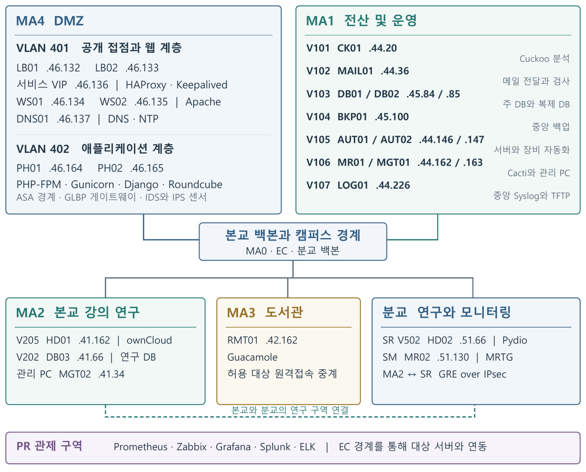

공개 접점인 LB·웹 서버와 공개 DNS는 DMZ의 VLAN 401에 배치됨. 앱 처리 서버 PH는 VLAN 402, 학사 데이터를 저장하는 DB01·DB02는 전산망의 VLAN 103에 배치됨. 웹 화면에 접속하는 주소와 실제 데이터를 조회하는 서버를 분리한 구성임.

| 구역 | 주소 블록 | 자산과 연결 |
| --- | --- | --- |
| MA0 본교 백본 | 203.230.32.0/21 | MA0-R1~R8, OSPF Area 0, 구역 경계 ABR |
| MA1 전산 | 203.230.44.0/23 | 메일·학사 DB·백업·자동화·관제·관리 단말·로그 서버 |
| MA2 강의·연구 | 203.230.40.0/23 | 강의실 DHCP·NAT, 연구 VLAN, HD01·DB03, 본교 VPN 종단 |
| MA3 학생 | 203.230.42.0/23 | 기숙사·도서관, Frame Relay, RMT01 원격 접속 중계 |
| MA4 DMZ | 203.230.46.0/23 | ASA, 라우터·L3 게이트웨이, LB·WS·PH·DNS |
| SA0 분교 백본 | 203.230.48.0/23 | SA0-R1~R3와 분교 OSPF 경계 |
| SA1 기숙사 / SA2 강의 | 203.230.50.0/25 / 203.230.50.128/25 | 분교 단말망 |
| SR 연구 / SM 모니터링 | 203.230.51.0/25 / 203.230.51.128/25 | HD02·MR02, 연구 RIPv2와 VPN |
| EC 외부 코어 | 203.230.0.0/19 | EC-R1~R4, 본교·분교·관제·보안 검증 구역 연결 |
| PR / RD | 203.230.52.0/22 / 203.230.56.0/22 | 관제 수집 / 독립 점검 구역 |

1. 각 주소를 구역에 대응시킨 뒤 단말이 사용하는 기본 게이트웨이와 서버의 실제 주소를 구분함.
2. DB 구역은 `203.230.45.80/28`이며, 게이트웨이 VIP `.81`, MA1-R1 `.82`, MA1-R2 `.83`, DB01 `.84`, DB02 `.85`로 구분됨.
3. 관리 작업에는 서비스 IP와 별도 관리망 IP를 사용함. 같은 호스트도 웹 접속, SSH 관리, 로그 송신에서 사용하는 주소가 달라 인벤토리와 NAT 변환표를 함께 대조함.
4. 운영체제는 LB·WS·PH·AUT·HD01의 Rocky Linux, DB·BKP·MR01·LOG01의 Ubuntu, DNS01의 Windows Server, MGT01의 Windows로 나뉨.

#### GNS3 연결과 논리 구역

본교 백본을 중심으로 전산·학생 구역, 강의·연구 구역, DMZ, 분교를 연결함. GNS3의 링크에서는 장비명과 인터페이스를 확인하고, 논리 구성에서는 해당 연결이 속한 라우팅 영역과 서버 역할을 대조함.

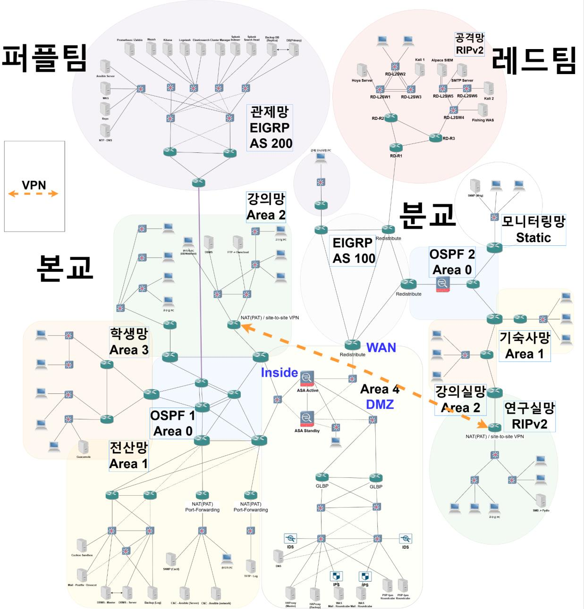

본교는 OSPF 프로세스 1의 Area 0을 중심으로 전산 Area 1, 강의·연구 Area 2, 학생 Area 3, DMZ Area 4를 연결함. 분교는 OSPF 프로세스 2를 사용하며 연구 구역에서 RIPv2와 연계됨. 외부 코어의 EIGRP와 본교 내부 OSPF, 분교 연구망의 RIP는 경계 장비의 재분배를 통해 연결됨. 연구망 VPN은 본교 MA2-R2와 분교 SR-R1 사이에 별도로 구성됨.

#### 업무 요청과 운영 통신의 구분

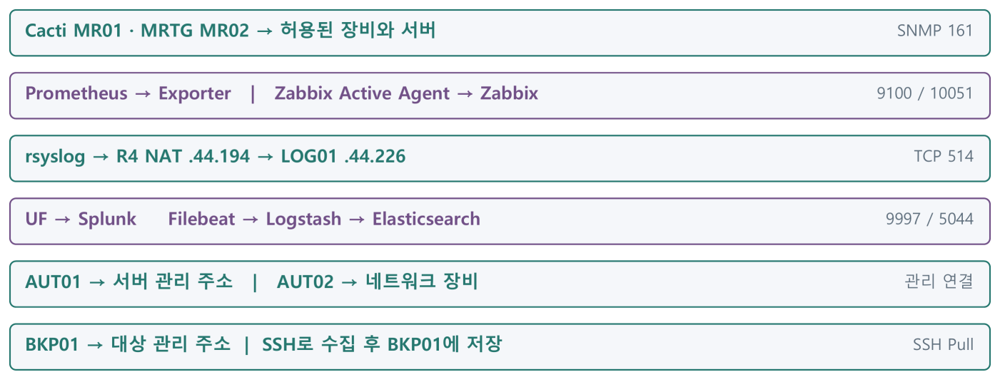

사용자의 웹·메일·파일 요청과 장비 운영 통신은 연결을 시작하는 호스트가 다름. Prometheus와 SNMP는 수집기가 대상에 접속하고, Zabbix Active·rsyslog·Filebeat·Splunk Forwarder는 대상 호스트가 수집 서버로 연결함. 백업은 BKP01이 관리망의 대상에 SSH로 접속해 파일을 가져오는 구조임.

| 통신 | 시작 지점 → 목적지 | 대조한 항목 |
| --- | --- | --- |
| SNMP | MR01 Cacti·MR02 MRTG → 장비·서버 | UDP 161, 허용 출발지, 대상 인터페이스 |
| 서버 지표 | Prometheus → Exporter | TCP 9100, 프로세스, scrape 상태 |
| Active 지표 | Agent → Zabbix | TCP 10051, ServerActive, Hostname |
| Syslog | 대상 서버 → R4 NAT → LOG01 | TCP 514, 송신 주소와 저장 파일 |
| 로그 분석 | Filebeat → Logstash / Forwarder → Splunk | TCP 5044 / 9997, 최근 수신 기록 |
| 자동화 | AUT01·AUT02 → 관리 대상 | 서비스 주소와 관리 주소, OS별 접속 방식 |
| 백업 | BKP01 → 대상 관리 주소 | SSH 연결, 수집 범위, 저장 결과 |

### 본교 백본과 OSPF 경계

#### MA0의 다중 경로와 ABR

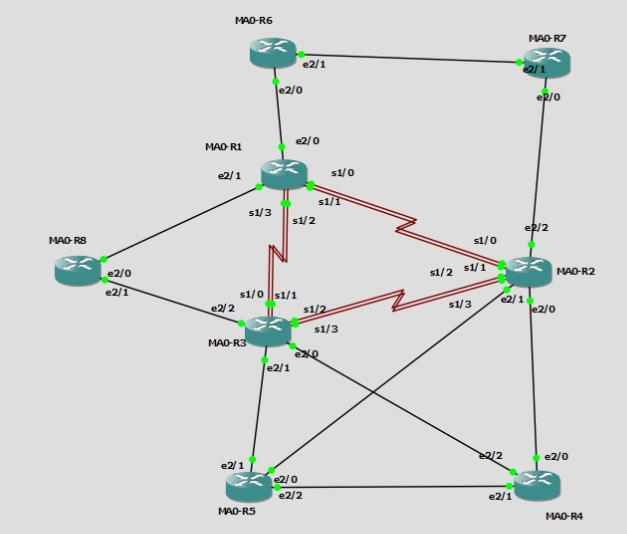

MA0-R1~R3 사이에는 복수 Serial 링크를 두고, 바깥쪽 R4~R8에서 각 업무 영역으로 연결함. MA0-R4·R5는 전산망, R6·R7은 강의·연구망, R8은 학생망 경계를 담당함. R4·R7은 DMZ Area 4에도 연결됨.

MA0-R6의 Ethernet2/0은 `203.230.33.130/26`, Ethernet2/1은 `203.230.35.193/26`, 강의망 방향 Ethernet2/2는 `203.230.40.1/25`로 구성됨. 단말에서 서버까지 경로를 확인할 때 해당 단말의 게이트웨이, 구역 라우터, ABR, 목적 구역의 게이트웨이 순서로 대조함.

#### OSPF 프로세스와 외부 경로

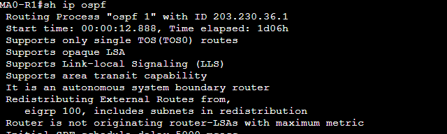

`show ip ospf` 출력에서 프로세스 1과 Router ID `203.230.36.1`을 확인함. `autonomous system boundary router`와 `Redistributing External Routes from eigrp 100`이 출력되어, MA0-R1이 내부 OSPF 경로와 외부 EIGRP 경로의 접점임을 확인함.

1. 구역 사이의 OSPF 인접 관계와 외부 프로토콜 재분배를 구분함.
2. 내부 Area 경계는 ABR의 영역 설정과 연결 인터페이스를 확인함.
3. 외부 경로는 ASBR의 재분배 대상과 경로 정보원을 확인함.
4. 반환 경로까지 연결되는지 목적 대역의 경로 코드와 next hop을 함께 대조함.

#### 강의망 Stub과 DMZ NSSA

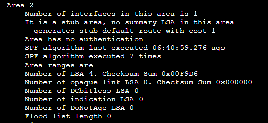

Area 2는 `stub area, no summary LSA`로 표시되며, 기본 경로 비용 1이 출력됨. 강의·연구망에서 모든 외부 경로를 전달받는 대신 ABR 방향의 기본 경로를 사용하는 구성임. MA0-R6의 OSPF 설정에는 Area 0의 두 대역과 Area 2의 `203.230.40.0/25`, `area 2 stub no-summary`가 연결됨.

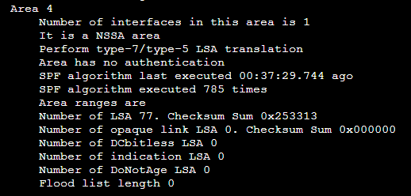

Area 4는 NSSA이며 Type 7→Type 5 LSA 변환 역할이 출력됨. 강의망 Area 2의 Stub, DMZ Area 4의 NSSA 설정을 각각 대조함. 장비 출력에서 Area 번호, 영역 종류, 연결 인터페이스 수와 LSA 값을 확인함.

### 전산망 VLAN·HSRP·LACP

#### 서비스 구역과 관리·로그 접점

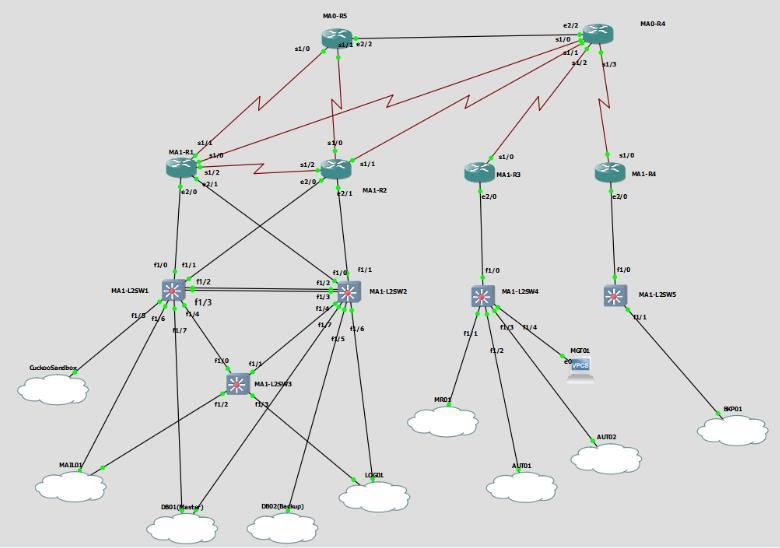

MA1-R1·R2는 전산 서버의 서비스 게이트웨이를 이중화하고, MA1-R3는 관리·자동화 구역, MA1-R4는 LOG01의 전용 구역을 연결함. 전산 스위치는 R1·R2로 교차 연결되고 상위 MA0-R4·R5로 백본에 연결됨.

| 구분 | 실제 구성 |
| --- | --- |
| 메일 | MAIL01 `203.230.44.36`, VLAN 102 |
| 학사 DB | DB01 `.45.84`, DB02 `.45.85`, VLAN 103 |
| 백업 | BKP01 `.45.100`, VLAN 104 |
| 자동화 | AUT01 `.44.146`, AUT02 `.44.147`, VLAN 105, GW `.44.145` |
| 관리·관측 | MR01 `.44.162`, MGT01 `.44.163`, VLAN 106, GW `.44.161` |
| 중앙 로그 | 외부 접점 `.44.194` → LOG01 `.44.226` |

#### VLAN 할당과 Spanning Tree

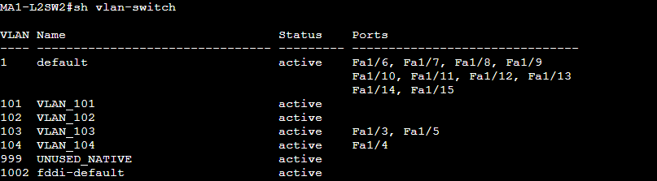

VLAN 상태에서 DB 구역 VLAN 103은 Fa1/3·Fa1/5, 백업 구역 VLAN 104는 Fa1/4에 연결됨. VLAN 999는 `UNUSED_NATIVE`로 등록됨. 서버 접점의 Access VLAN과 R1·R2 업링크의 802.1Q Trunk를 구분함.

동일 스위치의 `show spanning-tree summary`에서 VLAN 103·104의 Root bridge 상태를 확인함. VLAN 101·102는 Secondary, VLAN 103·104는 Primary로 역할이 배치됨. 서버 Access 포트의 VLAN 번호와 업링크 Trunk의 허용 VLAN, Spanning Tree 전달 상태를 대조함.

#### HSRP 가상 IP와 역할 전환

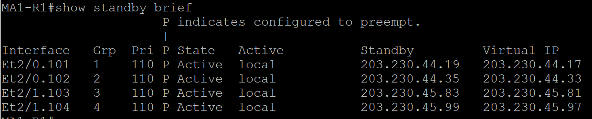

전환 전 MA1-R1의 그룹 1~4는 모두 `Active local`이며 Priority 110과 preempt가 설정됨. 서버가 사용하는 VIP는 그룹별로 `203.230.44.17`, `.44.33`, `.45.81`, `.45.97`임. DB VLAN 103은 실제 라우터 주소 `.45.82`와 별도로 VIP `.45.81`을 사용함.

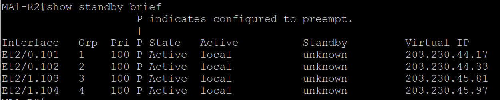

전환 후 MA1-R2에서는 그룹 1~4가 모두 `Active local`로 표시됨. Priority는 100이며 서버가 참조하는 VIP는 그대로 유지됨. 상대 대기 장비는 `Standby unknown`으로 표시돼 전환 당시의 상태로 함께 기록함.

1. 전환 전 R1의 Active 상태와 그룹별 VIP를 확인함.
2. 전환 후 R2에서 동일 그룹과 VIP가 Active로 표시되는지 대조함.
3. DB VLAN의 라우터 실제 주소 `.82/.83`과 서버의 기본 게이트웨이 `.81`을 나눠 확인함.
4. HSRP 역할 인계 결과와 게이트웨이 응답, 업무 세션의 유지 여부를 각각 구분함.

#### LACP 구성원과 종단 응답의 차이

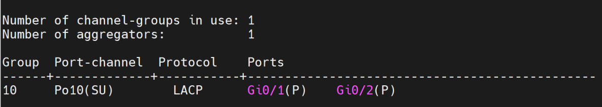

초기 `show etherchannel summary`에는 `Po10(SU)`, 프로토콜 `LACP`, `Gi0/1(P)`, `Gi0/2(P)`가 표시됨. 두 물리 링크가 같은 논리 채널의 구성원으로 사용되는 상태임.

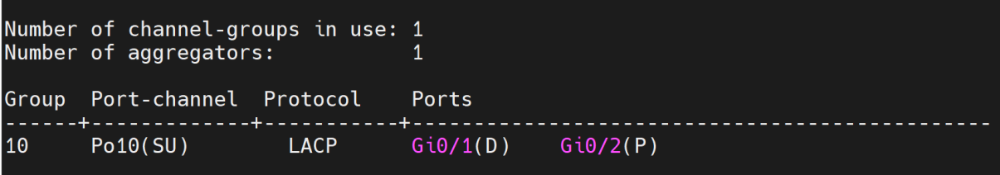

Gi0/1을 중단한 뒤 해당 구성원은 `(D)`, Gi0/2는 `(P)`로 표시됨. `Po10(SU)` 표시가 유지된 상태에서 아래의 BKP01 연속 Ping 결과를 비교함.

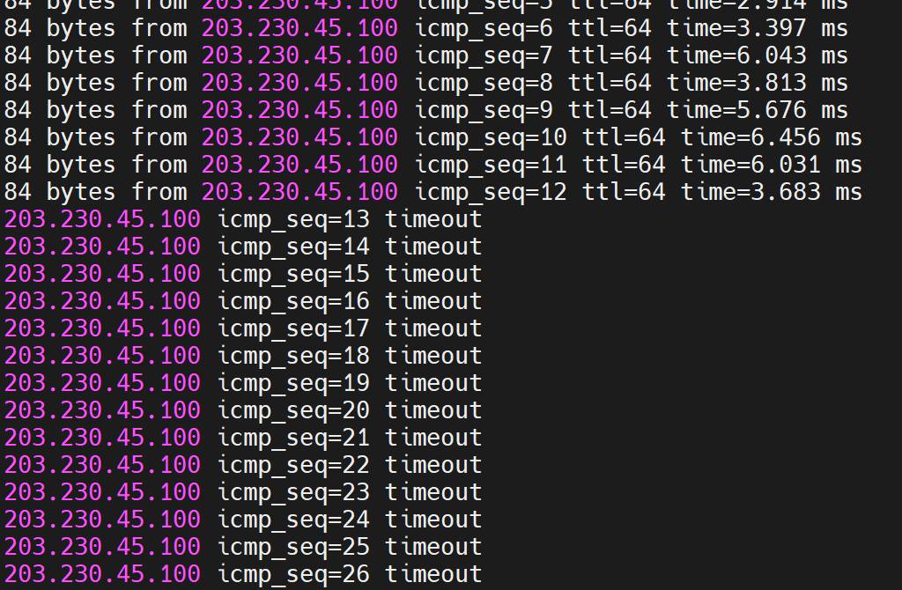

`203.230.45.100`의 연속 Ping은 seq 12까지 응답하고 seq 13부터 timeout으로 바뀜. 잔여 구성원과 Port-channel 표시가 유지되는 동안 실제 서버 응답은 중단됨. Gi0/1 재활성화 후 Ping 응답 복구가 확인됨.

장애 분석은 구성원 상태, Trunk 허용 VLAN, Port-channel의 송수신 카운터, 실제 전달 경로 순서로 진행함. `show etherchannel summary`, `show interfaces trunk`, `show interfaces port-channel 10` 출력을 BKP01의 응답 중단·복구 시점과 대조함.

### 강의·연구·학생망과 분교 연결

#### 강의실 DHCP와 연구 VLAN

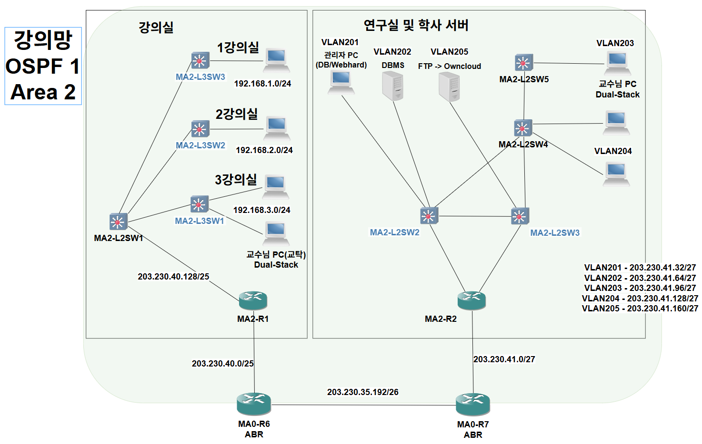

강의실은 `192.168.1.0/24` 등 단말 대역과 DHCP·NAT를 사용함. 연구 서버는 VLAN 202의 DB03과 VLAN 205의 HD01로 분리됨. 강의망은 MA0-R6, 연구망은 MA0-R7을 통해 백본에 연결됨.

| 대상 | 주소와 설정 |
| --- | --- |
| 강의실 단말 GW | Vlan1 `192.168.1.1/24` |
| 강의실 업링크 | Fa0/0 `203.230.40.130/25` |
| 연구 DB | VLAN 202 `203.230.41.64/27`, DB03 `.66` |
| 연구 파일 서버 | VLAN 205 `203.230.41.160/27`, HD01 `.162` |
| 연구망 외부 접점 | MA2-R2 `203.230.41.2`, PAT·Tunnel2 |

DHCP binding에서 `192.168.1.2`와 `Automatic` 임대를 확인함. 임대 주소와 기본 게이트웨이 `.1`을 확인한 뒤 장비 업링크와 NAT 경로를 대조함. MA2-R1↔R2의 Tunnel0은 IPv6 연동, Tunnel2는 연구망 VPN에 사용됨.

#### 학생망 Frame Relay

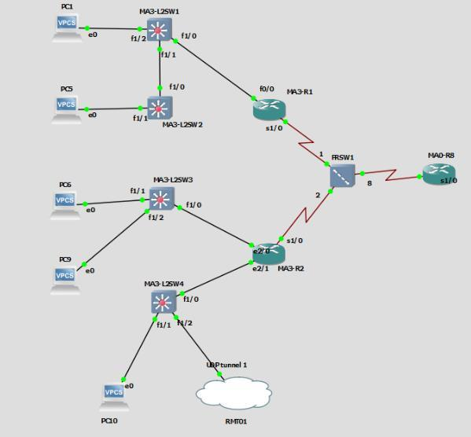

MA3-R1은 기숙사 단말, MA3-R2는 도서관 단말과 RMT01을 수용함. 두 라우터는 FRSW1을 거쳐 백본 MA0-R8로 연결됨. 도서관의 RMT01은 사용자 브라우저와 허용된 원격 관리 대상 사이의 세션 중계를 담당함.

MA0-R8의 `Serial1/0.812`에서 `203.230.42.2`는 DLCI 801, `.42.3`은 DLCI 802에 대응됨. 두 매핑 모두 `status defined, active`로 표시됨. Frame Relay map의 상대 IP·로컬 DLCI·상태를 확인한 뒤 목적 대역의 라우팅과 단말 게이트웨이를 대조함.

#### 분교 구역별 경로

분교의 외부 접점은 EC-R4이며, SA0 백본에서 기숙사 SA1, 강의 SA2, 연구 SR, 모니터링 SM으로 연결됨. SA0-R1은 학생·강의 구역, SA0-R3는 모니터링 구역의 경계를 맡음. SA2-R2는 OSPF와 연구 RIPv2를 연결하며, SR-R1은 연구 VLAN과 본교 VPN을 처리함.

| 분교 구역 | 연결 경로 | 자산 |
| --- | --- | --- |
| 기숙사 | SA0-R1 → SA1-R1 | 203.230.50.0/25 단말 |
| 강의 | SA0-R1 → SA2-R1 | 203.230.50.128/25 단말 |
| 연구 | SA2-R2 → SR-R1 | HD02 `203.230.51.66`, 연구 VLAN 501·502 |
| 모니터링 | SA0-R3 → SM-L2SW1 | MR02 `203.230.51.130` |

### DMZ의 게이트웨이와 ASA 경계

#### 외부·교내 경계와 서버 수용

DMZ는 외부 EC-R2, 교내 MA0-R4·R7과 연결됨. ASA 쌍 아래 MA4-R1·R2, L3SW1·2가 교차 연결되고, L2SW1·2에서 LB·웹·앱·DNS와 센서를 수용함.

VLAN 401에는 LB01 `.46.132`, LB02 `.133`, WS01 `.134`, WS02 `.135`, 서비스 VIP `.136`, DNS01 `.137`이 배치됨. VLAN 402에는 PH01 `.46.164`, PH02 `.165`가 배치됨. WS에서 PH로 요청을 전달할 때 VLAN 경계를 통과하며, 웹 수신 포트와 앱 처리 포트의 정책 적용 위치도 달라짐.

#### GLBP Active·Standby와 VLAN별 우선순위

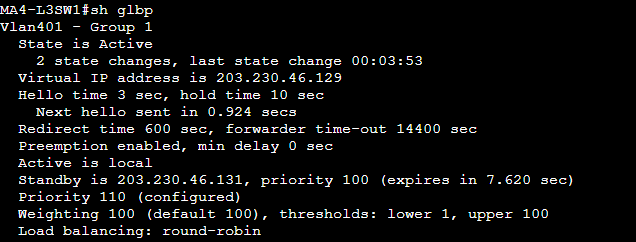

L3SW1의 그룹 1은 `Active`, VIP `203.230.46.129`, Priority 110, 부하 분산 방식 `round-robin`으로 표시됨. 상대 Standby는 `.46.131`, preemption은 enabled로 출력됨.

L3SW2의 동일 그룹은 `Standby`, Priority 100이며 Active 주소 `.46.130`을 인식함. 두 장비의 출력에서 VIP와 그룹 번호는 같고 실제 주소와 우선순위가 다름을 대조함.

| 항목 | VLAN 401 | VLAN 402 |
| --- | --- | --- |
| 대역 / VIP | `.46.128/27` / `.129` | `.46.160/27` / `.161` |
| SW1 / SW2 실제 주소 | `.130` / `.131` | `.162` / `.163` |
| AVG 우선순위 | SW1 110 / SW2 100 | SW1 100 / SW2 110 |
| STP 우선 루트 | MA4-L3SW1 | MA4-L3SW2 |

GLBP의 Active·Standby 관리 역할과 실제 패킷을 전달하는 Forwarder 역할을 대조함. VLAN별 게이트웨이 우선순위는 GLBP 출력, 우선 루트는 Spanning Tree 출력으로 확인함.

#### ASA 수동 절체

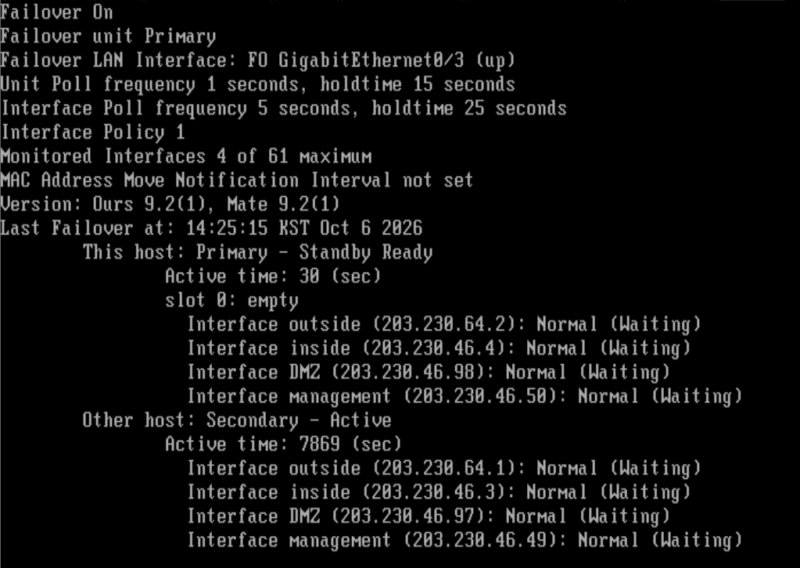

`show failover`에서 Primary는 `Standby Ready`, 다른 장비인 Secondary는 `Active`로 표시됨. Failover LAN 인터페이스는 GigabitEthernet0/3이며, 장비 역할과 함께 Outside·Inside·DMZ의 주소 인계를 대조함.

| 인터페이스 | 주소 쌍 | 역할 |
| --- | --- | --- |
| G0/0 Outside | 203.230.64.1 / .2 | 외부 경계 |
| G0/1 Inside | 203.230.46.3 / .4 | 교내 경계 |
| G0/2 DMZ | 203.230.46.97 / .98 | 서버 구역 |
| G0/3 Failover | 203.230.46.33 / .34 | 역할 감시 |

VLAN 402의 GLBP VIP `.46.161` 점검에서는 ASA가 `Normal (Waiting)`을 표시하고 CLI에서 응답을 인식하지 못했지만, Wireshark에는 Echo Reply가 관측됨. 수동 절체는 장비 역할 인계까지 확인했으며, 기존 사용자 세션의 유지 여부는 별도 검증 항목으로 남김.

### 외부 코어·NAT·연구망 VPN

#### 경계 프로토콜의 재분배

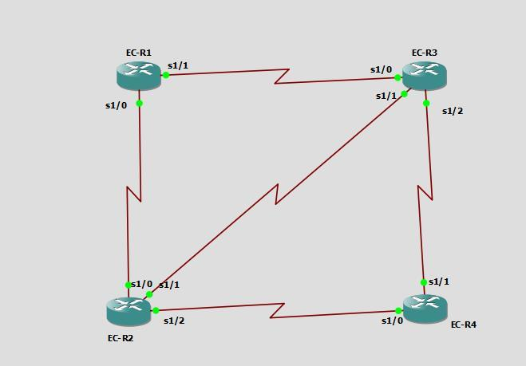

EC-R1은 관제, R2는 본교, R3은 독립 점검 구역, R4는 분교의 경계를 담당함. 네 라우터 사이에 복수 Serial 경로를 구성하고, 업무망 OSPF와 외부 EIGRP, 연구 RIPv2의 접점에서 경로를 재분배함.

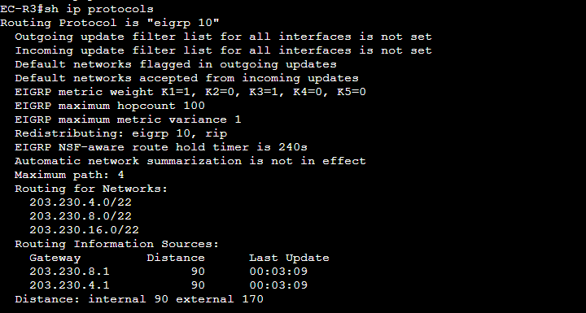

EC-R3의 EIGRP AS 10 출력에서 참여 대역 `203.230.4.0/22`, `.8.0/22`, `.16.0/22`와 RIP 재분배를 확인함. 경로 정보원 `.8.1`, `.4.1`, 기본 Administrative Distance의 internal 90·external 170도 출력됨. 별도 RIP 출력은 send version 2·receive version 2와 점검 구역 `203.230.56.0`의 정보원 `.56.2`를 사용함.

본교 MA0-R1의 EIGRP 100 재분배와 EC-R3의 EIGRP 10·RIP 연동을 구분함. 서비스 접근 오류에서는 요청 방향의 경로뿐 아니라 응답이 돌아갈 경로 코드 D·O·R과 next hop을 함께 확인함.

#### PAT 세션과 송신 호스트 식별

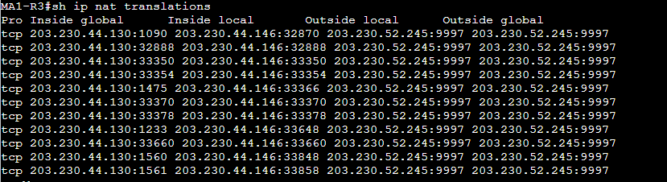

NAT 변환표에는 내부 AUT01 `203.230.44.146`이 외부 접점 `.44.130`으로 변환되어 수집 서버 `.52.245:9997`에 연결되는 세션이 표시됨. 같은 목적지로 여러 세션이 있어 내부 주소·원본 포트·변환 포트를 함께 대응시킴.

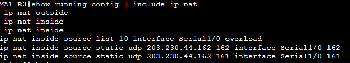

MA1-R3에서는 VLAN 105·106에 PAT를 적용하고 MR01 `.44.162`의 UDP 161·162를 정적으로 매핑함. Push 로그는 내부에서 외부 수집 서버로 시작되지만, SNMP Pull은 외부에서 내부 대상으로 시작되므로 목적지 매핑과 허용 출발지를 따로 확인함.

| 경계 | 내부 대상 | 외부에서 관찰하는 접점 |
| --- | --- | --- |
| MA1-R3 | AUT01·02, MR01, MGT01 | `.44.130`, PAT와 SNMP 포트 매핑 |
| MA1-R4 | LOG01 `.44.226` | `.44.194`, TFTP 69·로그 514 |
| MA2-R2 / SR-R1 | 본교 / 분교 연구 VLAN | `.41.2` / `.51.2`, PAT와 VPN |

관리 단말의 직접 주소 `.44.163`과 PAT 이후 `.44.130`을 당시 변환표·연결 경로로 대응시킴. 외부 수집 기록의 주소를 내부 호스트의 세션과 연결함.

#### GRE와 IPsec의 구간별 확인

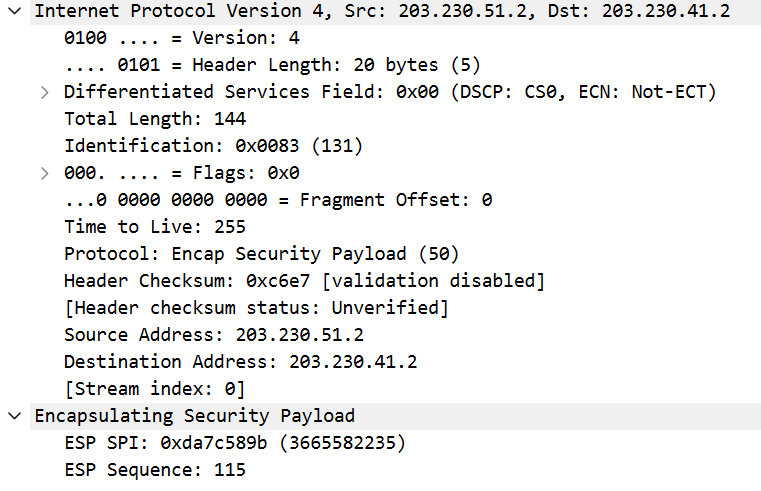

Wireshark에는 외부 피어 `203.230.51.2 → 203.230.41.2` 사이의 패킷이 IP 프로토콜 50 ESP로 표시됨. 연구 서버의 내부 주소와 암호화 통신이 관찰되는 외부 피어 주소를 구분함.

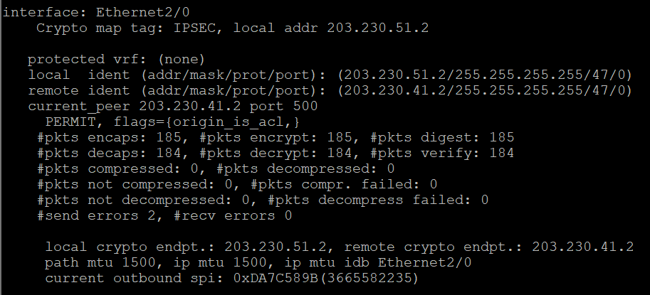

SR-R1의 IPsec 상태에는 local `.51.2`, remote `.41.2`, 보호 대상 프로토콜 47(GRE)이 표시됨. `encaps/encrypt` 185, `decaps/decrypt` 184로 암복호화 패킷을 확인함. 같은 시점의 `send errors 2`, `recv errors 0`을 기록해 송신 오류도 함께 검토함.

1. 본교 Tunnel2는 `10.255.0.1/30`, 분교는 `10.255.0.2/30`으로 구성됨.
2. 본교의 tunnel source는 Ethernet2/0, destination은 `203.230.51.2`이며 mode는 GRE IP임.
3. 터널 MTU 1400, TCP MSS 1360을 적용하고 연구 VLAN 501·502의 경로를 분교 터널 주소로 전달함.
4. IKEv1·IPsec transport mode에서 GRE 트래픽을 보호하고, SA·암복호화 카운터·양방향 패킷을 대조함.
5. IPv6 over IPv4용 Tunnel0과 연구망 GRE용 Tunnel2의 목적을 구분함. 종단 파일 서비스 연결은 터널 상태와 별도로 확인함.

### 서비스 ACL과 관리 접근

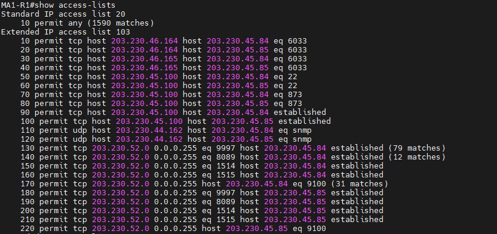

MA1-R1의 ACL 103은 PH→DB, BKP→DB SSH·rsync, MR01→DB SNMP와 관제 포트를 출발지별로 구분함. 화면에서 출발지 포트 9997·8089의 `established` 규칙은 각각 79·12 matches, 목적지 포트 9100은 31 matches로 표시됨.

PH→DB 규칙에 보이는 6033은 실제 DB01 서비스 포트 3306과 불일치함. DB listener와 호스트 INPUT 정책에서 앱·복제 포트를 대조하고, 라우터 ACL의 주소·포트 조합을 수정 확인 항목으로 남김. `established` 규칙은 TCP ACK/RST 비트 조건으로 확인함.

관리 접속은 MA1-R3의 직접 관리 경로에서 MGT01 `.44.163`, AUT02 `.44.147`을 허용하는 VTY 정책으로 설계됨. SSHv2, 접속 제한 60초, 인증 재시도 3회, 유휴 10분을 사용하고 전체 VTY에 같은 접근 제한을 적용하는 구성임. 서비스 트래픽의 ACL과 관리 접속의 `access-class`를 분리해 확인함.

### 웹·앱·DB 서비스 연결

#### 서비스별 서버 위치

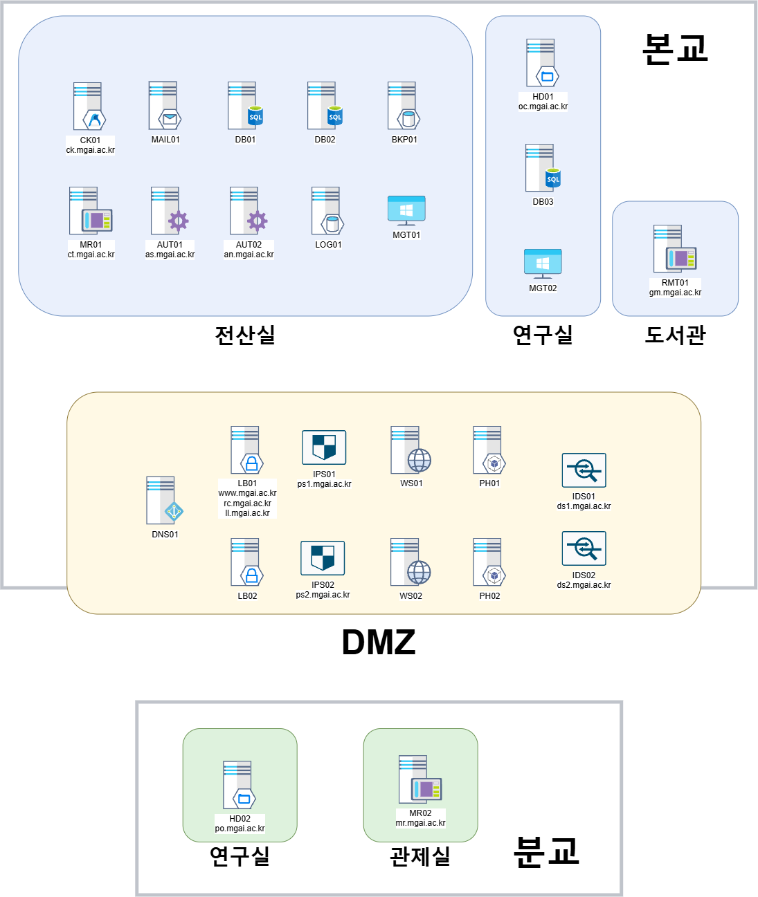

웹 요청은 DMZ의 LB→WS→PH를 거쳐 전산 구역의 DB01로 전달됨. 외부 SMTP는 LB→MAIL01, 연구 파일은 HD01→DB03 또는 HD02 내부 DB, 원격 접속은 RMT01→허용 관리 대상의 경로를 사용함. 같은 서버 구역에서도 웹 백엔드, 앱 실행, DB, 메일의 포트가 달라 요청 종류별로 경로를 나눠 확인함.

#### Keepalived의 VIP 구성

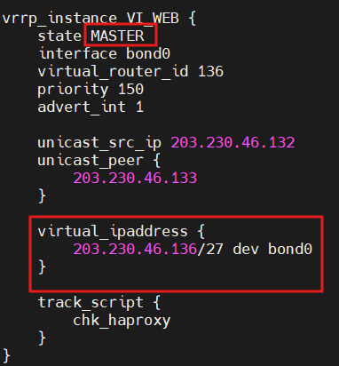

LB01의 `VI_WEB`은 `state MASTER`, `interface bond0`, `virtual_router_id 136`, `priority 150`, `advert_int 1`로 구성됨. unicast source는 `203.230.46.132`, peer는 `.46.133`이며 VIP는 `.46.136/27`로 설정됨. `track_script chk_haproxy`가 HAProxy 상태와 VIP 유지 조건을 연결함.

Keepalived는 LB 사이의 서비스 VIP 소유권을 관리함. GLBP의 VIP `.46.129`는 VLAN의 기본 게이트웨이임. 서비스 접속 주소의 인계는 Keepalived에서, 서버의 게이트웨이 상태는 GLBP에서 확인함.

#### HAProxy의 웹·메일 백엔드

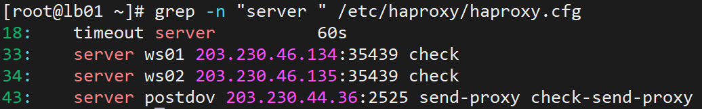

HAProxy에는 WS01 `203.230.46.134:35439`, WS02 `.135:35439`가 각각 `check` 대상으로 등록됨. 메일 백엔드는 `203.230.44.36:2525`이며 `send-proxy check-send-proxy`가 지정됨. 웹 요청 전달과 메일 SMTP 전달이 같은 LB를 통과하더라도 별도 백엔드로 처리되는 구성임.

| 연결 | 설정값 | 상태 확인 대상 |
| --- | --- | --- |
| 사용자→서비스 VIP | `.46.136`, TCP 80·443·25 | 공개 접점과 요청 종류 |
| LB01↔LB02 | `.46.132` / `.46.133`, VRRP | VIP 소유권과 HAProxy 상태 연계 |
| LB→WS01·02 | `.46.134/.135:35439` | 웹 백엔드 접속과 health check |
| LB→MAIL01 | `.44.36:2525` | SMTP와 PROXY protocol 처리 |

#### LB→WS→PH→DB의 포트 대응

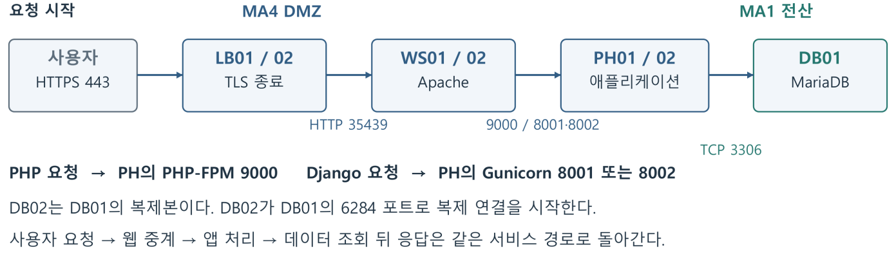

1. 사용자가 VIP의 HTTPS 443으로 접속함.
2. LB가 TLS를 처리하고 WS01·WS02의 HTTP 35439로 요청을 전달함.
3. WS의 Apache가 PHP 요청을 PH의 PHP-FPM 9000, Django 요청을 Gunicorn 8001·8002로 전달함.
4. PH의 앱은 전산 구역 DB01 `203.230.45.84:3306`에 연결해 데이터를 조회·기록함.
5. DB02는 별도 복제 연결로 DB01의 변경 데이터를 수신함. 앱 연결의 3306과 복제 연결의 6284를 나눠 확인함.

WS와 PH는 각각 VLAN 401·402이므로 웹 백엔드 접근과 앱 실행 전달의 경계가 다름. 요청이 WS에 도착하지 않으면 LB 백엔드와 호스트 수신 정책을, WS 도착 후 오류가 나면 Apache의 전달 설정과 PHP·Django 처리 기록을 대조함.

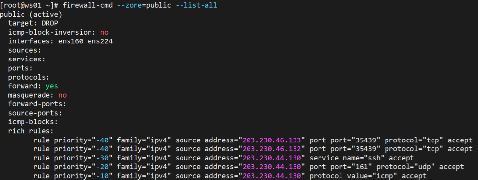

WS01의 public zone은 기본 target이 DROP이며, LB01 `.46.132`와 LB02 `.46.133`에서 오는 TCP 35439를 rich rule로 허용함. 웹 백엔드 접속은 LB 출발지에 한정하고, 관리·관측 출발지에는 SNMP·ICMP 규칙을 따로 적용한 구성임.

#### 연구 파일 서비스의 DB 암호화 통신

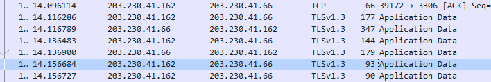

패킷은 HD01 `203.230.41.162`와 DB03 `203.230.41.66` 사이의 TCP 3306 연결이며, 이후 패킷에 `TLSv1.3 Application Data`가 표시됨. ownCloud의 파일 메타데이터를 별도 DB에서 처리하는 연구망 세션임. 웹·학사 서비스의 PH→DB01과 다른 호스트 쌍으로 구분해 기록함.

### MariaDB 서비스와 복제 연결 오류

#### 앱 접속과 복제 대상의 분리

DB01은 앱과 Cacti의 일반 접속을 수신하고 DB02의 복제 연결도 처리함. 앱과 복제 연결은 목적 서버가 같지만 출발지와 수신 포트가 다름. DB01 `.45.84`, DB02 `.45.85`를 기준으로 host 방화벽과 복제 설정을 대조함.

INPUT 정책에서는 PH01·PH02와 Cacti 관련 출발지의 TCP 3306, DB02 출발지의 TCP 6284가 나뉘어 허용됨. 접속 오류는 출발지 주소, 요청 포트, DB listener와 INPUT 규칙을 대응시켜 확인함.

#### 포트 불일치와 상태 변화

초기 복제는 DB01의 3306으로 연결을 시도했으나 DB02에 허용된 복제 포트는 6284였음. 연결 시간 초과와 I/O 스레드 상태를 확인한 뒤 서버 담당자가 `MASTER_PORT`를 6284로 맞춤.

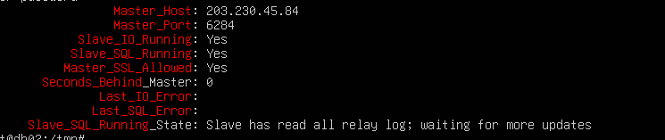

| 필드 | 화면의 값 | 의미 |
| --- | --- | --- |
| Master_Host | 203.230.45.84 | 복제 원본 DB01 |
| Master_Port | 6284 | 복제 연결 포트 |
| Slave_IO_Running | Yes | 원본의 변경 로그 수신 스레드 동작 |
| Slave_SQL_Running | Yes | 수신 로그 적용 스레드 동작 |
| Master_SSL_Allowed | Yes | 복제 연결의 SSL 사용 허용 |
| Seconds_Behind_Master | 0 | 관측 시점의 복제 지연 |
| Slave_SQL_Running_State | Slave has read all relay log; waiting for more updates | 현재 relay log 적용 후 다음 변경 대기 |

1. 앱 접속 3306과 복제 접속 6284를 별도 연결로 정리함.
2. 복제 원본 주소와 `MASTER_PORT`, DB01 INPUT 규칙의 출발지·목적지 포트를 대조함.
3. 수정 후 I/O와 SQL 스레드가 모두 Yes인지 확인함.
4. SQL 스레드 상태와 당시 지연 0초를 확인함. 해당 값은 캡처 시점의 복제 상태로 기록함.
5. 중간 라우터 ACL의 6033 표기는 서버 설정과 불일치하는 별도 항목으로 구분함.

### 메일 수신·검사·재주입·최종 배달

#### 외부 SMTP와 웹메일의 접점

PH의 Roundcube는 웹메일 화면을 제공함. 실제 SMTP 전송과 IMAP 메일함 조회는 MAIL01의 Postfix·Dovecot에 연결됨. 외부 SMTP는 공개 VIP의 25번 포트로 들어와 LB에서 MAIL01의 2525로 전달됨.

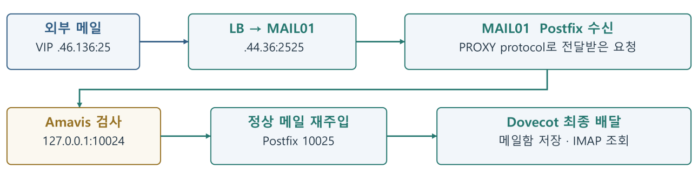

메일 처리는 공개 수신, 검사, 재주입, 최종 배달의 단계로 나뉨. MAIL01 내부의 Amavis는 `127.0.0.1:10024`에서 검사하고 정상 메시지는 Postfix 10025로 재주입됨. 최종 사용자 메일함의 배달은 Dovecot 기록으로 확인함.

| 단계 | 연결·처리 | 확인한 필드 |
| --- | --- | --- |
| 공개 수신 | VIP:25 → MAIL01:2525 | smtpd 접수와 PROXY protocol |
| 첨부 검사 | Postfix → Amavis:10024 | CLEAN 또는 INFECTED |
| 정상 재주입 | Amavis → Postfix:10025 | queued_as와 변경된 queue ID |
| 최종 배달 | Postfix → Dovecot | delivered via dovecot service |
| 차단 처리 | ClamAV 탐지 → Amavis 격리·폐기 | FOUND, Blocked INFECTED, Quarantined, discarded |

#### 정상 메일의 큐 연결

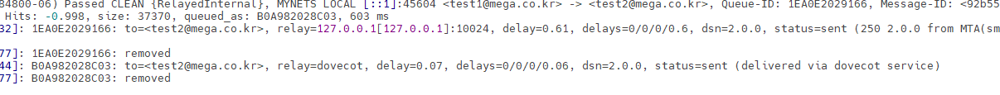

정상 메일 로그에는 `Passed CLEAN`과 `queued_as`가 나타남. `queued_as`에 표시된 새 queue ID를 따라 재주입 이후의 기록을 조회하고 `delivered via dovecot service`까지 확인함.

1. 최초 접수의 queue ID와 Amavis 검사 결과를 찾음.
2. `Passed CLEAN` 뒤 `queued_as`의 새 ID를 확인함.
3. 새 ID의 Dovecot 전달·큐 제거 기록을 대조함.
4. 수신 화면의 첨부 표시까지 확인해 서버 배달 기록과 사용자 결과를 연결함.

#### 의심 첨부의 격리·폐기

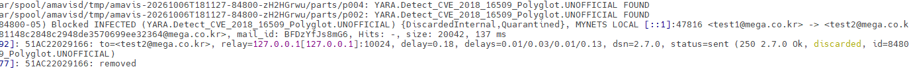

의심 첨부에서는 파일 부분에 `YARA.Detect_CVE_2018_16509_Polyglot.UNOFFICIAL FOUND`가 기록됨. Amavis는 `Blocked INFECTED`, `DiscardedInternal`, `Quarantined`로 처리하고 이어지는 전송 기록에 `250 2.7.0 Ok, discarded`가 나타남.

이 로그에서는 SMTP 250과 `status=sent`가 있어도 최종 처리 내용은 discarded임. 전송 단계의 접수 응답과 메일함 최종 배달을 구분함. 정상 메일과 같은 방식으로 큐를 추적하되 종료 지점이 Dovecot인지 격리·폐기인지로 결과를 나눔.

#### 정책 이벤트와 수신 첨부

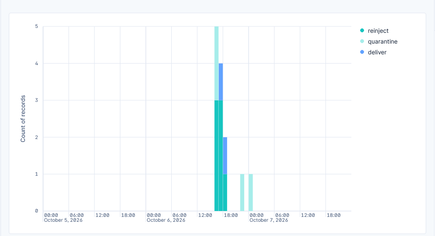

중앙 화면은 action별 이벤트 발생 추이를 보여 줌. `reinject`, `quarantine`, `deliver`를 구분해 검사 후 재주입·격리·배달 동작이 어느 시점에 발생했는지 확인함. 이벤트 집계와 개별 SMTP 큐는 서로 다른 관찰 단위이므로 특정 메시지의 최종 상태는 해당 큐 로그와 연결함.

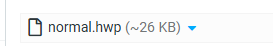

수신 화면에는 `normal.hwp` 첨부가 약 26 KB로 표시됨. 정상 첨부의 배달 결과는 악성 첨부 차단과 별도 시험으로 구분함.

메일 헤더의 `X-Virus-Scanned`에 Amavis 검사 표시가 남음. 검사 헤더, Dovecot 배달 기록, 첨부 표시가 각각 검사 통과·서버 배달·사용자 수신의 확인 지점임.

### 파일 서비스와 원격 접속 중계

#### ownCloud·Pydio·Guacamole의 처리 위치

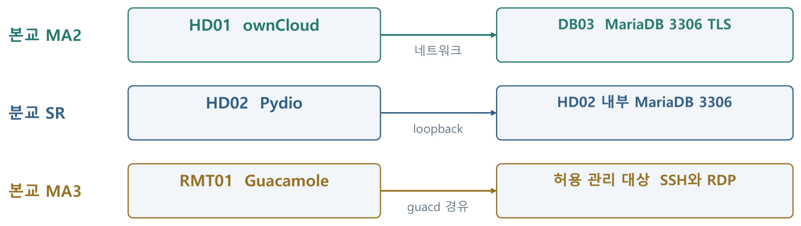

HD01의 ownCloud는 파일을 본교 연구 서버에 저장하고 메타데이터를 별도 DB03에 보관함. Redis는 HD01의 `127.0.0.1:6379`에서 동작함. 분교 HD02의 Pydio는 서버 내부 MariaDB `127.0.0.1:3306`을 사용함. 같은 파일 서비스라도 DB가 경계를 통과하는 경우와 loopback에 머무는 경우가 다름.

| 서비스 | 주소·이름 | 내부 연결 |
| --- | --- | --- |
| HD01 ownCloud | 203.230.41.162, oc.mgai.ac.kr | DB03 `.41.66:3306`, Redis `127.0.0.1:6379` |
| HD02 Pydio | 203.230.51.66, po.mgai.ac.kr | 자체 DB `127.0.0.1:3306` |
| RMT01 Guacamole | 203.230.42.162, gm.mgai.ac.kr | guacd `127.0.0.1:4822`, 허용된 SSH·RDP 대상 |

RMT01의 Guacamole이 브라우저 접속을 받고, guacd가 허용된 내부 대상에 SSH·RDP 세션을 연결하는 구조임.

#### Pydio 사이트 설정과 서비스 상태

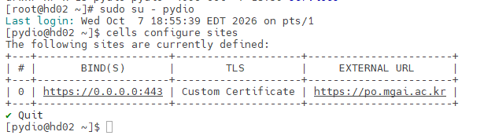

`cells configure sites` 출력에서 HTTPS 바인딩은 `0.0.0.0:443`, TLS는 `Custom Certificate`, 외부 URL은 `https://po.mgai.ac.kr`로 표시됨. 프로세스의 수신 주소와 사용자가 입력하는 외부 URL을 별도로 확인함.

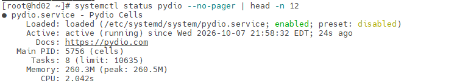

서비스 조회에는 `pydio.service`, loaded·enabled, `active (running)`과 실행 프로세스가 표시됨. systemd 구동 상태를 확인한 뒤 브라우저에서 HTTPS 접속 화면을 확인함.

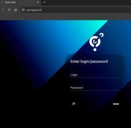

사이트 설정과 서비스 실행을 확인한 뒤 브라우저에서 Pydio HTTPS 로그인 화면에 접속함. 해당 확인 범위는 서비스 구동과 로그인 접점의 응답임.

### 서버·네트워크 지표 수집

#### Cacti의 대상·폴러·트래픽 그래프

MR01의 Cacti는 Ubuntu의 Nginx·PHP-FPM에서 동작하고 대상 장비의 SNMP 161을 조회함. Cacti DB는 DB01 `203.230.45.84:3306`에 연결되며 경로에 따라 관찰되는 PAT 출발지는 `.44.130`임.

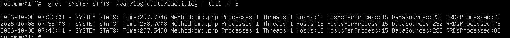

`SYSTEM STATS`에서 Method는 `cmd.php`, 관측 당시 Hosts는 15, DataSources는 232로 표시됨. 폴러는 5분 간격으로 실행됨. 수집 대상 등록 수, 실행 시각, 처리 시간과 실제 그래프 갱신을 대조함.

DB01의 bond0 그래프는 `bytes per second` 단위로 Inbound와 Outbound를 표시함. 최대값은 Inbound 8.29 k, Outbound 254.50 k로 나타나 해당 인터페이스의 시간대별 입출력 트래픽으로 기록함.

1. DB01의 대상 인터페이스가 bond0인지 확인함.
2. Cacti 폴러가 정해진 간격으로 실행되는지 SYSTEM STATS를 대조함.
3. 데이터 소스와 그래프의 최근 시각, 입출력 방향, 표시 단위를 확인함.
4. 서비스 사용 시점의 트래픽 변화와 로그를 함께 비교함.

#### MRTG의 인터페이스 인덱스 불일치

분교 MR02 `203.230.51.130`에는 MRTG와 5분 주기의 cron 수집이 구성됨. MRTG 대상 설정은 ifIndex 1의 `lo`를 가리키고 있었으나 SNMP `ifDescr` 조회에서 실제 NIC `ens160`은 ifIndex 2로 표시됨.

| 비교 항목 | 관측값 |
| --- | --- |
| 설정의 대상 인덱스 | 1 |
| 인덱스 1의 인터페이스 | lo |
| 실제 NIC | ens160 |
| 실제 NIC의 인덱스 | 2 |
| 결과 디렉터리 | /var/www/mrtg |

재등록 절차는 `ens160`의 ifIndex 2 지정 → `ifDescr` 조회 → 수집 카운터 증분 비교로 정리함. 기존 ifIndex 1은 loopback 수집값으로 기록함.

#### 서버 자원과 인터페이스 지표

관제팀의 Grafana 화면에서 CPU·메모리 사용률, 파일시스템별 디스크 사용률, 서버별 네트워크 송수신량을 조회함. 같은 서버의 지표라도 프로세스 부하, 저장 공간, 트래픽은 원인이 달라 호스트명과 시각을 기준으로 함께 대조함.

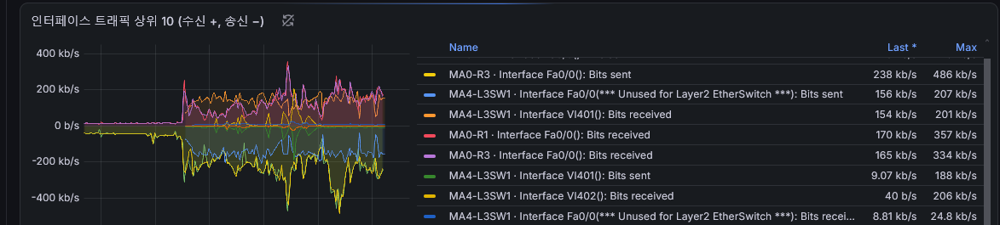

네트워크 화면에는 장비명과 인터페이스 이름, 송수신 방향과 최근값이 함께 표시됨. 서버 전체의 네트워크 트래픽과 스위치 특정 포트의 트래픽을 구분하고, 요청이 통과한 링크의 증감과 연결함.

| 수집 방식 | 연결 방향 | 상태 대조 |
| --- | --- | --- |
| Prometheus Pull | 수집기→Exporter TCP 9100 | job, 대상 파일, scrape 상태, 최신 지표 |
| Zabbix Active | Agent→Zabbix TCP 10051 | ServerActive, Hostname, 최근 아이템 수신 |
| ICMP·SNMP | 수집기→장비 | 응답·손실, OID, 인터페이스, 허용 출발지 |

Prometheus 설정안에서는 `scrape_interval`과 `evaluation_interval`을 각각 15초로 지정함. `node_exporter` job의 대상은 `file_sd_configs`로 분리하고 `/etc/prometheus/targets/node_blue.yml`에서 읽도록 구성함. 수집 주기·대상 파일의 설정과 실제 데이터 수신은 별도로 확인하며, 실행 결과는 Exporter 접근 상태와 관제 화면의 최근 지표를 기준으로 대조함.

NAT 안쪽 Agent의 Active 데이터가 들어오는 상태와 외부 ICMP 도달성은 구분함. 장비가 응답하지 않거나 지표가 멈추면 대상 프로세스, 송신·수신 방향, 방화벽, 최근 수신 시각을 각각 확인함.

### 중앙 로그 수집과 전송 장애 분석

#### LOG01의 TCP 수신 준비

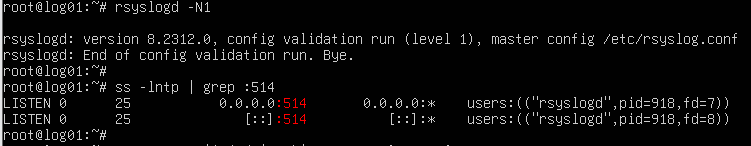

LOG01에서 `rsyslogd -N1` 검사가 끝난 뒤 `ss -lntp`로 TCP 514 수신을 확인함. IPv4 `0.0.0.0:514`와 IPv6 `[::]:514`가 LISTEN으로 표시됨. 설정 문법이 맞는 상태와 실제 프로세스가 포트를 수신하는 상태를 나눠 대조함.

#### DB01 송신과 파일 저장

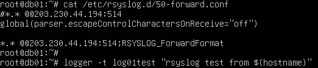

DB01의 전달 설정은 외부 로그 접점 `203.230.44.194:514`를 사용함. `@@`는 TCP 전송이며 `RSYSLOG_ForwardFormat`을 지정함. `logger`로 호스트명이 포함된 테스트 메시지를 생성해 수신 파일과 연결함.

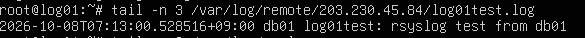

LOG01의 `/var/log/remote/203.230.45.84/log01test.log`에 `db01`과 `rsyslog test from db01`이 저장됨. 수신 프로세스, 송신 설정, 실제 파일의 메시지를 순서대로 연결한 결과임.

1. 송신 대상은 LOG01의 직접 주소 `.44.226` 대신 R4의 외부 접점 `.44.194`로 설정됨.
2. R4에서 TCP 514를 LOG01로 전달하는 경로를 대조함.
3. DB01에서 생성한 메시지의 태그·호스트명·시각을 수신 파일과 비교함.
4. 관리망 송신자가 PAT 주소 `.44.130`으로 보이는 경우에는 NAT 세션과 원래 호스트를 연결함.

#### AUT01의 송신 차단

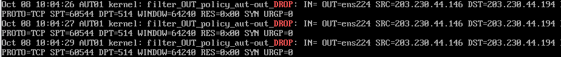

AUT01의 커널 로그에는 출발지 `.44.146`, 목적지 `.44.194`, 목적 포트 514와 `OUT_DROP`가 표시됨. 중앙 서버 수신 설정과 별개로 송신 호스트의 OUTPUT 경로에서 차단된 사례임. 같은 대상에서 5044·9997·8089의 로그 연계도 사용하므로 목적지와 포트별 정책을 구분함.

송신 프로세스→호스트 OUTPUT→NAT·중간 경계→수신 LISTEN→저장 파일 순서로 전달 경로를 추적함. DB01의 시험 메시지는 중앙 파일에 저장됐고, AUT01은 출발 호스트의 OUTPUT에서 차단됨.

#### Filebeat 웹 로그와 Splunk 인증 요청

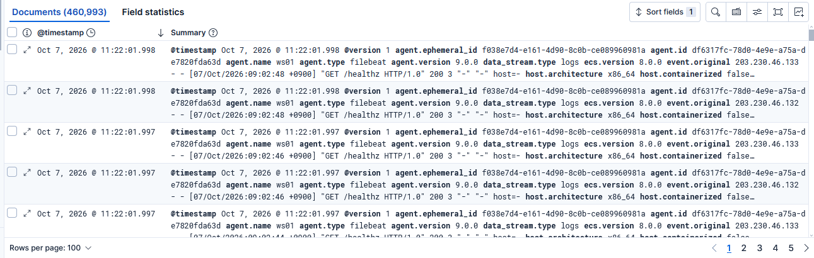

Kibana의 `agent.name`으로 발생 서버를 찾고 `event.original`의 요청 경로·출발지·접근 시각을 대조함. WS01의 `/healthz`는 로드밸런서의 정상 점검 요청으로 분류함.

Splunk에서는 Cacti의 `auth_changepassword.php` 경로를 조회해 시각·clientip·method·uri·status를 시간순으로 정렬함. 화면에는 총 9개 이벤트가 있으며, `.44.163`에서 시작한 GET 이후 `action=checkpass` POST와 마지막 POST의 302 응답이 표시됨.

요청 기록은 HTTP 처리 경로의 근거임. 해당 시점의 작업 주체와 계정 변경 결과는 NAT·프록시 경로 및 인증 기록을 함께 대조함. Filebeat→Logstash는 TCP 5044의 output·파싱·원문, Forwarder→Splunk는 TCP 9997의 연결·source·sourcetype을 기준으로 수집 경로를 구분함.

### 장비 응답 상실과 수집 포트 차단

#### 백본 노드의 응답 차이

같은 관제 화면에서 MA0-R2~R8의 7개 노드는 DOWN, ICMP 손실 100%로 표시됨. MA0-R1·MA4-R1·MA4-L3SW1의 세 지점은 UP으로 유지됨. 동일 시간대의 응답 유지 구간을 기준으로 영향을 받은 경로를 구분함.

장비별 ICMP 손실을 기록한 뒤 콘솔, 인터페이스, 구역 간 경로, 사용자 서비스 상태를 추가 대조 항목으로 정리함. 10개 UP 화면은 다른 시점의 비교 상태로 보관함.

#### LB01 Exporter 접근 차단

LB01의 커널 로그에서는 관제 출발지 `203.230.52.196`에서 LB01 `.46.132`의 TCP 9100으로 향하는 SYN 패킷이 `IPT BLOCK`으로 기록됨. 같은 화면의 UDP 138 브로드캐스트는 목적 포트와 대상이 다른 별도 트래픽임.

Exporter 수집 실패는 웹 서비스의 가용성 장애와 별도로 분석함. 관제에서 LB01로 시작되는 Pull 방향을 기준으로 Exporter 프로세스, 허용 출발지, 호스트 INPUT 정책과 최근 지표 수신을 대조함. 백본 ICMP 손실 사례와 이 로그는 서로 다른 관측 기록임.

### Ansible의 관리 대상과 작업 구성

#### 서비스 주소와 관리 주소

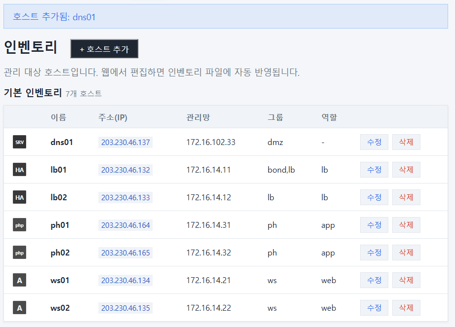

AUT01은 서버, AUT02는 네트워크 장비의 자동화 제어를 담당함. 인벤토리에는 서비스 주소와 관리 주소, 그룹과 역할을 별도로 등록함. 화면에는 DNS01 등록과 LB·WS·PH의 주소 대응이 표시됨.

| 대상 | 서비스 주소 | 관리 주소 |
| --- | --- | --- |
| LB01 / LB02 | 203.230.46.132 / .133 | 172.16.14.11 / .12 |
| WS01 / WS02 | 203.230.46.134 / .135 | 172.16.14.21 / .22 |
| PH01 / PH02 | 203.230.46.164 / .165 | 172.16.14.31 / .32 |
| DNS01 | 203.230.46.137 | 172.16.102.33 |

자동화 접속값 `ansible_host`에는 관리 주소, 서비스 주소에는 별도 변수를 사용하는 설계임. Linux는 전용 계정·sudo, IOS는 network_cli·enable, Windows는 해당 OS의 접속 방식으로 구분함.

#### 플레이북과 대상의 연결

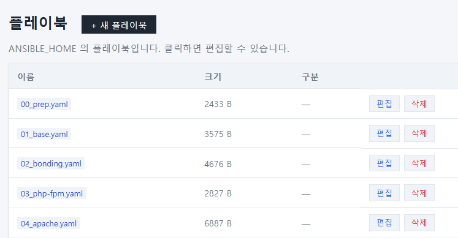

플레이북 목록은 `00_prep.yaml`, `01_base.yaml`, `02_bonding.yaml`, `03_php-fpm.yaml`, `04_apache.yaml`로 나뉨. 공통 사전 설정과 역할별 서비스 설정을 파일로 구분한 구조임.

LB01 사전 설정 작업 템플릿에는 `00_prep.yaml`과 대상 `203.230.46.132`가 연결됨. 템플릿에 보이는 서비스 주소와 실제 관리 접속에 사용하는 인벤토리 주소를 구분해 확인함. 작업이 등록된 상태와 대상에 설정이 적용된 결과도 따로 기록함.

#### 로그 수집 역할의 적용 순서

rsyslog 운영 역할은 패키지 설치→전달 설정 생성→구문 검사→서비스 반영→수신 확인의 순서로 설계됨. 기존 수집 설정과 충돌하지 않도록 전달 규칙을 먼저 비교하고, 실제 변경이 발생한 경우에만 handler가 실행되도록 구성함.

| 단계 | 설계한 처리 |
| --- | --- |
| 패키지 | rsyslog 설치 상태 확인 |
| 템플릿 | `/etc/rsyslog.d/50-forward.conf`, root 소유, mode 0640, 백업 생성 |
| 개별 검사 | `rsyslogd -N1 -f`로 임시 설정 검사 |
| 전체 검사 | 기존 설정과 포함 파일 전체의 문법·전달 규칙 대조 |
| 반영 | 변경 시 Restart rsyslog handler와 active 상태 조회 |
| 실패 처리 | 백업 복원 또는 신규 파일 제거 후 다음 대상 중단 |
| 결과 확인 | LOG01의 송신자별 파일에 테스트 메시지가 도착하는지 확인 |

`--syntax-check`와 `--check`는 문법과 변경 예측을 확인하는 단계임. 실제 수신 결과는 LOG01의 파일로 확인하는 구성임. SSH 호스트 키는 known_hosts에 등록하고 자격증명은 SSH agent·Vault로 분리하며 ansible-core·Python·컬렉션의 호환성을 함께 관리하는 설계임.

#### AUT02의 네트워크 작업

AUT02에는 EIGRP·OSPF·Port-security·RIPv2별 디렉터리가 배치됨. 각 디렉터리의 `inventory.ini`, 설정 YAML, 준비 스크립트로 대상과 작업을 연결한 구조임.

AUT02는 Rocky Linux 9.8이며, 관리 인터페이스 ens192는 `172.16.102.6/16`, 서비스 인터페이스 ens224는 `203.230.44.147/28`로 표시됨. 작업 파일이 있는 호스트와 실제 네트워크 접속 주소를 함께 대응시킴.

IOS 역할은 `ansible.netcommon.network_cli`, `cisco.ios.ios`, libssh를 사용하는 설계임. running-config 백업 후 파일 존재·크기·0600 권한·SHA-256을 확인하고, 로그 시각 형식 한 항목을 변경해 재조회하는 순서임. `serial: 1`, `any_errors_fatal`, `save_when: never`로 한 장비씩 처리하고 오류 시 다음 대상을 중단하도록 구성함. 재조회 성공 후 startup-config 저장과 백업 보관으로 이어지는 설계이며, 확인한 화면은 작업 등록 단계임.

### RAID 저장소와 대상별 백업

#### BKP01 저장소 상태

`mdadm --detail /dev/md5`에서 RAID level 5, Array Size 약 99.93 GiB, Raid Devices 3, Active Devices 3, Failed Devices 0, State clean을 확인함. 활성 디스크 3개가 참여한 정상 배열 상태로 기록함.

#### 관리망에서 수집하는 대상

| 대상 | 관리 주소 | 수집 범위 |
| --- | --- | --- |
| DB01 / DB02 | 172.16.102.12 / .13 | DB dump |
| LOG01 | 172.16.102.16 | 로그 |
| HD01 | 172.16.102.8 | 지정 파일 데이터 |
| AUT01 / AUT02 | 172.16.102.5 / .6 | Ansible 플레이북·인벤토리·설정 |
| BKP01 | 172.16.102.15 | 수집 결과 저장, 서비스 주소 203.230.45.100 |

BKP01이 대상 관리 주소에 SSH로 먼저 접속하고 데이터를 가져오는 Pull 방식임. 업무 서비스의 공개 포트와 백업용 관리 SSH의 방향·출발지를 분리함.

화면에는 HD01 파일 동기화, AUT01 Ansible 서버 설정, AUT02 Ansible 네트워크 설정의 순서가 표시됨. 각 대상에서 `receiving incremental file list`, 송수신 바이트, `total size`, 완료 메시지가 이어짐. 대상별 수집이 끝난 뒤 오래된 DB 백업 정리와 백업용 인터페이스 제어가 실행되는 흐름임.

1. HD01은 `172.16.102.8`에 연결해 지정 파일을 수집함.
2. AUT01은 `172.16.102.5`, AUT02는 `.6`으로 연결해 자동화 설정을 수집함.
3. 각 작업의 종료와 수집 파일의 크기·경로·권한을 대조하는 기준으로 정리함.
4. DB dump는 비어 있지 않은 파일과 압축 검사를 거쳐 격리 환경 복원까지 확인하는 절차로 분리함.
5. RAID는 배열 상태, rsync는 대상별 작업 종료, 복원은 격리 환경의 검증 결과로 기록하도록 정함.

### Hoya 원격 실행과 파일 전송

웹 콘솔에서 작업을 등록하고 로컬 엔진 또는 원격 에이전트의 응답을 확인함. Rocky·Ubuntu·Windows에서 등록·명령·파일 전송을 같은 흐름으로 검증하고, 에이전트 연결 문제와 도구 실행 문제를 구분함.

| 구성 | 기능 | 점검한 값 |
| --- | --- | --- |
| 웹 콘솔 | 대상·작업 등록, 상태·결과 조회 | 선택 대상, 실행 위치, 작업 상태와 개별 결과 |
| Spring Boot 서버 | API 제공, 작업 조정 | 요청 접수와 에이전트 결과 반영 |
| Python 엔진 | 점검 도구 실행, 결과 수집 | 도구 실행 여부, 성공·실패 출력 |
| 원격 에이전트 | 원격 작업 수행, 응답 전달 | 운영체제, 연결 상태, 명령 응답 |
| RPM·systemd | Rocky Linux 설치·서비스 실행 구성 | 패키지·서비스 실행과 CI 결과 |

#### 1. 에이전트 등록과 명령 응답

1. 대상 운영체제에서 에이전트를 실행하고 콘솔 서버 목록의 등록 상태를 확인함.
2. 서버·에이전트 사이의 상호 인증서 통신을 확인함. 등록된 대상과 실행할 작업을 선택한 뒤 원격 명령을 전달함.
3. 대상에서 반환된 명령 응답을 콘솔의 작업 결과와 대조함. Rocky·Ubuntu·Windows에서 각각 명령 입력과 응답 수신을 검증함.
4. 작업 전체 상태와 도구별 세부 출력을 함께 확인함. 에이전트가 연결돼 있어도 대상에 도구가 없거나 운영체제가 지원하지 않으면 개별 검사가 실패함.
5. Windows에서 실행할 수 없는 Linux 전용 도구는 Rocky·Ubuntu로 실행 대상을 바꿔 검증함.

| 검증 항목 | 결과 |
| --- | --- |
| 등록 | 실행한 에이전트가 서버 목록에 표시됨 |
| 통신 | 서버·에이전트 간 상호 인증서 통신 확인 |
| 명령 | Rocky·Ubuntu·Windows에서 입력과 응답 수신 |
| 도구 | 운영체제별 지원 도구의 실행·성공·실패 출력 확인 |
| 실패 분석 | 연결 상태, 도구 설치 여부, 운영체제 지원 여부를 순서대로 대조 |

#### 2. 파일 왕복 전송과 무결성

*Windows 원격 파일 목록과 업로드 설정 화면.*

1. 콘솔에서 대상 에이전트의 원격 파일 목록을 조회하고 업로드할 위치를 확인함.
2. 파일 업로드 후 전송 완료 상태를 확인함. 원격 파일 목록에서 대상 파일을 조회함.
3. 같은 파일을 다시 다운로드하고 전송 전 원본과 내려받은 파일의 SHA-256을 비교함.
4. Rocky·Ubuntu·Windows에서 같은 순서로 왕복 전송을 검증함. 세 운영체제 모두 원본·다운로드 파일의 해시가 일치함.

원격 명령과 파일 전송의 결과를 함께 확인해 연결 이후의 실제 기능을 검증함. 이후 POST 검사에서 작업 상태와 세부 결과가 다른 오류를 발견해 주소 검증 로직을 보완함.

### 침투 시나리오와 관측 기준

관리 단말·학사 DB의 무결성, 연구 파일의 기밀성, 학내망 가용성을 각각 분리해 점검함. 공개 접점 조사 뒤 단말 실행, 관리 서비스 접근, 데이터 변경, 장비 응답까지 이어지는 경로를 구성함. 각 구간에는 테스트 계정과 가상 데이터를 사용했으며, 레드팀 실행 기록을 관제팀의 원본 로그와 대조함.

| 구분 | 대상과 시작 조건 | 확인한 흐름 |
| --- | --- | --- |
| SCN-00 | 공개 웹·DNS·메일·서비스 응답 | 업무 문서 → 서비스 접점 → 입력·인증 기능 → 점검 대상 선정 |
| SCN-01 | 관리 단말의 테스트 메일과 관리 세션 | 단말 연결 → 예약 작업 권한 → Cacti → 서비스 계정 → 학사 레코드 |
| SCN-02 | 게시글의 인증 모사 화면과 테스트 단말 | 에이전트 등록 → 입력 이벤트 → FTP 목록 → 연구 공유·구성 백업의 접근 조건 |
| SCN-03 | 게임 형태 배포 페이지와 강의실 단말 | 파일 수신 → 보호기능 탐지 → 변경된 조건의 단일 세션 → 장비별 응답 비교 |

HTTP 응답, 계정 로그인, 원격 실행, 데이터 변경을 대상·계정·요청 경로로 연결함. 관리망의 PAT 주소는 변환표와 내부 세션으로 원래 단말에 대응시킴.

#### SCN-00 · 공개 접점과 입력 지점 조사

**1. 공지와 첨부에서 업무 접점 확인**

학사 게시판의 공지 제목, 게시 일자, 작성 부서, 첨부 형식을 조사함. 보안 안내와 비밀번호 변경 공지에는 HWP 첨부와 전산실 명의의 안내가 함께 노출됨. 공지 열람부터 첨부 파일까지 이어지는 사용자 동선을 확인하고, 메일 시나리오에서 사용할 수신·열람 조건에 연결함.

*보안 안내 게시글과 첨부 파일 표시.*

게시글의 제목·본문·첨부 링크를 각각 확인함. 게시글 열람은 웹 요청, 첨부 수신은 파일 전달, 첨부를 연 뒤의 동작은 단말 실행으로 나눔. 같은 업무 안내에 속해도 각 단계의 처리 주체와 남는 로그가 달라 메일 큐·웹 접근·단말 연결을 별도로 기록함.

**2. 이름 해석과 서비스 노출 대응**

1. 공개 문서에서 확인한 서비스 이름을 DNS·메일 수신 경로와 대응시킴.
2. 하위 도메인과 응답 포트, 서비스 배너, 웹 인증 화면으로 공개 서비스와 관리 서비스를 분류함.
3. 게시판·로그인·첨부·관리 URL의 요청 주소와 인증 조건을 정리함.
4. 서버 목록과 비교해 외부에 공개된 접점과 내부 전용 접점을 구분함.
5. 계정·출발지·접속 시각·요청 URI를 시나리오 공통 기록으로 사용함.

| 조사 대상 | 비교한 내용 | 시나리오 연결 |
| --- | --- | --- |
| DNS·메일 | 이름 해석, 메일 수신 서버, 공개 이름과 실제 자산 | 테스트 메일 수신과 서비스 주소 대응 |
| 웹 입력 | 게시글·첨부·로그인·관리 URL, GET·POST 처리 | 저장·출력과 인증 경계 점검 |
| 관리 접점 | Cacti·SSH·원격 접속의 출발지와 권한 | 관리 단말 이후 이동 조건 분석 |
| 파일 서비스 | FTP·SMB·웹 파일 서비스·구성 백업의 목적 | 목록·파일·관리정보의 접근 범위 분리 |
| 관제 접점 | 수집 서버, 로그 종류, 원래 호스트와 변환 주소 | 실행 기록과 중앙 이벤트의 대상 일치 확인 |

배너와 자동 탐색 결과로 점검 후보를 고르고, 계정 권한·접근 기능·입력 처리 결과를 확인해 시나리오 대상을 선정함.

### SCN-01 · 관리 단말에서 학사 DB까지

공문형 메일을 시작으로 관리 단말의 권한과 Cacti 관리 기능을 점검함. 이후 서비스 설정의 DB 계정으로 학사 스키마에 접근한 경로를 분석하고, 같은 테스트 학생의 수강 레코드 5건을 비교함.

*관리 단말·Cacti·서비스 계정·학사 데이터의 연결.*

#### 1. 관리 단말과 Cacti의 위치 확인

관리 단말 MGT01과 Cacti 서버 MR01은 전산망의 관리 구역에 배치됨. Cacti는 장비와 서버의 상태를 수집하는 중앙 관리 접점이며, Windows 단말에서는 브라우저로 관리 화면에 접근함. 외부 연결은 PAT를 통과하므로 MR01의 웹 접근 로그와 외부 세션 화면에 서로 다른 주소가 나타날 수 있음.

*관리 구역의 Cacti와 Windows 단말 배치.*

| 대상 | 내부 역할 | 시나리오에서 비교한 기록 |
| --- | --- | --- |
| MGT01 | Windows 관리 단말 | 사용자 문맥, 예약 작업, 로컬 그룹, 원격 세션 |
| MR01 | Cacti 관리 서버 | 관리자 UI, 패키지 요청, 서버 측 세션, 접근 로그 |
| DB01·DB02 | 학사 데이터와 복제 | 서비스 계정의 스키마 권한, 시험 레코드 전후 값 |
| 외부 관측 접점 | 파일 전달·시험 세션 수신 | 파일 요청 시각, 변환된 주소, 연결 결과 |

MGT01에서 MR01로 향한 웹 요청을 시작으로 Cacti 서비스의 실행 결과와 DB 연결을 순서대로 추적함.

#### 2. 테스트 메일 수신과 파일 요청

업무 점검 요청을 모사한 메일과 HWP 첨부가 수신함에 표시됨. 메일 제목·표시 이름·첨부를 확인한 뒤, 열람 이후 배포 서버에 도착한 파일 요청을 대조함. 이 단계에서는 수신함 표시와 파일 전달을 확인함.

*두 파일의 GET 요청과 HTTP 200 응답.*

배포 서버 기록에는 `/agent.exe`와 `/agent.toml`의 GET 요청이 순서대로 남음. 첫 파일은 `10:46:57`, 설정 파일은 `10:51:28`에 요청됐으며 두 요청 모두 HTTP 200으로 처리됨. 두 요청의 접속 주소를 Windows 연결 화면의 외부 주소와 대응시킴.

| 확인 단계 | 관측한 값 | 연결한 결과 |
| --- | --- | --- |
| 메일 수신 | 수신함의 테스트 메일·HWP 첨부 | 단말에서 열람 가능한 상태 |
| 첫 파일 요청 | `/agent.exe`, GET, HTTP 200 | 실행 파일 전달 요청 처리 |
| 설정 파일 요청 | `/agent.toml`, GET, HTTP 200 | 설정 파일 전달 요청 처리 |
| 단말 연결 | Windows 사용자 경로·수신 세션 | 파일 요청 이후의 실행 문맥 확인 |

#### 3. Windows 사용자 문맥 확인

*승인된 연결과 Windows 사용자 임시 경로.*

원격 연결 화면에는 `C:\Users\cacti-manager\AppData\Local\Temp` 경로가 표시됨. 배포 서버의 요청 주소와 연결 화면의 외부 주소를 대조하고, 관리 단말의 사용자 문맥에서 연결이 성립한 상태를 확인함.

1. 연결 승인 후 명령 프롬프트가 Windows 사용자 경로에 위치하는지 확인함.
2. 실행 중인 사용자를 기준으로 로컬 관리 작업과 참조 파일을 조사함.
3. 파일을 수정할 수 있는 권한과 예약 작업이 실제로 실행되는 권한을 비교함.
4. 단말 권한이 변경된 뒤에는 별도 출력과 그룹 목록을 다시 확인함.

#### 4. 예약 작업 참조 파일의 ACL

예약 작업이 참조하는 `collect-downloads.bat` 파일을 확인함. 파일 경로는 `C:\ProgramData\MonitoringArchive\scripts` 아래이며, 일반 사용자 `cacti-manager`에 상속된 수정 권한 `(I)(M)`이 표시됨. SYSTEM과 Administrators는 전체 권한 `(I)(F)`, Users는 읽기·실행 `(I)(RX)`으로 나타남.

*cacti-manager의 수정 권한과 SYSTEM·Administrators의 전체 권한.*

파일을 수정하는 사용자와 작업을 실행하는 계정이 다르게 설정된 점을 확인함. 높은 권한의 작업이 일반 사용자가 수정할 수 있는 파일을 참조하므로 파일 내용 변경이 높은 실행 권한으로 이어지는 조건임.

| ACL 항목 | 표시된 권한 | 분석한 의미 |
| --- | --- | --- |
| cacti-manager | `(I)(M)` | 참조 파일 수정 가능 |
| SYSTEM | `(I)(F)` | 파일 전체 권한 |
| Administrators | `(I)(F)` | 관리자 전체 권한 |
| Users | `(I)(RX)` | 일반 그룹 읽기·실행 |

예약 작업의 실행 계정, 참조 BAT 파일, cacti-manager의 수정 ACL을 함께 대조해 권한이 이어지는 지점을 확인함.

#### 5. SYSTEM 출력과 관리자 그룹 변화

*시험 작업에서 반환된 SYSTEM 실행 문맥.*

작업 실행 결과에 `nt authority\system`이 표시됨. 이어서 로컬 Administrators 그룹을 조회해 `admin`, `Administrator`, `cacti-manager`가 포함된 상태를 확인함.

*로컬 관리자 그룹에 포함된 cacti-manager.*

파일 ACL에서 수정 권한을 확인한 뒤 SYSTEM 실행 출력과 관리자 그룹 조회를 대조함. 조치 대상으로는 참조 파일의 수정 권한과 예약 작업 실행 계정을 지정함.

#### 6. 원격 세션과 기존 업무 세션

Windows 원격 화면에서 기존 업무 환경과 관리 서비스 접점을 확인함. `query session` 결과에는 테스트 원격 세션과 기존 관리 사용자 세션이 함께 표시됨.

*cacti-manager·admin 세션과 활성 rdp-hop 세션.*

| 세션 구분 | 화면의 상태 | 분석에 사용한 값 |
| --- | --- | --- |
| cacti-manager | 연결이 끊긴 사용자 세션 | 사용자·세션 ID |
| admin | 연결이 끊긴 사용자 세션 | 기존 관리 세션의 존재 |
| rdp-hop | 활성 원격 세션 | 현재 원격 접속 사용자·ID |
| rdp-tcp | 수신 대기 | 원격 접속 서비스의 대기 상태 |

Windows 사용자 목록과 세션 상태를 확인한 뒤 브라우저에서 Cacti 관리 접점으로 이동해 로그인 표시를 확인함.

#### 7. Cacti 관리자 UI와 자산 목록

Cacti 1.2.26의 관리자 화면에서 `Logged in as admin`과 장비 목록을 확인함. 관리 목록에는 BKP01, DB01·DB02, LB01·LB02, LOG01, MA1-R1~R4, MAIL01, MR01, PH01, WS01·WS02가 표시됨.

*관리자 로그인 상태와 장비별 상태·가동 시간·폴링 시간.*

장비 목록의 `All 15 Devices`는 등록 대상 수임. 같은 표에서 장비마다 `Status`, `In State`, `Uptime`, `Poll Time`을 확인함. 목록 접근으로 관리 자산과 주소를 파악하고, 패키지 처리 기능의 권한과 서버 측 파일 결과를 이어서 분석함.

1. 브라우저의 관리자 인증 상태를 확인함.
2. 자산 이름과 주소를 전산망 배치와 대응시킴.
3. 패키지 가져오기 요청과 처리 결과에 표시된 서버 측 파일 경로를 확인함.
4. 원격 세션 목록에서 PHP 실행 문맥을 확인함.
5. 패키지 요청 시각과 서버 파일·연결 시각을 관제 로그와 대조함.

*별도 세션 목록에 표시된 shell php/php 연결.*

관리자 페이지의 인증 상태와 패키지 요청을 확인한 뒤, PHP 세션의 서버 측 실행 결과를 대조함. 장비 목록의 15개는 Cacti 등록 대상 수로 기록함.

#### 8. 서비스 계정의 학사 스키마 접근

Cacti 서비스 설정의 DB 연결 계정으로 학사 스키마를 조회함. 조회 결과에는 `academics_cartitem`, `academics_college`, `academics_course`, `academics_department`, `academics_enrollment`, `academics_meeting`이 `BASE TABLE`로 표시됨.

*관제 서비스 계정으로 접근한 학사 테이블 목록.*

관제용 계정의 접근 범위가 자체 서비스 DB를 넘어 학사 데이터까지 이어지는 상태임. 검증에는 동일 테스트 학생의 수강 레코드 5건을 사용함. 행 표시 순서가 바뀌어도 같은 레코드를 비교할 수 있도록 레코드 식별자를 기준으로 변경 전후를 대응시킴.

| 수강 레코드 | 변경 전 | 변경 후 |
| --- | --- | --- |
| A | B0 | A+ |
| B | D0 | A+ |
| C | A0 | A+ |
| D | C0 | A+ |
| E | B0 | A+ |

Cacti 설정의 서비스 계정이 가진 DB 권한으로 학사 스키마에 접근함. 관리 단말의 권한 변화, Cacti 관리 기능, 서비스 계정, 학사 레코드 변경을 단계별로 연결함.

#### 9. Cacti 요청 타임라인 대조

관제팀의 Cacti 접근 기록에서 MR01을 대상, MGT01을 출발지로 조회함. 관리자 비밀번호 변경 페이지, 패키지 가져오기, 로그 조회, 서버 파일 요청을 `_time` 순서로 비교함.

*관리자 기능 GET·POST 뒤 package_import.php 요청이 이어진 기록.*

| 로그 표시 시각 | 요청 | 분석한 내용 |
| --- | --- | --- |
| 04:44:25 | `auth_changepassword.php` GET | 관리자 기능 접근 |
| 04:44:35~04:44:43 | 비밀번호 처리 POST | 같은 기능의 반복 요청 |
| 06:11:23 | `package_import.php` GET | 패키지 가져오기 화면 접근 |
| 06:13:13 | `package_import.php` POST | 패키지 처리 요청 |
| 06:13:47~06:13:50 | POST 뒤 GET | 처리 이후 페이지 요청 |

이벤트 원문 시각과 화면 표시 시간대를 맞춘 뒤 출발지·대상·method·상태·서버 파일을 대조함. 비밀번호 변경, 패키지 처리, PHP 경로 요청의 순서를 확인함.

*동일 출발지·동일 경로의 200 응답과 응답 크기 37바이트.*

PHP 경로의 성공 응답은 `06:40:05`, `08:19:57`, `08:22:00`, `08:23:11`에 각각 기록됨. 출발지는 MGT01이며 네 행 모두 HTTP 200·37바이트로 표시됨. 경로 탐색에서 나타난 404와 구분하고, 서버 측 실행 여부는 앞의 PHP 세션과 연결함.

*clog.php의 GET 요청과 HTTP 200 응답.*

추가로 `clog.php` 경로를 조회해 `06:26:43`부터 `06:29:51`까지의 GET 4건을 확인함. 관리 기능 접근 이후 같은 출발지가 어떤 내부 기능을 조회했는지 좁히는 데 사용함. 이 4건은 Cacti 로그 조회 요청 수이며, 앞의 PHP 경로 응답 4건과 구분함.

#### 10. 관리 경계별 조치와 재점검 조건

| 경계 | 확인된 문제·영향 | 조치·재점검 항목 |
| --- | --- | --- |
| 예약 작업 | 일반 사용자 수정 파일이 높은 권한으로 실행됨 | 참조 파일 ACL과 실행 계정을 함께 조정하고 비인가 수정 거부·정상 작업 실행 비교 |
| 관리 단말 | 기존 업무 세션과 원격 세션이 함께 존재함 | 세션·로그온 ID·관리자 그룹을 정리하고 승인된 관리 접속 확인 |
| Cacti | 관리자 기능과 서버 측 실행 경로 연결 | 관리 출발지·Import 권한·버전 확인, 생성 파일과 실행 이력 대조 |
| DB 연결 | 관제 서비스 계정의 학사 스키마 접근 | 계정 자격정보·허용 출발지·스키마 권한 분리, 테스트 레코드 원상태 대조 |
| 관제 복구 | 관리 서버 자체의 상태 수집도 영향 대상임 | SNMP 응답·폴링·그래프 갱신·중앙 로그 수신 확인 |

### SCN-02 · 웹 입력에서 연구 파일 서비스까지

학사 웹의 게시글에서 인증을 모사한 화면을 표시하고, 사용자 동작 이후 단말 연결과 입력 이벤트를 확인함. 입력 이벤트의 FTP 접점을 시작으로 본교·분교 연구 파일과 장비 구성 백업의 접근 조건을 나눠 점검함.

*웹·단말·FTP·SMB·TFTP별 점검 대상.*

#### 1. 가짜 인증 UI와 사용자 동작

*사용자 실행을 유도하는 인증 모사 화면.*

게시글 위에 `로봇이 아닙니다` 형태의 UI가 겹쳐 표시됨. 인증 모사 화면을 확인한 뒤 사용자 동작 이후의 Hoya 단말 등록과 셸 연결을 확인함.

저장형 입력의 판정은 입력 저장, 다른 조회에서의 재출력, 실행 문맥을 기준으로 수행함. 인증 모사 화면은 UI 표시 결과로 기록하고, 단말의 연결은 Hoya 등록·세션 결과로 구분함. 이 구분을 Hoya의 저장형 입력 판정 조건에도 반영함.

#### 2. Hoya 에이전트 등록과 셸 연결

*test 에이전트의 온라인 상태와 콜백 경로.*

Hoya 에이전트 목록에 Windows 단말 1대가 `온라인`으로 표시됨. 에이전트 이름, 단말 식별자, 버전과 콜백 주소를 확인하고, 목록의 등록 상태에서 실제 셸 연결로 진행함.

*Windows 10·x86_64 대상의 실행 중인 셸.*

연결 화면에는 `WINDOWS_10`, `X86_64`, `Windows PowerShell`이 표시됨. 에이전트가 온라인으로 등록된 상태와 명령 입력을 받을 수 있는 셸 준비 상태를 각각 확인함. 등록 ID와 셸 세션 ID를 구분해 같은 단말에서 생성된 연결인지 대조함.

1. 웹 동작 이후 에이전트 목록에 대상 단말이 나타나는지 확인함.
2. 등록된 단말 이름과 운영체제를 기준으로 대상 선택 오류를 방지함.
3. 셸 연결 상태와 세션 식별자를 확인함.
4. 승인된 테스트 입력과 중앙에 도착한 입력 이벤트를 대응시킴.
5. 입력 이벤트에 나타난 서비스 접점을 별도 파일 서비스 점검으로 연결함.

#### 3. FTP 접점과 디렉터리 목록

*본교 파일 서비스 접점에서 표시된 pub 목록.*

입력 이벤트에서 확인한 FTP 접점으로 이동했을 때 `pub` 디렉터리가 표시됨. 화면의 서버 주소를 HD01과 대응시키고 목록 열람 결과를 기록함. 인증 방식, 파일 읽기, 업로드 허용 여부는 목록 표시와 별도 항목으로 구분함.

| 관측 단계 | 확인 결과 | 이어서 비교한 조건 |
| --- | --- | --- |
| 입력 이벤트 | FTP 서비스 접점 확인 | 입력 주체·단말·수신 시각 |
| 접점 접근 | 서버 주소와 응답 확인 | HD01의 서비스·네트워크 경로 |
| 목록 표시 | `pub` 디렉터리 열람 | 인증 계정, 목록·읽기·업로드 범위 |
| 호스트 기록 | 계정의 로그인 이벤트 | 파일 서비스 인증과 OS 권한의 관계 |

#### 4. FTP 인증과 호스트 권한 분리

*운영체제 인증 로그에 남은 admin 세션.*

호스트 로그에는 `pam_unix(login:session)`과 `admin(uid=0)` 세션이 나타남. 해당 행은 OS 로그인 결과로 기록하고, FTP 인증 로그는 별도 서비스 기록으로 대조함. 공개키 root 접속, 자동화 작업, 직접 로그인과 테스트 계정 사용을 계정·서비스·시각별로 확인함.

`admin` 계정의 UID 0과 실행 권한을 확인함. 파일 서비스의 자료 접근 권한, SSH·sudo의 호스트 관리 권한을 각각 연구 자료의 영향 범위에 연결함.

#### 5. 본교·분교 SMB 공유의 접근 조건

*연구 구역 간 도달성과 계정·공유 권한의 연결.*

본교 HD01의 FTP 접점과 분교 HD02의 공유 서비스를 별도 자산으로 구분함. 연구망 VPN과 허용 경로가 있어도 서비스 인증과 파일 권한은 목적지에서 다시 적용됨. 계정 재사용 여부와 실제 공유 읽기 권한을 다음 순서로 확인하도록 구성함.

| 순서 | 점검 대상 | 비교할 결과 |
| --- | --- | --- |
| 1 | 허용된 출발지에서의 SMB 서비스 | 서버 응답, ACL, 서비스 대기 상태 |
| 2 | 테스트 계정 인증 | 허용·거부 결과와 인증 로그 |
| 3 | 공유 목록과 자료 읽기 | 공유 권한·파일 권한의 일치 |
| 4 | 호스트 관리 기능 | 자료 읽기 계정과 관리자 실행 권한 분리 |

단말 입력과 FTP 목록을 시작으로 SMB 연결·계정 인증·공유 읽기를 점검하는 흐름으로 구성함. 서버 관리 권한은 공유 계정의 파일 권한과 별도로 확인하는 항목으로 남김.

#### 6. TFTP 구성 백업의 수신 기준

*승인된 백업의 읽기·수신·원본 해시 대조 순서.*

연구 자료와 장비 구성 백업은 보호 대상을 분리함. 구성 백업에는 인터페이스, 라우팅, 게이트웨이, 접근 정책과 운영 자격정보가 포함될 수 있어 파일의 읽기 범위가 다음 관리 접점에 미치는 영향을 점검함.

1. 승인된 장비 목록과 구성 백업 접점을 대응시킴.
2. 서비스 포트 응답과 실제 파일 읽기 요청 수락을 구분함.
3. 수신 파일의 장비·인터페이스·라우팅 정보가 요청한 대상과 일치하는지 비교하도록 구성함.
4. 파일 요청 기록·수신 파일·원본 백업의 해시를 동일 파일 식별자로 연결하도록 정함.
5. 자료 유형별로 연구 파일 읽기와 장비 운영정보 접근을 따로 판정함.

#### 7. Samba 정리와 웹 파일 서비스 전환

분교 HD02는 Samba 대신 Pydio를 사용하는 구성으로 변경됨. 팀의 서비스 정리 결과에서 패키지·서비스 단위·설정 경로·대기 포트를 각각 확인함.

*Samba 관련 서비스 0개와 SMB 포트 대기 없음.*

`rpm -qa` 조회에 Samba 패키지가 나타나지 않고, `systemctl list-unit-files` 결과는 `0 unit files listed`로 표시됨. `/etc/samba`, `/var/lib/samba`, `/var/cache/samba`, `/var/log/samba` 경로는 존재하지 않는 것으로 반환됨. 139·445 포트 조회에서도 대기 중인 SMB 리스너가 나타나지 않음.

| 확인 대상 | 결과 | 해석 |
| --- | --- | --- |
| Samba 패키지 | 조회 결과 없음 | 패키지 정리 상태 |
| smb·nmb 서비스 단위 | 0개 | 자동 실행 서비스 정리 상태 |
| 설정·상태·캐시·로그 경로 | 경로 없음 | 기존 Samba 파일 경로 정리 상태 |
| TCP 139·445 | 대기 없음 | 기존 SMB 서비스 비활성 상태 |
| 대체 서비스 | Pydio·HTTPS·로컬 MariaDB | 웹 파일 서비스와 전용 실행 계정 사용 |

본교 HD01은 ownCloud와 별도 DB03을 사용함. 캐시·파일 잠금, 중복 헤더, 추가 파일 경고를 서비스 설정과 대조한 뒤 보안·설치 점검 결과를 확인함.

*자체 점검 항목의 통과 표시.*

HD01은 ownCloud 자체 점검 통과, HD02는 Samba 패키지·서비스·리스너 제거를 확인함. 파일 앱·DB·SSH·백업 경로는 각 자산의 설정과 연결해 관리함.

#### 8. 웹 오류와 인증 실패의 감시 경로

*nginx-4xx jail 상태와 연구망·관리·백업의 방화벽 규칙.*

`nginx-4xx`는 `/var/log/nginx/access.log`를 감시함. 조회 시점의 누적 실패는 1건, 현재 실패와 차단은 0건이며 차단 주소 목록은 비어 있음. 하단 방화벽에는 연구망의 HTTP·HTTPS, MR01의 SSH·ICMP, BKP01의 TCP 873 허용 규칙이 나뉘어 표시됨.

*owncloud-auth의 애플리케이션 로그 감시와 실패·차단 집계.*

`owncloud-auth`는 `/var/www/owncloud/data/owncloud.log`를 감시함. Nginx의 HTTP 오류와 ownCloud 인증 실패가 서로 다른 파일에서 집계됨. 이 조회에서도 누적 실패 1건·차단 0건으로 나타남.

| 항목 | 웹 오류 감시 | 인증 실패 감시 |
| --- | --- | --- |
| jail | nginx-4xx | owncloud-auth |
| 감시 파일 | Nginx access.log | ownCloud 앱 로그 |
| 누적 실패 | 1 | 1 |
| 현재 차단 | 0 | 0 |
| 판정 | HTTP 오류 집계 상태 | 앱 인증 실패 집계 상태 |

HD02는 Pydio JSON 로그인 이벤트의 출발지를 기준으로 10분 내 5회 실패를 집계하고 443 접속을 제한하는 정책으로 구성됨. HD01의 두 jail 상태와 HD02의 별도 정책을 구분함. 차단 적용 검증은 실패 집계·동적 규칙·새 연결 결과를 같은 출발지 기준으로 비교하도록 정함.

### SCN-03 · 배포 파일과 가용성 관측

강의실 단말에서 외부 연결을 확인하고, 강의망 → 백본 → 전산망 경로에 있는 장비 응답을 관측함. 배포 화면·단말 세션과 관제의 장비 상태는 각각의 기록으로 나눔.

#### 1. 게임 형태의 배포 페이지

*게임 외형·버전·ZIP 표시·다운로드 경로.*

페이지에는 `NIGHT SHIFT`, `0.8 · PUBLIC TEST`, ZIP과 다운로드 버튼이 표시됨. 정상 프로그램을 모사한 외형에서 파일 수신과 압축 파일 열람까지 이어지는 사용자 흐름을 확인함. HTTP 요청의 200 응답과 단말의 파일 목록을 다운로드·열람 결과로 사용함.

초기 배포 파일은 Defender에 탐지됨. 이후 보호기능을 변경한 테스트 조건에서 단말 연결을 확인함. 최초 탐지와 변경 조건의 연결을 각 실행 결과로 기록함.

#### 2. 단일 강의실 단말의 세션

*활성 세션 수 1개와 대상 단말 주소.*

활성 목록에는 강의실 단말 `203.230.40.132`의 세션 1개가 표시됨. 단말 식별자·세션 ID·연결 시각을 기준으로 연결 이후의 응답과 프로세스 메시지를 확인함.

| 단계 | 관측 결과 | 기록한 조건 |
| --- | --- | --- |
| 배포 | 게임 형태 화면과 다운로드 경로 | 전달 환경 |
| 수신 | HTTP 200과 압축 파일 열람 | 요청·파일 수신 |
| 보호기능 | 초기 Defender 탐지 | 최초 조건의 탐지 결과 |
| 연결 | 보호기능 변경 조건에서 단일 세션 | 단말 1대·해당 조건 |
| 연결 이후 | 동일 세션의 응답·프로세스 메시지 | 개별 동작 결과 |

#### 3. 장비별 ICMP 상태 비교

*비교 관측 시점의 장비 10개 UP.*

상태 비교 화면에는 MA0-R1~R8, MA4-R1, MA4-L3SW1의 카드가 나타남. 위 시점에는 장비 10개가 모두 UP으로 표시됨. 같은 대상 목록을 기준으로 응답 손실이 나타난 시점과 비교함.

손실 화면에서는 MA0-R2~R8이 DOWN이며, MA0-R1·MA4-R1·MA4-L3SW1은 UP으로 유지됨. 대상 7개의 ICMP 현재 손실은 100%로 표시됨. 같은 화면의 응답 시간·손실·CPU 항목은 각각의 지표로 비교함.

| 관측 대상 | 상태 | 해석 범위 |
| --- | --- | --- |
| MA0-R2~R8 | 7개 DOWN | 해당 관측 시점 ICMP 응답 상실 |
| MA0-R1 | UP | 같은 시점 응답 유지 |
| MA4-R1·MA4-L3SW1 | UP | DMZ 경계의 응답 유지 |
| 손실 지표 | 대상 7개 현재 100% | ICMP 시험의 손실 결과 |
| CPU·앱 응답 | 별도 수집 항목 | 장비 과부하·업무 서비스 원인 분석에 추가 대조 |

10개 UP 화면과 7개 DOWN 화면은 서로 다른 관측 시점의 장비 응답 상태임. 원인 분석 항목에는 해당 시각의 유입량·인터페이스·라우팅·HSRP·서비스 응답을 연결함. 전체 서비스 복구 시각은 산정하지 않음.

#### 4. HSRP 기준 상태와 가용성 원인 분리

HSRP 기준 화면에서 MA1-R1의 그룹 1~4는 모두 Active, 우선순위 110으로 표시됨. `P` 표시는 preempt 설정이며, 각 그룹의 VIP와 Standby 주소가 함께 나타남. 이 값은 게이트웨이 역할을 비교하는 기준으로 사용함.

| 계층 | 확인한 항목 | 비교 목적 |
| --- | --- | --- |
| ICMP | 대상별 응답·손실·지연 | 장비 도달 상태 |
| 라우팅 | 인접 상태·목적지 경로 | 구역 간 전달 경로 |
| 게이트웨이 | HSRP 역할·우선순위·VIP | 기본 게이트웨이 유지 상태 |
| 제어 트래픽 | 장비 자체로 향한 처리량 | 라우팅·관리 통신 영향 |
| 업무 서비스 | 웹·앱 응답 | 사용자가 수행하는 정상 요청 |

게이트웨이 역할 전환 시험과 과부하 방어 시험을 구분함. HSRP는 역할 유지 여부를, 경계 ACL·제어면 정책은 유입과 장비 자체 처리량을 확인하는 항목으로 정리함.

### 관제 수집과 탐지 기록 분석

#### 1. 가용성 카드와 실제 수신 지표

*AUT01·AUT02의 상태 미확인과 별도로 도착한 자원 지표.*

AUT01·AUT02·MAIL의 상단 가용성 카드는 `미확인`, MR01·LOG01은 `연결`로 표시됨. 같은 시점의 CPU 표에는 AUT01 3.22%, AUT02 1.14%, MR01 39.8%, LOG01 0.234%의 최근 값이 표시됨. AUT01·AUT02는 메모리와 디스크 수치도 수신됨.

| 관측 항목 | 표시 결과 | 분석 |
| --- | --- | --- |
| AUT01·AUT02 가용성 | 미확인 | 상태 카드 판정 신호 확인 대상 |
| AUT01·AUT02 CPU | 최근 값 존재 | 자원 지표 수신과 가용성 값을 분리 |
| MR01·LOG01 가용성 | 연결 | 해당 카드의 연결 상태 |
| MR01 메모리 | 최근 95.2%, 최대 97.8% | 수집된 자원 사용량 |
| 디스크 | AUT01·AUT02·MR01·LOG01 값 존재 | 호스트별 수신 지표 대조 |

NAT 뒤의 서버는 Zabbix Active 방식으로 관제 서버에 먼저 접속함. 가용성 값과 지표 수신이 일치하지 않을 때에는 에이전트 버전·하트비트·호스트명과 최근 수신 시각을 대조함. 모든 지표가 없는 경우에는 TCP 10051 전달 경로와 에이전트 로그를 별도로 확인함.

#### 2. Splunk UF 연결 통계와 이벤트 도착

*tcpin_connections·fwdType=uf·인덱서 TCP 9997 기록.*

Splunk 연결 기록에는 `group=tcpin_connections`, `connectionType=cooked`, `fwdType=uf`와 인덱서의 TCP 9997 접점이 표시됨. 연결된 송신 측 주소를 BKP01과 대응시키고, `_tcp_KBps`·처리량·연결 시각을 마지막 수신 이벤트와 대조함.

연결 설정은 `ssl=false`, `ack=false`로 표시됨. 해당 값과 연결 통계를 기록하고, 중앙 검색에서 최신 원본 이벤트의 도착 시각을 함께 확인함.

#### 3. rsyslog 설정 검사와 TCP 수신

LOG01에서 `rsyslogd -N1` 설정 검사가 `End of config validation run`으로 끝남. 이어서 TCP 수신 상태를 조회해 `0.0.0.0:514`와 `[::]:514`의 LISTEN을 확인함. 설정 문법 검사와 실제 포트 수신 상태를 나눠 확인한 뒤 DB01의 시험 메시지를 대조함.

수신 파일은 DB01 주소 아래의 `log01test.log`이며, 원문에는 `db01 log01test: rsyslog test from db01`이 기록됨. 송신 호스트·시험 태그·메시지 내용을 비교해 실제로 요청한 메시지가 중앙 파일까지 도착했는지 확인함.

1. LOG01의 설정 검사 결과를 확인함.
2. 수신 포트의 LISTEN과 프로세스를 확인함.
3. DB01에서 생성한 시험 메시지의 호스트·태그·내용을 기록함.
4. LOG01의 수신 경로에서 같은 메시지를 조회함.
5. NAT 주소와 원래 호스트가 다른 경우 수신 파일명과 로그 원문의 호스트를 함께 대조함.

#### 4. Filebeat의 정상 상태 확인 요청

*LB01·LB02의 /healthz 요청과 HTTP 200 응답.*

ELK 원문에서 `agent.name=ws01`, `agent.type=filebeat`, `event.original`을 확인함. 원본 웹 접근에는 LB01·LB02 주소에서 들어온 `GET /healthz HTTP/1.0`과 200 응답이 반복됨. 이는 로드밸런서의 상태 확인 요청으로 분류함.

이벤트의 `@timestamp`와 `event.original` 안의 접근 시각이 다르게 표시돼 원본 시각·수집 시각·표시 시간대를 대조함. 수집 호스트는 WS01, HTTP 요청 출발지는 LB01·LB02로 대응시키고 반복 주기·`/healthz`·200 응답을 정상 기준으로 사용함.

#### 5. 등록 규칙과 실제 발생 이벤트

*SSH 반복 대입·반복 실패 후 성공·root 직접 로그인·신규 계정 생성 규칙.*

Splunk 목록에는 경고 20개가 등록돼 있음. 화면에 표시된 항목은 `SSH 무차별 대입`, `무차별 대입 후 로그인 성공`, `root 직접 로그인`, `신규 계정 생성` 등임. 각 규칙의 다음 예약 시각·소유자·상태를 확인함.

20개는 등록 규칙 수임. 검색 결과와 실제 발생 경고, 대응 완료 건수를 별도 값으로 관리함. 인증 실패 뒤 성공이 이어진 경우에는 같은 계정·호스트·출발지인지 확인하고, 신규 계정·그룹 변경은 정상 관리 작업과 실행자·시각을 대조함.

| 분석 대상 | 연결한 필드 | 분리한 상황 |
| --- | --- | --- |
| 반복 로그인 실패 | 계정·호스트·출발지·원본 시각 | 다른 계정의 실패가 합산된 경우 |
| 실패 뒤 성공 | 동일 계정의 시간순 인증 결과 | 정상 관리자의 별도 성공 |
| 계정·그룹 변경 | 실행자·대상·변경 시각 | 승인된 관리 작업과 시험 변경 |
| 이벤트 공백 | 마지막 수신·에이전트·전달 경로 | 실제 이벤트 없음과 수집 중단 |

### 메일·웹·관리 계정의 통제 검증

#### 1. 첨부 검사에서 격리까지

MAIL01의 검사 흐름은 Postfix → Amavis TCP 10024 → ClamAV로 구성됨. 악성 시험 첨부와 정상 첨부를 구분해 검사 결과와 최종 전달 상태를 비교함. 정상 메일은 검사 뒤 TCP 10025로 Postfix에 재주입되는 경로임.

*Blocked INFECTED·DiscardedInternal·Quarantined 처리.*

악성 시험 첨부에는 YARA 규칙 일치와 `Blocked INFECTED`가 기록됨. 이어진 `DiscardedInternal`, `Quarantined`와 최종 discarded 처리를 확인해 해당 첨부의 격리·폐기 결과로 기록함.

#### 2. 정상 첨부의 검사와 최종 배달

*정상 첨부 검사와 재주입된 큐 식별자.*

정상 첨부는 Amavis에서 `Passed CLEAN`으로 처리됨. 이어서 `queued_as`에 기록된 식별자로 재주입 이후의 Postfix 기록을 연결함. 큐가 바뀌는 경계에서 같은 메일인지 확인하도록 Queue-ID·Message-ID·첨부 식별자를 사용함.

*dsn=2.0.0과 delivered via dovecot service.*

최종 전달 행에는 `dsn=2.0.0`, `status=sent (delivered via dovecot service)`가 표시됨. 검사 통과와 실제 메일함 전달을 순서대로 확인함.

| 단계 | 악성 시험 첨부 | 정상 시험 첨부 |
| --- | --- | --- |
| 첨부 검사 | YARA 일치·Blocked INFECTED | Passed CLEAN |
| 정책 처리 | DiscardedInternal·Quarantined | Postfix 재주입 |
| 최종 상태 | discarded 처리 대조 | Dovecot 배달 |
| 연결 기준 | 검사 판정·첨부 식별자·큐 ID | 재주입 전후 큐 ID·최종 배달 행 |

#### 3. Cuckoo 분석 상태와 메일 정책 이벤트

중앙 관제의 메일 이벤트에는 `action`, `attachment_count`, 첨부 해시, 분석 작업 ID, 점수와 상태가 함께 기록됨. 동적 분석 결과와 메일 정책 결정을 분리해 읽음. 분석이 완료된 첨부의 `finished`·점수와 `quarantine`, 기존 해시 일치에 따른 `not_submitted_hash_match`, 최소 분석 크기에 미달한 `too_small`·`reinject`를 구분함.

| 이벤트 상태 | 처리 의미 | 비교한 항목 |
| --- | --- | --- |
| finished | 동적 분석 완료 | 작업 ID·점수·첨부 해시 |
| not_submitted_hash_match | 기존 해시 일치 조건 적용 | 동일 파일 식별자와 정책 처리 |
| too_small | 최소 분석 크기 미달 | 첨부 크기·처리 사유·재주입 여부 |
| quarantine·reinject | 메일 정책의 처리 결과 | 분석 상태와 최종 전달 경로 |

해시 일치는 기존 파일 정책, 크기 미달은 분석 대상 조건으로 처리 사유를 확인함. 메일 검사기의 감염 판정, Cuckoo 분석 상태, 격리·재주입·배달을 첨부 식별자로 연결함.

#### 4. ownCloud WAF 설정과 HTTP 거부 결과

HD01의 Nginx는 HTTPS 요청을 받은 뒤 ModSecurity로 입력을 검사함. 연구망에서 웹 접속이 허용돼도 요청 내용은 애플리케이션 계층에서 다시 검사하는 구성임.

*SecRuleEngine On·SecAuditEngine RelevantOnly·감사로그 경로.*

설정 조회에서 `SecRuleEngine On`, `SecAuditEngine RelevantOnly`, `/var/log/modsec_audit.log`를 확인함. 요청 검사는 활성 상태이며 감사로그는 관련 이벤트를 기록하도록 설정됨.

*네 유형의 시험 요청에 반환된 HTTP 403.*

SQLi, 경로 탐색, 명령 삽입, 스캐너 유형의 시험 요청을 각각 구분해 응답 코드를 확인함. 화면의 `SQLi`, `LFI`, `RCE`, `Scan` 출력은 모두 403으로 표시됨. 요청 거부 결과는 확인되지만 어떤 규칙이 적용됐는지는 같은 시각의 감사로그 요청·규칙 ID·조치를 기준으로 대조함.

| 확인 대상 | 값·결과 | 기록한 범위 |
| --- | --- | --- |
| 검사 모드 | SecRuleEngine On | 설정상 검사 활성 |
| 감사 방식 | RelevantOnly | 관련 이벤트 기록 |
| SQLi·LFI·RCE·Scan | HTTP 403 | 해당 시험 요청 거부 |
| 정상 WebDAV | 메서드·경로별 허용 정책 | 파일 조회·업로드·이동의 재점검 대상 |

정상 기능의 재점검 항목에는 WebDAV 파일 조회·업로드·이동을 포함함. WAF 예외는 해당 작업에 필요한 경로·메서드 단위로 확인하도록 정함.

#### 5. root 직접 접속과 인증 감사

백업 서버 BKP01은 직접 root SSH 접속과 관리 계정의 작업 경로를 분리함. MR01에서 root로 접속했을 때 인증이 거부되는 결과와 서버 측 인증 로그를 대조함.

*대상 호스트 연결 뒤 반환된 Permission denied.*

호스트 키 교환과 암호 요청 뒤 `Permission denied`가 반환됨. 네트워크 접속 자체의 실패와 계정 인증 거부를 구분함. 실효 설정의 `permitrootlogin no`, 계정 잠금, 서비스 실행 권한을 함께 확인함.

*콘솔·SSH·su의 실패 행과 로그 조회 실행 기록.*

인증 로그에는 root 콘솔 로그인 실패, SSH의 `Failed password for root`, 관리 계정의 `FAILED SU`가 서로 다른 행으로 기록됨. 마지막 sudo 행은 인증 로그를 조회한 명령의 기록임. 실패 이벤트와 조회 작업을 분리해 시각·서비스·계정·출발지를 비교함.

| 관리 경계 | 확인 내용 | 판정 |
| --- | --- | --- |
| 원격 root SSH | Permission denied | 해당 인증 시도 거부 |
| 로컬·원격 인증 로그 | 로그인·SSH·su의 실패 기록 | 서비스별 인증 결과 추적 |
| 일반 관리 계정 | SSH·sudo 관리 경로 | 직접 root 접속과 작업 경로 분리 |
| 감사 정보 | 시각·계정·출발지·명령 | 실행자와 변경 기록 연결 |

### 시나리오별 결과와 이행점검 연결

침투 영향과 설정 점검을 같은 자산 구조에 대응시킴. 결과 증적에는 실제 계정·세션·파일·응답·데이터를 사용하고, 조치 후 재점검 조건은 해당 경계의 정상 기능과 함께 정리함.

| 시나리오·통제 | 확인한 결과 | 이행점검의 비교 대상 |
| --- | --- | --- |
| 관리 단말 | 참조 파일 수정 권한, SYSTEM 출력, 관리자 그룹 | 파일 비인가 수정 거부와 정상 예약 작업 |
| Cacti·학사 DB | 관리자 UI·PHP 세션·학사 테이블·시험 레코드 5건 | 관리 출발지·Import 권한·DB 최소 권한·데이터 원상태 |
| 웹·단말·파일 서비스 | 인증 모사 UI·에이전트·FTP 목록·호스트 기록 | 저장·출력 조건, 서비스 인증과 파일 권한 |
| 공유 서비스 보완 | HD02 Samba 정리, HD01 자체 점검 | 기존 서비스 종료와 정상 파일 작업 |
| 가용성 | 단일 단말 세션, 장비별 ICMP 응답 손실 | 필터·제어면·게이트웨이·업무 응답의 동일 시각 비교 |
| 메일 | 감염 첨부 격리, 정상 첨부 Dovecot 전달 | 첨부별 처리와 정상 메일 지속 |
| WAF | 설정 활성·시험 요청 403 | 규칙별 기록과 정상 WebDAV |
| 관리 계정 | root 직접 접속 거부·실패 감사 | 개별 관리 계정의 승인 작업과 로그 |
| 중앙 관제 | 시험 로그 수신·상태 요청·등록 규칙 | 새 이벤트·마지막 수신·수집 공백 |

주요정보통신기반시설 점검 기준의 계정·권한·입력 검증·접근통제·가용성 항목에 시나리오의 조치 지점을 대응시킴. 침투 결과로 영향 범위를 확인하고, 설정·인증·권한 기록으로 각 항목의 상태를 판단하는 구조로 이행점검을 구성함.

| 시나리오 | 연결한 점검 범위 | 적용한 조건 |
| --- | --- | --- |
| SCN-01 | 단말 보호·예약 작업, 웹 인증·권한·세션, DB 권한·접속 제한 | 예약 작업의 실행 계정과 참조 파일 ACL, Cacti Import 권한, 서비스 계정의 학사 스키마 접근을 각각 대조 |
| SCN-02 | 웹 입력·출력 검증, 공유·FTP 접근, TFTP 구성 백업 | 저장 콘텐츠 처리와 사용자 동작, 서비스별 인증·읽기 권한, 승인된 백업 경로를 분리 |
| SCN-03 | 네트워크 가용성, 경계 장비의 탐지·차단 | 단말 세션과 장비 응답을 구분하고, 같은 시각의 필터 카운터·손실·업무 응답으로 영향 범위 비교 |

항목 적용은 대상 OS·제품·기능과 서비스 정책을 기준으로 구분함. Windows 단말·서버의 역할 차이와 MariaDB 지원 기능에 따라 적용 범위를 나눔. 전체 기준 항목의 점검 완료나 일괄 양호 판정으로 처리하지 않음.

## 문제 해결

### POST 폼 검사 실행 오류

#### 1. 증상 재현

Rocky Linux의 Python 3.9에서 작업 상태는 `COMPLETED`로 표시되지만 개별 POST 검사 결과는 실패함. 전체 작업 종료와 개별 도구 성공이 다른 상태여서 세부 출력부터 확인함.

1. 실패한 작업의 대상 URL, 요청 방식, Python 버전을 확인함.
2. 같은 조건에서 로컬 사례 2건을 재실행해 POST 검사 실패를 재현함.
3. XSSer 실행 래퍼의 주소 검사를 추적함.
4. 쿼리 문자열이 없는 URL을 래퍼가 거부해 요청 전송 전에 종료되는 조건을 확인함.

POST 폼은 입력값을 요청 본문으로 전달하므로 URL의 쿼리 문자열은 필수 조건이 아님. 기존 검증 조건이 POST 대상까지 제한한 것이 원인임.

#### 2. 수정과 재실행

| 순서 | 수정·검증 | 결과 |
| --- | --- | --- |
| 1 | 요청 방식에 맞게 주소 검증 로직 보완 | 쿼리 없는 POST 대상 허용 |
| 2 | Rocky Python 3.9에서 같은 조건으로 실행 | POST 검사 실행 |
| 3 | 로컬 재현 2건의 세부 결과 확인 | 검사 실행 완료 |
| 4 | 주소·버전 처리 조건을 회귀 테스트에 반영 | 관련 테스트 보완 |
| 5 | 서버·엔진·RPM CI 확인 | CI 통과 |

작업 상태와 함께 개별 도구 출력·실패 사유를 확인함. 수정 후에도 대상·요청 방식·버전을 유지해 주소 검증 변경의 영향을 비교함.

### 저장형 입력 판정 보완

#### 1. 잘못 섞이던 결과 분리

POST 응답에 입력값이 보이는 것만으로 저장형 입력으로 판단하면 단순 반사와 일회성 메시지가 포함됨. 이스케이프된 일반 텍스트와 요청 실패도 별도 조건으로 처리하도록 보완함.

| 기존에 구분할 필요가 있던 경우 | 확인할 조건 |
| --- | --- |
| POST 응답에만 표시됨 | 이후 조회에도 값이 남는지 |
| 한 번만 표시되는 메시지 | 반복 GET에서 계속 표시되는지 |
| 일반 텍스트로 이스케이프됨 | 독립된 `script` 요소의 출력인지 |
| POST 요청 실패 | 정상 전송이 선행됐는지 |

#### 2. 전송·반복 조회·출력 문맥의 순서

1. 실행 코드 대신 비실행성 표식을 POST 요청으로 전송함.
2. POST 응답은 저장 판정에서 분리함.
3. 이후 첫 GET에서 같은 표식이 조회되는지 확인함.
4. 두 번째 GET에서도 표식이 유지되는지 비교함.
5. 문자열 존재 여부와 독립된 `script` 요소의 출력 조건을 함께 검사함.
6. 전송 실패·일회성 표시·이스케이프 출력은 각각 다른 결과로 처리함.

| 관찰 결과 | 판정 |
| --- | --- |
| POST 응답에만 표식 표시 | 저장 판정에서 제외 |
| GET 한 번에서만 표시 | 일회성 표시 가능성 |
| 이스케이프된 일반 텍스트 | script 요소 출력 조건에서 제외 |
| GET 두 번의 독립된 script 요소에 동일 표식 | 저장·출력 문맥의 신호로 기록 |
| POST 요청 실패 | 정상 전송·저장 판정에서 제외 |

수정한 테스트에서 단순 반사·일회성 출력·이스케이프된 출력·POST 요청 실패를 구분함. 서버·엔진·RPM CI 통과함. HTTP 응답의 저장·반복 출력과 `script` 문맥을 검사하며, 실제 브라우저 실행과 CSP 영향은 별도 검증 필요함.

## 결과와 배운 점

| 작업 | 결과 |
| --- | --- |
| 원격 기능 | 3개 운영체제의 명령 응답·파일 왕복 전송 확인 |
| 전송 무결성 | 원본·다운로드 파일 SHA-256 일치 |
| 검사 실행 | POST 주소 검증 오류 수정, 로컬 재현 2건 완료 |
| 판정 로직 | 저장형 입력의 반복 조회·출력 문맥·실패 조건 반영 |
| 서비스·로그 분석 | 학사 DB 변경, FTP 열람, 장비 응답 손실, 메일 검사·배달 기록 대조 |

[프로젝트 요약](README.md) · [포트폴리오 메인](../../README.md)
